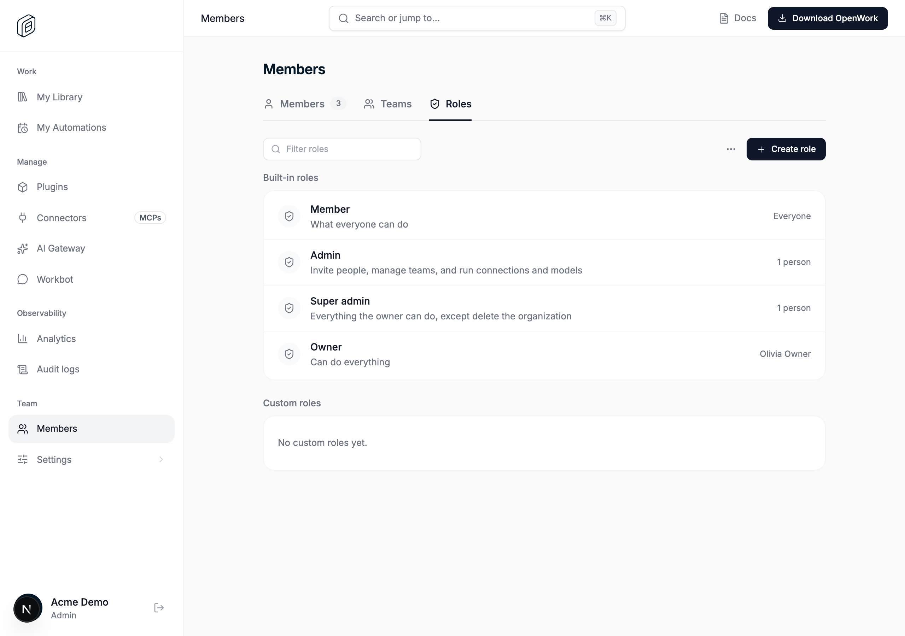
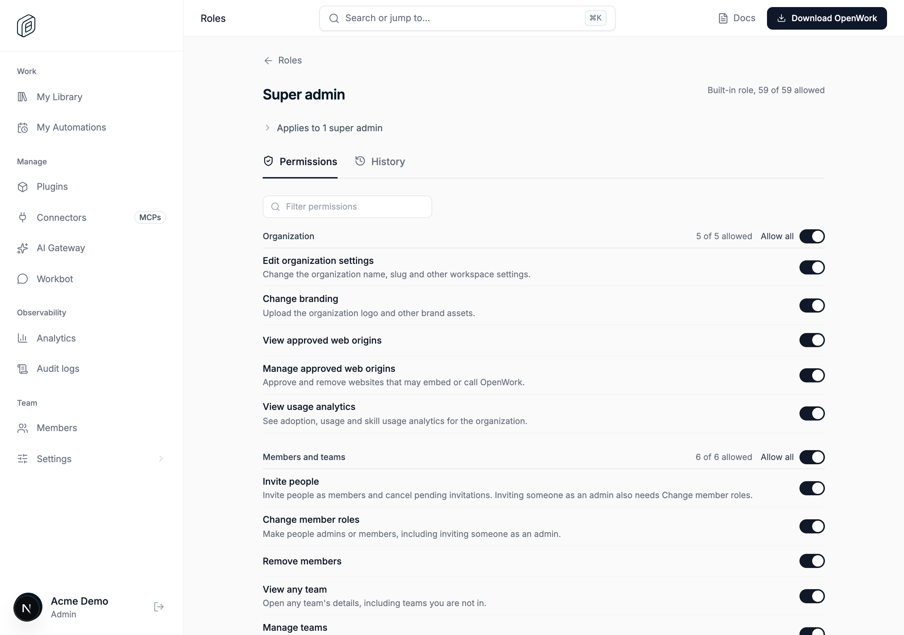

# Super admin permission set

> **Generally available:** `superAdminPermissionSet` is retired; the enabled behavior is now standard. Permissions, organization settings and entitlements still apply. Any rollout, off-state or kill-switch instructions below describe the historical rollout; see [the retirement guide](../ga-rollout-retirement/README.md).

- Feature key: `superAdminPermissionSet`
- Deployments: cloud and self-hosted
- Default: off
- Author: `benjaminshafii`

## What changes and for whom

Super admin becomes a default permission set beside Member and Admin, so every built-in role below the owner is a permission set.

- Every organization gets a **Super admin permissions** set (`permission_set.default_key = 'super-admin'`, migration `0184_super_admin_permission_set`). It is seeded with every catalog permission, including the owner-only ones, and reconciliation turns on new catalog permissions for it automatically.
- With the feature on, a member with the direct `super-admin` role gets their permissions from that set, plus Member, Admin and any team sets, instead of the role granting every permission in code. **Members › Roles › Super admin** opens the set, shows who it applies to, and lets the owner or a super admin turn permissions off and back on for every super admin.
- Only the owner and super admins can edit the Super admin set (`super_admin_permissions_require_super_admin`). Admins can't, even with **Manage permissions**. The set can't be renamed or deleted, like Member and Admin.
- Super admins no longer skip "you can only grant what you hold": their own set decides what they can hand out. Role-hierarchy rules don't change: only the owner or a super admin can make, change or remove super admins. The owner always holds every permission, and deleting the organization and transferring ownership stay owner-only.

## How to try it

1. Turn `superAdminPermissionSet` on for a test organization in `/admin`.
2. Make someone a super admin (**Members › Edit role › Super admin**).
3. Open **Members › Roles › Super admin**. Every permission is on and it applies to that person.
4. Turn a permission off (for example **Open the billing portal**) and save. The super admin loses it: check **Members › the person › Permissions**, or `GET /v1/org` as them.
5. As an admin who holds **Manage permissions**, try to edit the Super admin role. The API answers 403 `super_admin_permissions_require_super_admin` and the page is read-only.

## Turning it off

Off (or the kill switch): super admins hold every permission through the role again, as before, with the source shown as "Super admin role". The Super admin set is hidden from **Roles**, `GET /v1/permissions/sets`, the per-permission view and the catalog's `defaultOn`. Reading or editing it by id answers 404 `permission_set_not_found`. The set and its history stay stored, and they keep being seeded and reconciled, so turning the feature back on restores any edits instantly. Turning it off can only widen what super admins hold (back to everything); it never removes access.

The migration and the lazy creation of the set run whatever the feature's state; neither changes what anyone can do. Organizations created before this change get the set the first time their permissions are resolved or listed (`ensureDefaultPermissionSets`), like Member and Admin.

## What to watch

- `permission default sets are missing` errors in den-api logs (`component: permissions`). Resolution falls back to code defaults, which give super admins every permission. Inside a write transaction, the Super admin set is only required for super admins, so other members are unaffected while it hasn't been created yet.
- 403 `super_admin_permissions_require_super_admin` and `permission_not_held` on `PUT /v1/permissions/sets/:id/permissions`, and `admin_permissions_missing` on role changes by super admins whose set was trimmed.
- The permission set audit events (`permission_set.permissions_changed` with `kind: super_admin_default`).

## Screenshots

Real local Den with the feature on for a demo organization:

- **Members › Roles**: Super admin is a built-in role that opens its permission set.
  
- **Super admin** role page: applies to the super admins, starts with all 59 permissions, editable by the owner and super admins.
  

With the feature off, the Roles tab looks the same, except the Super admin row doesn't open a page (today's behavior). The page reuses the Member and Admin set editor, applies-to disclosure and read-only notice (DESIGN.md P4).
