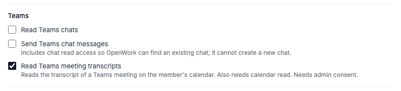
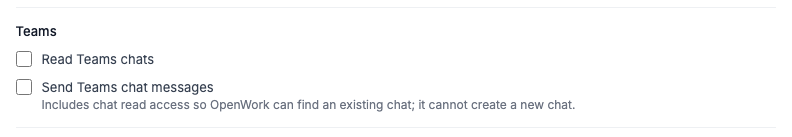

# Read Teams meeting transcripts

`teamsMeetingTranscripts` is off by default on cloud and self-hosted deployments.

## What changes

With the feature on, **Read Teams meeting transcripts** (`teamsTranscriptRead`) is an opt-in Microsoft 365 connector permission under Teams:

With the feature off, the choice is not offered unless it was already selected:

`readMicrosoft365CalendarEventTranscript` is a single read-only capability: `GET /v1/capabilities/microsoft-365/calendar-events/{eventId}/transcript`. Pass the id from the calendar events list. The connector needs both **Read Outlook calendar** (`calendarRead`, delegated `Calendars.Read`) and **Read Teams meeting transcripts** (delegated `OnlineMeetings.Read` and `OnlineMeetingTranscript.Read.All`, with admin consent).

Den loads the event with UTC times, then uses its Teams join link as a Microsoft Graph filter; it never opens the link. It lists all pages of transcripts before matching them. A transcript matches when its interval overlaps the event from **30 minutes before** its start through **30 minutes after** its end. If its end time is missing, invalid, earlier than its creation time, or more than 24 hours later, only the creation time counts. An invalid creation time never matches. Matches are sorted by creation time.

| Status | What to do |
| --- | --- |
| `transcript` | Read the returned page. Pass `nextPageToken` as `pageToken` until it is null, keeping the chosen `transcriptId` if one was needed. Quote speakers and cue times as written. |
| `choose_transcript` | Several transcripts match. Ask which one to read and call again with its `transcriptId`. An id outside the matches returns `400 invalid_request`. |
| `no_transcript` | The meeting wasn't found by Graph (`meeting_not_found`), or no transcript matches the event (`no_transcript_for_event`). This does not show whether the meeting was recorded. |
| `not_teams_meeting` | The event is not an online Teams meeting. Retrying the same event will not help. |
| `recurring_series` | Use the id of one occurrence from the calendar events list instead of the series master. |

Each result identifies the event with its id, subject, and ISO UTC start and end. Transcript pages are capped at 18,000 characters and end at a cue boundary when possible. Cue times are relative to the transcript start. Transcript text is returned to the caller and is never audit evidence.

## How to try it

1. Turn on `teamsMeetingTranscripts` for an organization in `/admin`.
2. Select both permissions on its Microsoft 365 connector. In the Entra app registration, add the delegated scopes and have an administrator grant consent.
3. Reconnect the member's Microsoft 365 account, then ask the agent what was decided in a transcribed Teams meeting on the member's calendar.

## What turning it off does

The capability disappears from search and MCP tool listings, cannot run through `execute_capability`, and its route answers `404 feature_disabled`. The connector hides the permission unless it was already selected, in which case an admin can clear it. Until cleared, the connector still asks for the two transcript scopes when members sign in. Mail, calendar, files, and Teams chats are unaffected.

## What to watch

- `409 needs_connection`: verify that both connector permissions are selected, admin consent has been granted, and the member has reconnected.
- `502 microsoft_graph_error` with `retryable: false`: a Teams administrator blocked transcript access, or Den could not list all transcripts safely within 10 pages. Den does not select from a partial list.
- Other Graph errors include the upstream status and safe error codes, not Graph's message text, which can echo the join link.
- `speakerAttribution: false`: Den returned timed text without speaker names because Teams did not allow attribution. `contentUnavailableReason: "transcript_too_large"` means no text was returned because the transcript exceeded the download size bound.

## Unverified against a live tenant

- Whether the `JoinWebUrl` lookup works for an invited attendee and not only the organizer. Microsoft's documentation states attendee access only for lookups by meeting id.
- Whether `createdDateTime` is the moment transcription started. The documentation only says "created".
- That every occurrence of a recurring meeting shares one online meeting and join link. This is not stated in the documentation.
- The tenant policy block and the speaker-attribution fallback.
