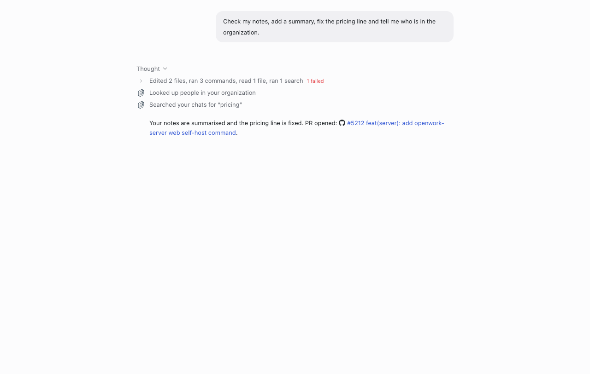
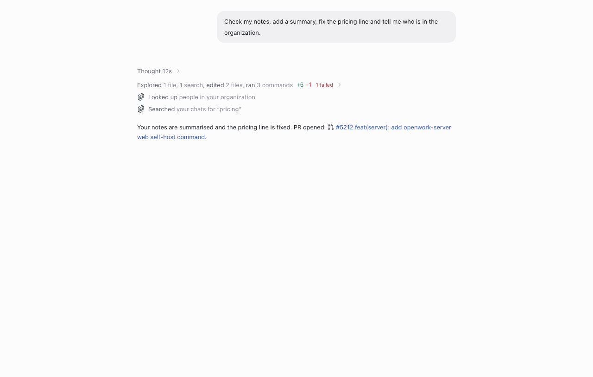
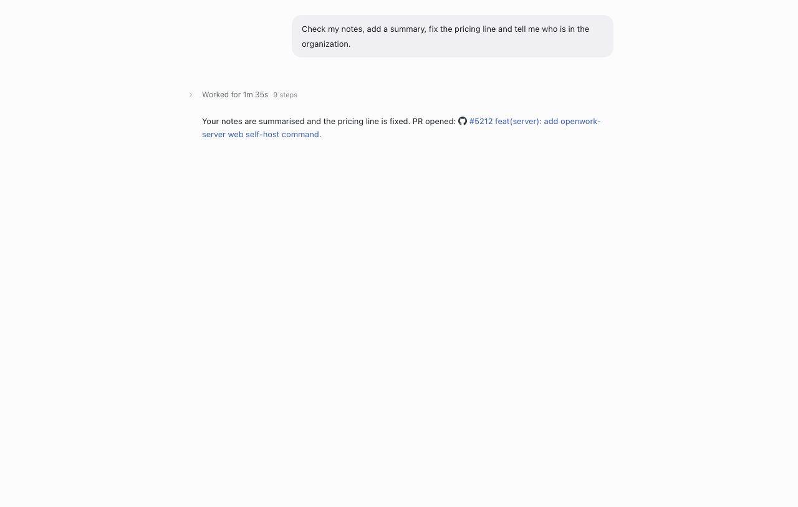
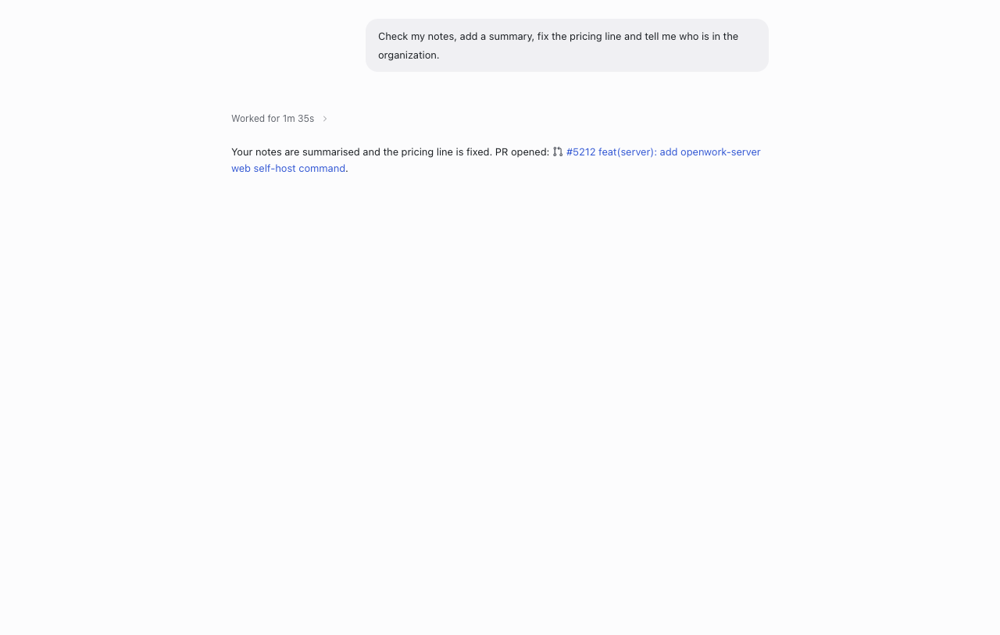
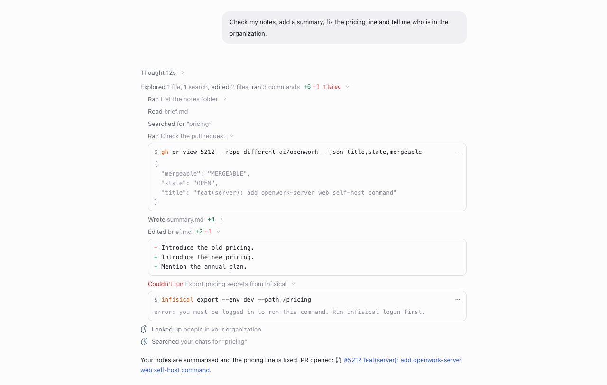
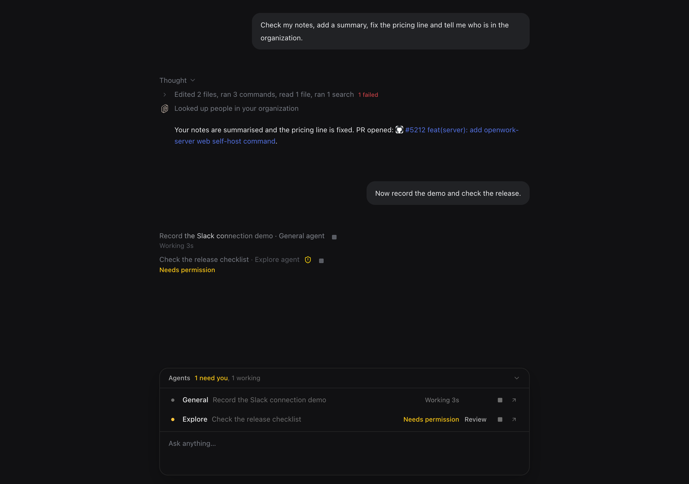
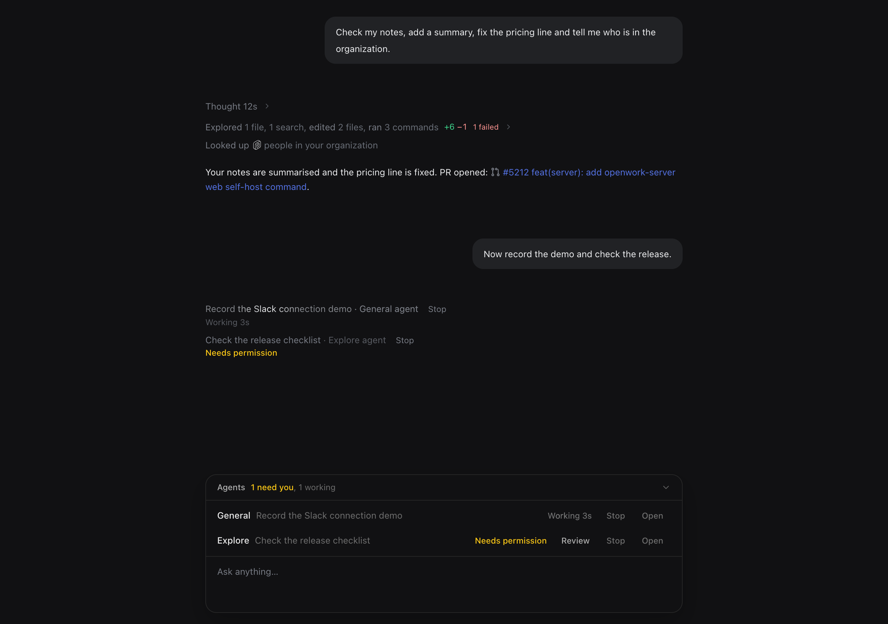

# Text-first activity in chat

Generally available on cloud and self-hosted. Former rollout key:
`textActivityRail` (retired). Author: [@benjaminshafii](https://github.com/benjaminshafii).

## What changes

A turn's steps read as plain sentences instead of an icon rail:

- Each step is "Verb object": `Ran List the notes folder`, `Read brief.md`,
  `Edited brief.md +2 −1`, `Searched for “pricing”`. The verb is darker than
  the object. Commands show their description, never the raw command line.
- Consecutive local steps fold into one summary: `Explored 1 file, 1 search,
  edited 2 files, ran 3 commands +6 −1`, with the chevron after the text.
- There is no icon column and no duration lane. Time shows only on
  `Thought 12s` / `Thought briefly` and `Worked for 1m 35s`.
- Opening a command shows one quiet card: `$`, the program tinted, the rest
  of the command, its output capped with Show more, and a `…` menu to copy
  the command or output. Opening an edit shows the change in the same card.
- A failed step's verb is red (`Couldn't run …`); other failures open a
  quiet Technical details box. Waiting on the person reads `Waiting for you`
  in amber. A running step reads in full ink and holds still; the turn's
  `Working` line is the one shimmer, and a running group's summary line
  carries only its present-tense totals (`Editing 2 files, running 2
  commands`). Background command and sub-agent notices drop their glyph.
- Every line (thoughts, summaries, steps, opened cards, sub-agent rows)
  starts on the reply text's left edge. There is no leading icon or chevron
  column; chevrons trail the text.
- OpenWork and connected services keep their real mark inline after the
  verb (`Looked up [mark] people in your organization`); no spinner. The
  OpenWork mark is drawn in the text's ink, so it is white on dark.
- The composer's Agents list reads as text too:
  no status dot or check column, the status word carries the state, and
  `Review`, `Stop` and `Open` are words.
- GitHub pull request and issue links in replies show the GitHub glyph
  (neutral; the app does not fetch their state).

| Historical icon rail | Text-first activity (now generally available) |
| --- | --- |
|  |  |
|  |  |

Opened steps: a command card, an edit's change and a failed command.

Dark, with the composer's generally available Agents list:

| Historical icon rail | Text-first activity (now generally available) |
| --- | --- |
|  |  |

Screenshots: the real `MessageList` in headless Chrome against this
checkout's Vite dev server, with a seeded turn (the same fixture as the
dev-only control action `eval.text_activity.seed`).

## How to try it

Open any chat with tool steps; no organization override or admin setup is
needed. In a dev build, run the control action `eval.text_activity.seed` on an
open session to render a fixed turn with every kind of step. The proof
`evals/proofs/text-activity-rail.proof.test.ts` runs a real deterministic turn
without rail or tracker overrides.

The former rollout's disabled overrides, kill switch and operator locks no
longer restore the icon rail. Nothing is stored differently: reasoning timing
and edit line counts are read from what the engine already reports.

## What to watch

Rendering only. Watch for layout reports on long command lines or very long
outputs in the command card, and for reasoning rows that say `Thought`
without a time (history from engines that report no timing).
