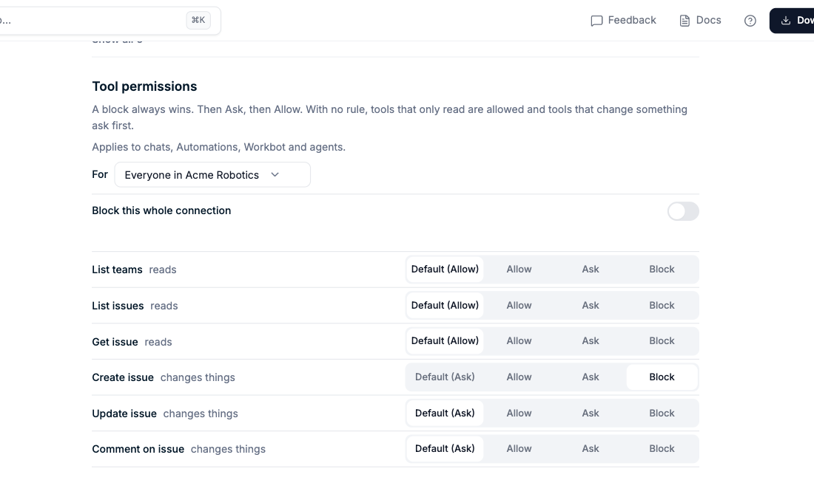

# Tool permissions (`toolPermissions`)

- **Feature key:** `toolPermissions`
- **Deployments:** cloud
- **Author:** `benjaminshafii`
- **Status:** private alpha. Off by default; turned on for one organization at
  a time, on request.

Org admins can set Allow, Ask, or Block for an external connection's tools
and apply the rule to everyone, a team, or one member. The rules cover
Connect-backed chats, cloud Automations, Workbot, and agents. This feature
works without `personalAgents`. When both are on, the organization tool
rules and written rules move from Agents to Connectors; agent-specific
settings stay with the agent.

## Try it

1. As a platform admin, open `/admin`, choose a test organization, and set
   `toolPermissions` to On for that organization under Features.
2. As an organization admin, go to **Connectors**, open an external
   connection, and under **Tool permissions** set an **Ask** rule for a
   tool. Make sure the person testing it is in the selected audience.
3. Run an Automation that calls that tool on test data. The connector
   should not get the call. In the OpenWork app approve the request with
   **Allow once**. The app requests a new run, not a continuation. Check
   that this run can call the tool, then try **Block** and confirm it wins
   even if an approval is waiting to be used.

## Evaluation and approvals

- Connection disables and Workbot's existing connection holds are hard
  denials. Then the evaluator checks matching organization, team, member and
  (for agent runs) agent rules. Rules match the exact, case-sensitive tool
  name or a connection-wide `*` block.
- Any Block wins, then Ask, then Allow. Without a match, allow tools with
  `readOnlyHint === true` and `destructiveHint !== true`; ask for other tools.
- Ask refuses the call before reaching the connector. It records one pending
  approval per requester, context, connection, and exact tool. Agent,
  Automation, and chat are separate contexts; Workbot approvals use the chat
  context. The requester can deny or approve once. Agent owners can also
  decide for others, and can set Always allow when organization policy permits.
- An unused Allow once expires after seven days. In chat the next matching
  call spends it. In a run the first matching call claims it, then later
  calls to that tool in the same run reuse it. A run that skips the tool
  doesn't spend the approval. An approval never bypasses a block.
- **Rules every run follows** gives written instructions to agent and ordinary
  cloud Automation runs. These are prompt text, not an access control.

## Storage

- `tool_permission_rule`: organization, subject kind and ID, connection,
  exact tool name (or `*`), decision, and who last changed it. The writer
  replaces exact names transactionally; there is no case-insensitive unique
  index on tool names.
- `tool_permission_org_policy`: organization and written instructions.
- `tool_approval`: requester, context, run and tool, status (`pending`,
  `denied`, `allowed_once`, `always_allowed`, `used`), decision and claim
  details. Agent approvals live here too; `personal_agent_request` is only
  for change requests.

## Turning it off

The feature's routes return 404 and its controls and approval cards disappear.
Rules and approvals are kept. Non-agent calls ignore them and use the prior
behavior. Agents still enforce organization and agent rules and use agent
approvals through `personalAgents`; they ignore team and member rules. The
organization's agent-only controls return to the Agents page if Agents is on.

Self-hosted: not available yet (cloud only); nothing runs and no route answers there.

## Not covered

Built-in connections (including Google Workspace and Microsoft 365), messages
sent as the Workbot Slack bot, and the dashboard tool tester are not covered.
People approve in OpenWork, not in Slack. Always allow outside agents is not
available; have an admin set Allow instead. Approval never resumes the run
that asked.

## Watch and verify

During rollout, check feature usage in `/admin` and watch for unexpected
refusals or growth in pending approvals. Compare Automation run failures
before and after rollout. Check that blocked or unapproved calls never reach
connectors and that pending requests don't duplicate on repeated attempts.
Check that a failed start after approval leaves the approval usable for the
next run.

API coverage: `ee/apps/den-api/test/api/tool-permissions.api.test.ts` for
rules, approval and dispatch behavior; `self-hosted-flags-off.api.test.ts`
for deployment gating; `personal-agent-permissions.api.test.ts` and
`personal-agent-org-rules.api.test.ts` for agent compatibility. Run each
file separately.
