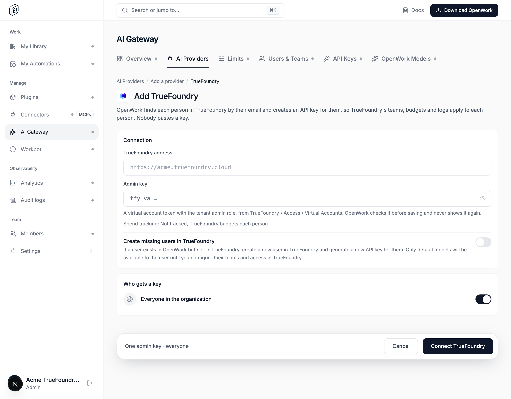
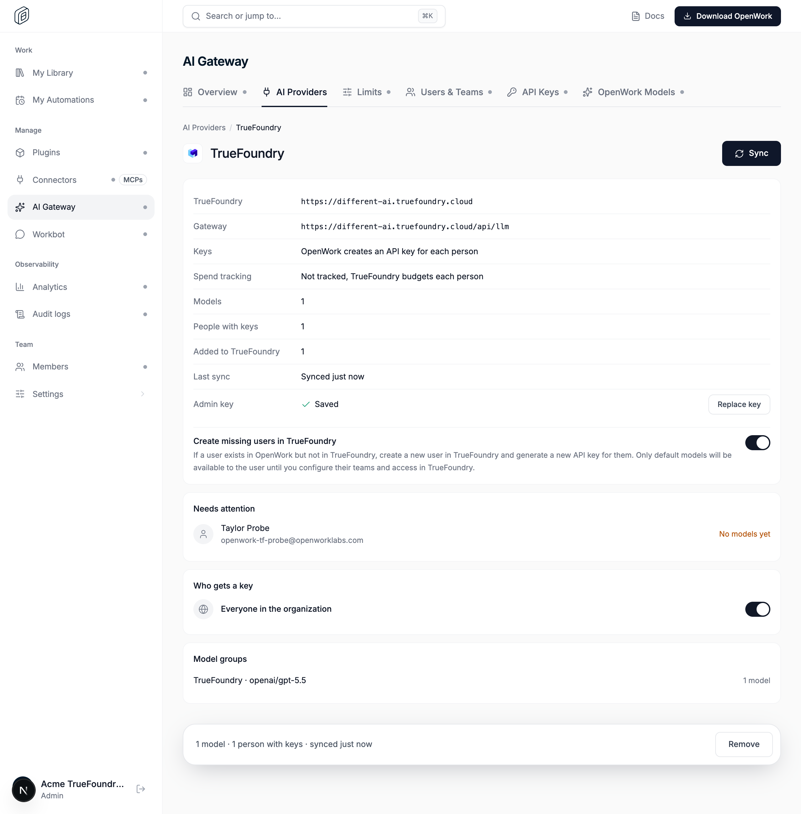

# AI Gateway: TrueFoundry

- **Feature key:** `truefoundryGateway`
- **Deployments:** cloud and self-hosted, off by default
- **Author:** @OmarMcAdam
- **Public docs:** `packages/docs/ai-gateway/truefoundry.mdx`

## What it does

An admin connects their TrueFoundry AI Gateway in **AI Gateway › AI Providers › Add a provider › TrueFoundry** with one admin key (a TrueFoundry virtual account token with the Tenant Admin role). For every person the admin allows, OpenWork:

1. finds their TrueFoundry user by their OpenWork email (`GET /api/svc/v1/users?query=`, exact match);
2. if missing and **Create missing users in TrueFoundry** is on, adds them (`POST /api/svc/v1/users/register`, default member role, no invite email);
3. creates one personal access token owned by that user (`POST /api/svc/v1/personal-access-tokens/for-user`, named `openwork-<hex>`), stores it encrypted as the person's member credential, and looks up its id with the token itself;
4. lists the chat models that token reaches (`GET <gateway>/models`) and grants the shared model group with exactly that set.

The catalog itself comes from `GET <gateway>/models` with the admin key. TrueFoundry lists ids only (`<provider account>/<model>`), so each model is matched to a models.dev model for its name, capabilities and limits (`ee/apps/den-api/src/llm/truefoundry-models.ts`). The search is prioritised: providers the account name points at (`azure-prod` → `azure`, `openai`; `my-claude` → `anthropic`), then the first-party vendors and OpenRouter, then the rest of the catalog. Within a provider: exact id, last path segment, case/punctuation-insensitive, then ignoring a trailing date; an ambiguous match inside a provider is skipped. Prices are never copied. Unmatched models keep their id as name and declare tool calling only. If models.dev can't be read during a sync, each model keeps the facts from the previous sync.

Requests go app → AI Gateway (person's AI Gateway key) → TrueFoundry (`<control plane>/api/llm`, person's token). TrueFoundry's teams, budgets, rate limits and logs apply per person. OpenWork records tokens, not cost, and skips its own usage limits for these requests.

## Why personal access tokens, not one virtual account per person

A token owned by the person's TrueFoundry user follows that user's teams and model access and is attributed to them in TrueFoundry, which is what "only default models until you configure their teams" needs. A per-person virtual account would be a separate identity with its own hand-listed permissions.

## TrueFoundry rules the design relies on (checked against a live tenant)

- Only an admin **virtual account** token can create tokens for other users; personal access tokens are refused (`tfy_pat_` keys are rejected before calling TrueFoundry).
- An admin cannot list or delete another user's tokens. A token can list and delete itself, so OpenWork deletes tokens with the token itself.
- Users may hold only a few tokens (3 on the test tenant). OpenWork keeps exactly one per person and reuses it; a person at the limit shows **Too many tokens**.
- New users reach no models until a TrueFoundry admin grants access. OpenWork keeps their token and picks up models at the next sync (**No models yet**).

## Lifecycle

- Tokens are created on provider creation, every sync (also after access changes in the UI) and the first time an allowed person lists providers in the app (rate-limited background provisioning).
- Losing access (grant edit/removal): the credential is revoked and the grant dropped in the same transaction, so serving stops at once; the next reconcile deletes the token in TrueFoundry and forgets the person. The secret is kept (encrypted, never served) only until then.
- Removing the provider deletes every token OpenWork created (best effort). TrueFoundry users OpenWork added are never removed. Deleting the organization does not touch TrueFoundry.

## Code map

| Piece | Where |
| --- | --- |
| Synthetic `truefoundry` catalog provider | `ee/packages/utils/src/truefoundry-catalog.ts`, used by `ee/apps/gateway/src/provider-catalog.ts` |
| TrueFoundry client | `ee/apps/den-api/src/llm/truefoundry.ts` |
| Model facts from models.dev | `ee/apps/den-api/src/llm/truefoundry-models.ts` |
| Settings, catalog, status | `ee/apps/den-api/src/llm/truefoundry-settings.ts` (`gateway_providers.settings.truefoundry`) |
| Sync, per-person tokens, pruning, removal | `ee/apps/den-api/src/llm/truefoundry-sync.ts`, table `gateway_truefoundry_users` (migration 0196) |
| Routes | `POST /v1/inference-providers/truefoundry`, `POST …/{id}/truefoundry/sync`, `PATCH …/{id}/truefoundry`, `POST …/oauth/browser-truefoundry-check` in `routes/org/inference-providers.ts` |
| Spend tracking off | `ee/apps/gateway/src/gateway.ts` |
| Den web | `truefoundry-provider-screen.tsx`, `truefoundry-provider-data.ts`, picker, `/gateway/connect` (`truefoundry_issued`) |

## Turning it off

The flag gates the picker entry, the setup screen and the create/sync/update routes (404 `feature_disabled`) and the browser "Check again" route. Existing TrueFoundry providers keep serving and can still be viewed or removed; their tokens stay valid in TrueFoundry until the provider is removed. Turning it back on resumes syncing.

## How to try it

1. Turn `truefoundryGateway` on for an organization in `/admin`.
2. In TrueFoundry, create a virtual account with the Tenant Admin role and copy its token.
3. Add the TrueFoundry provider with the tenant address (e.g. `https://acme.truefoundry.cloud`) and the token.
4. In the OpenWork app, the TrueFoundry models appear for allowed people with a TrueFoundry user.

## What to watch

- Den API logs: `truefoundry_background_provisioning_failed`, `truefoundry_token_delete_failed` (codes only, never keys).
- Provider page **Needs attention** and **Last sync failed** notices.
- Gateway request logs for `upstream_provider_id = truefoundry`: tokens recorded, `cost_micro_usd` empty by design.

## Tests

- `ee/apps/den-api/test/truefoundry.test.ts`: client behavior against a scripted tenant.
- `ee/apps/den-api/test/truefoundry-models.test.ts`: catalog matching order and rules.
- `ee/apps/den-api/test/api/gateway-truefoundry.api.test.ts`: full flow against a fake tenant that follows TrueFoundry's rules (feature gate, admin checks, token reuse, missing users, access loss, removal).
- `ee/apps/den-web/app/(den)/dashboard/_components/truefoundry-provider-data.test.ts`.
- Verified manually end to end against a real TrueFoundry tenant: provider creation, token creation, user creation, and streamed and non-streamed chat completions through the AI Gateway.
