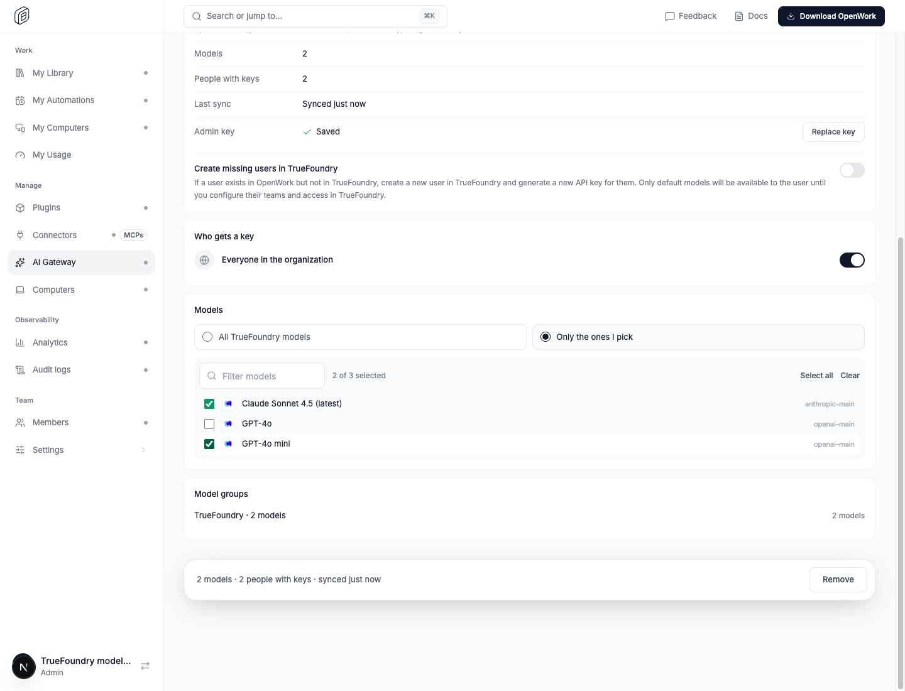
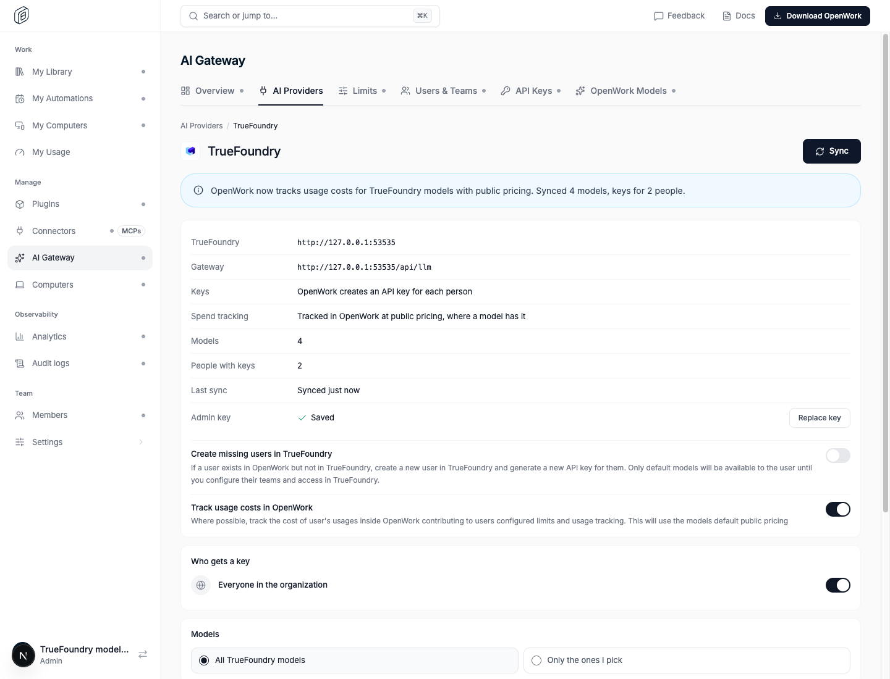
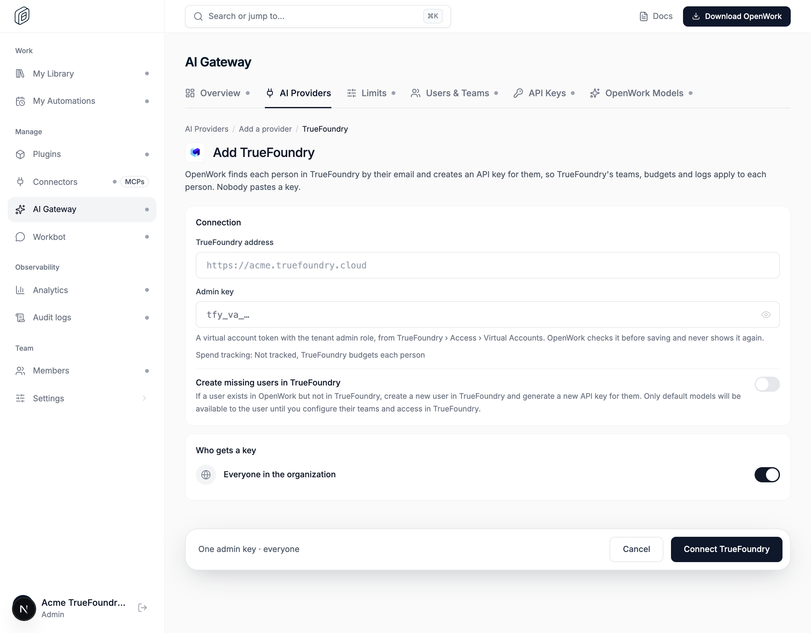
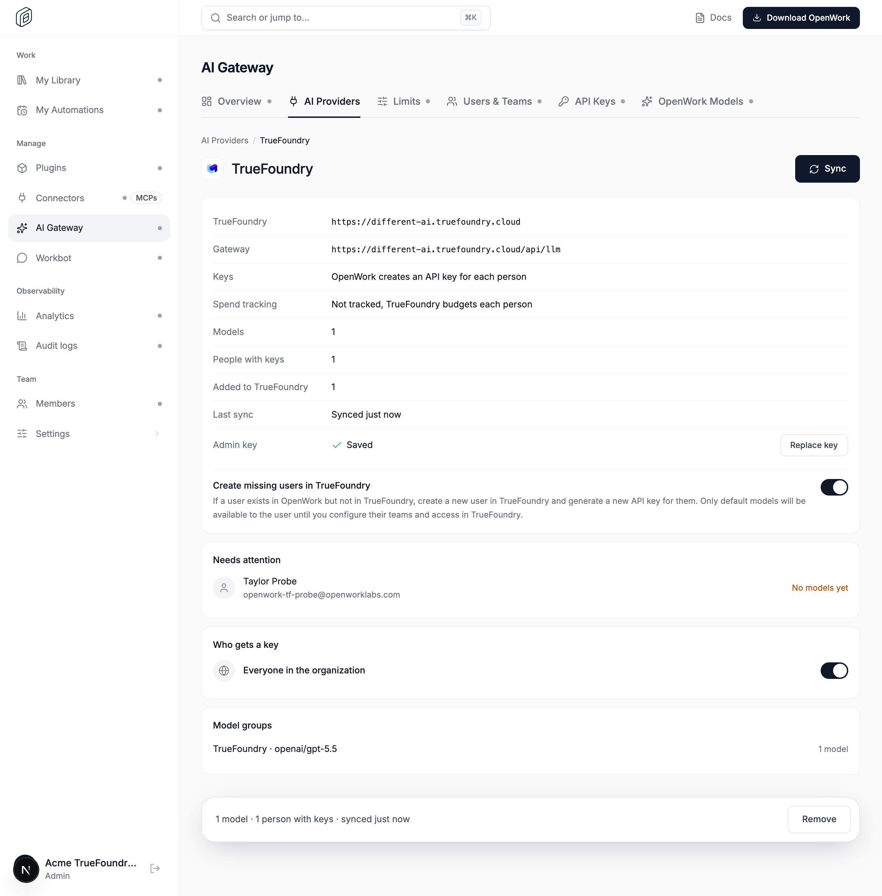

# AI Gateway: TrueFoundry

- **Feature key:** `truefoundryGateway`, retired 2026-11: always on, on cloud and self-hosted
- **Author:** @OmarMcAdam
- **Public docs:** `packages/docs/ai-gateway/truefoundry.mdx`

## What it does

An admin connects their TrueFoundry AI Gateway in **AI Gateway › AI Providers › Add a provider › TrueFoundry** with one admin key (a TrueFoundry virtual account token with the Tenant Admin role). For every person the admin allows, OpenWork:

1. finds their TrueFoundry user by their OpenWork email (`GET /api/svc/v1/users?query=`, exact match);
2. if missing and **Create missing users in TrueFoundry** is on, adds them (`POST /api/svc/v1/users/register`, default member role, no invite email);
3. creates one personal access token owned by that user (`POST /api/svc/v1/personal-access-tokens/for-user`, named `openwork-<email slug, ≤20>-<4-hex provider tag><2 random hex>` (≤36 chars, TrueFoundry's rule) so admins can tell whose a token is in TrueFoundry's list, which shows no owner; `expirationDate` 90 days ahead; a tenant whose maximum is shorter gets its maximum), stores it encrypted as the person's member credential, and looks up its id with the token itself;
4. lists the chat models that token reaches (`GET <gateway>/models`) and grants the shared model group with exactly that set.

The catalog itself comes from `GET <gateway>/models` with the admin key. TrueFoundry lists ids only (`<provider account>/<model>`), so each model is matched to a models.dev model for its name, capabilities and limits (`ee/apps/den-api/src/llm/truefoundry-models.ts`). The search is prioritised: providers the account name points at (`azure-prod` → `azure`, `openai`; `my-claude` → `anthropic`), then the first-party vendors and OpenRouter, then the rest of the catalog. Within a provider: exact id, last path segment, case/punctuation-insensitive, then ignoring a trailing date; an ambiguous match inside a provider is skipped. Capabilities, `reasoning_options` (the efforts the app offers: the desktop builds its reasoning variants only from them), modalities and limits are copied. The public `cost` is kept in `upstream` but stripped from `catalog` unless **Track usage costs in OpenWork** is on. Unmatched models keep their id as name and declare tool calling only. If models.dev can't be read during a sync, each model keeps the facts from the previous sync.

### Choosing models

The provider page has the same **Models** card as other providers: **All TrueFoundry models** (default; new TrueFoundry models arrive at the next sync) or **Only the ones I pick**. Settings keep `upstream` (every chat model the admin key listed at the last sync; providers synced before this have only `catalog`), `selectedModelIds` (the pick, `null` for all) and `catalog` (`upstream` narrowed to the pick, what people are served). Each person's models are already limited to `catalog`, so their groups follow at the same sync. A picked model that leaves TrueFoundry stays in the pick and is served again if it returns; new models are never added to a pick. `PATCH …/{id}/truefoundry` takes `modelIds` (ids from `truefoundry.availableModels`, or `null`) and syncs; unknown ids give `truefoundry_unknown_model`, an empty list `truefoundry_no_models_picked`. The card is the shared `gateway-model-scope-picker.tsx`, also used by the standard provider editor.

### Track usage costs in OpenWork

A toggle below **Create missing users in TrueFoundry** (`settings.truefoundry.trackUsageCosts`, default off; `trackUsageCosts` on `POST /v1/inference-providers/truefoundry`, `PATCH …/{id}/truefoundry` and the status). Off: TrueFoundry alone budgets these requests. On: every matched model with a models.dev public price is served with it, so the app shows it and the AI Gateway prices requests (`cost_micro_usd`) and applies the person's OpenWork usage limits. Models without a match or a price stay unpriced and unlimited ("where possible"); TrueFoundry's budgets still apply too. The price is always stored in `upstream`, and toggling syncs at once, so it works even if models.dev is unreachable. The gateway also checks the provider's setting, so a stale priced row never charges once it is off.

Requests go app → AI Gateway (person's AI Gateway key) → TrueFoundry (`<control plane>/api/llm`, person's token). TrueFoundry's teams, budgets, rate limits and logs apply per person. OpenWork records tokens, not cost, and skips its own usage limits for these requests, unless **Track usage costs in OpenWork** is on (below).

## Why personal access tokens, not one virtual account per person

A token owned by the person's TrueFoundry user follows that user's teams and model access and is attributed to them in TrueFoundry, which is what "only default models until you configure their teams" needs. A per-person virtual account would be a separate identity with its own hand-listed permissions.

## TrueFoundry rules the design relies on (checked against a live tenant)

- Only an admin **virtual account** token can create tokens for other users; personal access tokens are refused (`tfy_pat_` keys are rejected before calling TrueFoundry).
- An admin cannot list or delete another user's tokens. A token can list and delete itself, so OpenWork deletes tokens with the token itself.
- Users may hold only a few tokens (3 on the test tenant). OpenWork keeps exactly one per person and reuses it; a person at the limit shows **Too many tokens**.
- The PAT list API only shows the caller's own tokens, and the admin's only bulk action is revoking **every** token a user has (`DELETE /api/svc/v1/personal-access-tokens/revoke/all`). So OpenWork never lets go of a token's secret until it has deleted the token: a token it lost could never be found again and would hold one of the person's slots until it expires.
- New users reach no models until a TrueFoundry admin grants access. OpenWork keeps their token and picks up models at the next sync (**No models yet**).

## Lifecycle

- Tokens are created on provider creation, every sync (also after access changes in the UI) and the first time an allowed person lists providers in the app (rate-limited background provisioning).
- After a person's token is stored, OpenWork lists that person's tokens with it (`nameSearchQuery=openwork-`) and deletes their other OpenWork tokens: this provider's tag, or the old `openwork-<12 hex>` names. It skips tokens under 10 minutes old, so a concurrent run's fresh token survives, and never touches the person's own tokens or other providers' tags. Best effort; whether a token may delete its siblings was only checked against the fake tenant. Logs: `truefoundry_tokens_cleaned_up`, `truefoundry_token_cleanup_failed`.
- A token is replaced only when TrueFoundry rejects it (expired or deleted). A temporary failure (unreachable, 5xx) keeps the person's token and grant as they are. Whenever a person's stored token is replaced or dropped, including by a concurrent run for the same person, the old token deletes itself after the change commits. A token whose id is unknown is looked up by name first.
- Losing access (grant edit/removal): the credential is revoked and the grant dropped in the same transaction, so serving stops at once; the next reconcile deletes the token in TrueFoundry and forgets the person. The secret is kept (encrypted, never served) only until then.
- **Reset tokens** (Needs attention rows at **Too many tokens**, behind a confirmation): `POST …/{id}/truefoundry/members/{memberId}/reset-tokens` calls TrueFoundry's `DELETE /api/svc/v1/personal-access-tokens/revoke/all` for the person's email, which revokes **all** their PATs, including their own, since nothing narrower exists, then provisions them again. Only allowed while the person is at `token_limit`. The gentler fix, raising **Maximum Personal Access Token (PAT) Per User** in TrueFoundry, is in the public page `packages/docs/ai-gateway/truefoundry-too-many-tokens.mdx`, linked from the dialog.
- Removing the provider deletes every token OpenWork created (best effort). TrueFoundry users OpenWork added are never removed. Deleting the organization does not touch TrueFoundry.

## Code map

| Piece | Where |
| --- | --- |
| Synthetic `truefoundry` catalog provider | `ee/packages/utils/src/truefoundry-catalog.ts`, used by `ee/apps/gateway/src/provider-catalog.ts` |
| TrueFoundry client | `ee/apps/den-api/src/llm/truefoundry.ts` |
| Model facts from models.dev | `ee/apps/den-api/src/llm/truefoundry-models.ts` |
| Settings, catalog, status | `ee/apps/den-api/src/llm/truefoundry-settings.ts` (`gateway_providers.settings.truefoundry`) |
| Sync, per-person tokens, pruning, removal | `ee/apps/den-api/src/llm/truefoundry-sync.ts`, table `gateway_truefoundry_users` (migration 0196) |
| Routes | `POST /v1/inference-providers/truefoundry`, `POST …/{id}/truefoundry/sync`, `PATCH …/{id}/truefoundry`, `POST …/oauth/browser-truefoundry-check` in `routes/org/inference-providers.ts` |
| Spend tracking (off unless usage costs are tracked) | `ee/apps/gateway/src/gateway.ts` |
| Den web | `truefoundry-provider-screen.tsx`, `truefoundry-provider-data.ts`, picker, `/gateway/connect` (`truefoundry_issued`) |

## Availability

The `truefoundryGateway` flag shipped off and was retired in 2026-11: TrueFoundry is always available in **Add a provider**, and the key is listed in `RETIRED_FEATURE_KEYS` so stored overrides are ignored. To stop an organization using it, remove its TrueFoundry provider (its tokens are deleted in TrueFoundry).

## How to try it

1. In TrueFoundry, create a virtual account with the Tenant Admin role and copy its token.
2. Add the TrueFoundry provider with the tenant address (e.g. `https://acme.truefoundry.cloud`) and the token.
3. In the OpenWork app, the TrueFoundry models appear for allowed people with a TrueFoundry user.

## What to watch

- Den API logs: `truefoundry_background_provisioning_failed`, `truefoundry_token_delete_failed` (codes only, never keys).
- Provider page **Needs attention** and **Last sync failed** notices.
- Gateway request logs for `upstream_provider_id = truefoundry`: tokens recorded, `cost_micro_usd` empty by design.

## Tests

- `ee/apps/den-api/test/truefoundry.test.ts`: client behavior against a scripted tenant.
- `ee/apps/den-api/test/truefoundry-models.test.ts`: catalog matching order and rules.
- `ee/apps/den-api/test/api/gateway-truefoundry.api.test.ts`: full flow against a fake tenant that follows TrueFoundry's rules (admin checks, token reuse, missing users, access loss, removal).
- `ee/apps/den-web/app/(den)/dashboard/_components/truefoundry-provider-data.test.ts`.
- `evals/proofs/truefoundry-token-limit.proof.test.ts` (same world; the fake tenant enforces 3 tokens per user, lists and deletes a user's tokens only with that user's token, supports revoke-all and can fail `/models`): 90-day `expirationDate`; readable names; a sync deletes a lost old OpenWork token but not the person's own; an outage during a sync keeps every key; a person at the limit shows Too many tokens; Reset tokens confirms first, then revokes all and leaves exactly one new OpenWork key.
- `evals/proofs/truefoundry-usage-costs.proof.test.ts` (same world): a matched model reaches a member with its reasoning efforts and no price; the toggle sits below Create missing users, off; on serves the public price, off removes it.
- `evals/proofs/truefoundry-model-selection.proof.test.ts` (world `evals/worlds/gateway-truefoundry-models.ts`, a fake tenant): picking, filtering, saving, syncing and going back to all models, checking what a member is given.
- Verified manually end to end against a real TrueFoundry tenant: provider creation, token creation, user creation, and streamed and non-streamed chat completions through the AI Gateway.
