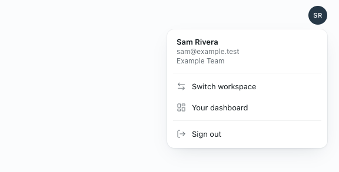

# Workbot: account menu

> **Generally available:** `workbotAccountMenu` is retired; the enabled behavior is now standard. Permissions, organization settings and entitlements still apply. Any rollout, off-state or kill-switch instructions below describe the historical rollout; see [the retirement guide](../ga-rollout-retirement/README.md).

Feature key: `workbotAccountMenu` · Deployments: cloud and self-hosted · Default: off · Author: @benjaminshafii

## What people see

With the feature on, the avatar in Workbot's header opens a menu instead of only linking to the Den dashboard:

- the signed-in name, email and workspace
- **Switch workspace**: signs in again through Den's workspace chooser and returns to the same Workbot page
- **Your dashboard**: the Den dashboard, as the avatar did before
- **Sign out**: ends this browser's Workbot sign-in and shows a "You're signed out of Workbot" page with a Sign in button

If Workbot can't be reached, Sign out says "Workbot couldn't sign you out. Check your connection and try again." and the person stays signed in. It never claims they are signed out while the sign-in cookie may still be there.

With the feature off, the avatar is a link to the dashboard, as before.

## How it works

- Den's `GET /v1/workbot/session` returns `accountMenu`; Workbot's `/v1/workbot/me` passes it to the page.
- Sign out calls Workbot's existing `POST /auth/logout` (revokes the refresh token at Den, best effort, and clears the cookie), then opens `/auth/signed-out`. That page does not go straight back to `/auth/login`, which would sign the person in again with their Den session.
- Switch workspace opens `/auth/login?workspace=choose&return=<current page>`.
- Signing out of Workbot does not sign the person out of Den itself.

## Turning it off

The avatar goes back to a dashboard link on the next page load. Sign-ins are untouched. `/auth/signed-out` and the logout fix stay, since they are only reached through this menu or an old tab.

## Proof

`evals/proofs/workbot-account-menu.proof.test.ts` renders the production avatar and host against Workbot's real `/auth` routes.
