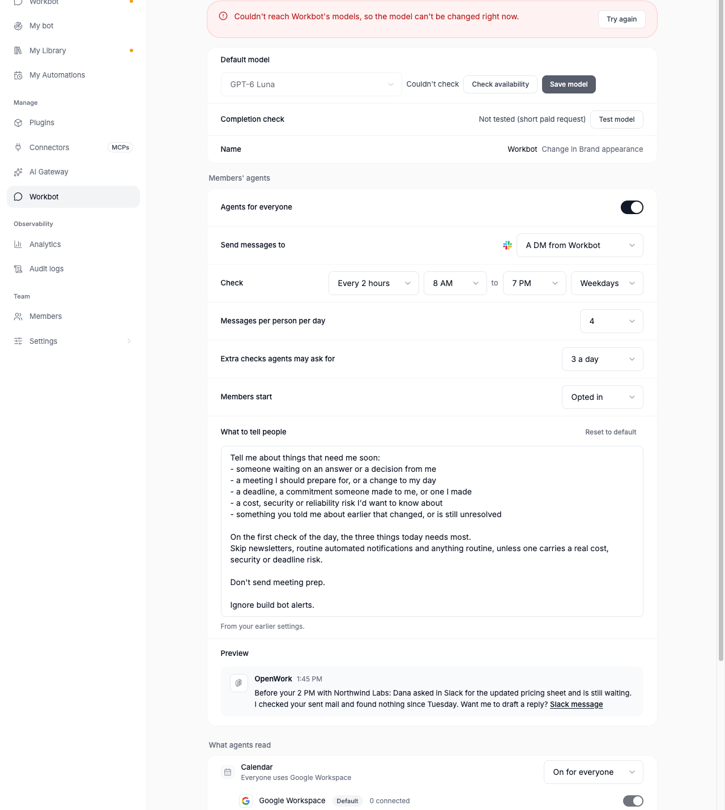
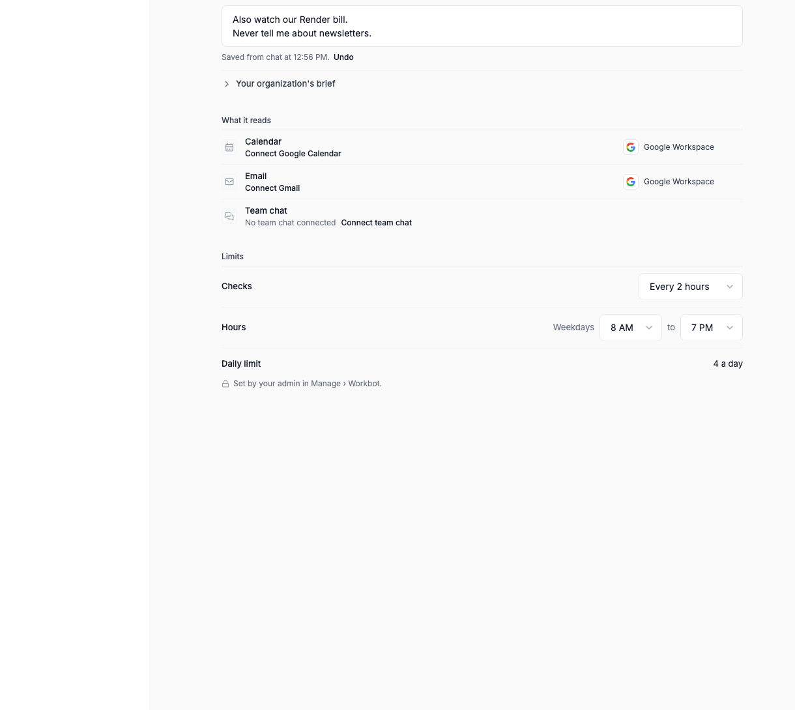

# Workbot: Your agent's brief and check rhythm

Feature `workbotAgentBrief` (cloud and self-hosted, off by default). Author: `benjaminshafii`.
It works on top of [Your agent](../workbot-proactive/README.md) (`workbotProactive`): both must be on for a member.
Off, Your agent works exactly as before (the legacy prompts are pinned by hash in
`ee/apps/den-api/test/workbot-agent-brief.test.ts`).

Your agent stops having four fixed message types (morning brief, meeting prep with a lead time, calendar changes,
waiting on you) and gets the shape every proactive product we looked at shares: **one rhythm, a free-text brief the
model reads, and the model deciding**. Den keeps only hard limits.





## What changes

| | Before (flag off) | With the brief |
| --- | --- | --- |
| When it looks | A morning pass, about every 3 hours, and calendar wakes (a meeting with outsiders 15 minutes before, a change someone else made) | A check every 2 hours from the start of the working day (8, 10, 12, 2, 4, 6 by default), plus up to 3 extra checks a day it asks for with `request_check(at, why)` ("1:45 PM: before your 2 PM with Northwind"). No calendar wakes |
| What it tells people about | Four switches in the template, members mute them | The organization's brief (plain text, default below) plus each member's own lines ("Also watch our Render bill.") |
| How a check works | One turn writes the message | Step 1, the check: researches, keeps notes, reports findings with P0/P1/P2. Step 2, the message: only for P0/P1, a short tool-less turn with the member's recent Workbot DM writes one message per finding |
| Daily limit | 3 | 4 (an organization that chose another limit keeps it) |
| Members' quiet window | Only urgent messages inside it | Quiet hours: no checks and nothing sent; anything urgent goes first at the next check |

## Default settings

| Setting | Default | Who changes it |
| --- | --- | --- |
| Check every | 2 hours (1, 2, 3 or 4) | Admin; a member may only check less often |
| Hours | 8 AM–7 PM, weekdays, in the member's time zone | Admin; a member may narrow them |
| Messages per person per day | 4 (1–10) | Admin; a member may lower it |
| Extra checks the agent may ask for | 3 a day (0–6) | Admin |
| Send to | A DM from Workbot | Admin (unchanged) |
| What agents read | Calendar, email and team chat on; other connections members choose | Admin and members (unchanged) |

## The default brief

```
Tell me about things that need me soon:
- someone waiting on an answer or a decision from me
- a meeting I should prepare for, or a change to my day
- a deadline, a commitment someone made to me, or one I made
- a cost, security or reliability risk I'd want to know about
- something you told me about earlier that changed, or is still unresolved

On the first check of the day, the three things today needs most.
Skip newsletters, routine automated notifications and anything routine, unless one carries a real cost, security or deadline risk.
```

Admins edit it in Manage › Workbot ("What to tell people", with Reset to default). Members add their own lines in My
bot or from any chat through `putMeAgent`: "also watch our Render bill" is `brief: { add: ["Also watch our Render
bill."] }`, "never tell me about newsletters" adds that line, "stop watching Render" is `brief: { remove: ["Render"]
}`. Every change shows where it came from ("Saved from chat at 10:42 AM") with Undo.

One text instead of the four Always / Never / When / How fields: it is what people write naturally, it is one field in
code and in the prompt, and chat can add or remove a line without picking a field. Existing words are carried over as
labeled lines ("Never tell me about: newsletters").

## Carrying the earlier settings over

Nothing is written when the flag turns on. Until an admin or member saves, Den reads the brief from what they had
(`resolveAgentBrief`, `carriedOverMemberBrief` in `@openwork/types/den/workbot-proactive`), and shows "From your
earlier settings":

- The organization's brief: the default brief, then a line for each message type the template turned off ("Don't send
  meeting prep.", "Don't tell me about calendar changes."…), then the organization's instructions as written.
- A member's lines: a line per message type they muted, then their Always / Never / When / How words, labeled.
- The daily limit: an organization still on the old default 3 gets the new default 4; any other limit is kept.
- The meeting lead time is dropped: the agent asks for an extra check before a meeting that matters instead.
- A member's only-urgent window becomes quiet hours.

Turning the flag off goes back to the template, mutes and words, which are untouched.

## The pipeline

```
rhythm (every N hours in hours) ─┐
request_check(at, why) ──────────┴▶ step 1: the check, in the agent's own read-only session
                                     brief + sources ─▶ notes in memory/ ─▶ findings report (P0/P1) | NO_FINDINGS
                                                  │
                     only P0/P1 and room today ───┘
                                                  ▼
                                     step 2: the message, a fresh tool-less session
                                     member's recent Workbot DM + sent today + now + next check + first check
                                                  ─▶ {"messages":[{text, about[], update}]} | NO_REPLY
                                                  │  (malformed: retried once, then dropped and logged)
                                                  ▼
                                     Den's hard limits ─▶ a Workbot DM per message, as today
```

- **Rhythm** (`checkSlotsOn`, `nextCheckSlot` in `@openwork/automations/proactive-brief`): slots anchored to the start
  of the working day in the member's zone, on the wall clock, so a late check never shifts the next ones and a
  daylight-saving change keeps them at the same local times. Due is derived from the last check and the current
  rhythm, so a member who slows it down gets the new rhythm at once. The first check of the day is flagged
  `first_check` (records keep the `morning` kind).
- **request_check(at, why)**: an MCP tool only the agent's own background check sees (a token Den minted with the
  agent's read allowlist and at least one source; never chat, never the messenger). It changes only that member's agent
  schedule. Capped at the organization's extra checks per day, only inside hours and outside quiet hours, within the
  next 24 hours, idempotent (a second request within ten minutes is the same one), and covered by a scheduled check up
  to 15 minutes before. Audited as `agent.check_request.create`. My bot shows it: "Next check 1:45 PM: before your 2 PM
  with Northwind."
- **Step 1, the check** (`agentCheckInstructions`, `agentCheckPrompt`): the existing session (`hs_agent_<hash>`), the
  existing read-scoped token and allowlist, its own `memory/` (notes.md, open.md, and a checkpoint per check under
  `memory/checks/<date>/<time>.md`, which it deletes after 14 days as the check prompt says). The brief and the source
  list are data people in OpenWork wrote; what the sources contain is data from other people.
- **Step 2, the message** (`agentMessagePrompt`): a fresh runner session per check (`hs_agentmsg_<hash>`), `readOnly`
  (no file tools) with an agent token that may read no source, deleted after. Not the member's Workbot chat session:
  it would need its tools taken away, would leave the findings in the member's chat memory, and could collide with a
  conversation in progress; the context it needs (the member's recent Workbot DM: the newest 20 messages of the last
  two days, including replies in the newest threads, read with the Workbot app's bot token and `im:history`, which it
  already has) is injected instead. Den keeps none of it. Delivered text lands in the same Workbot DM as today, which is
  where the member answers.
- **Den's hard limits** (`decideBriefDelivery`): outside hours, in quiet hours or snoozed nothing is sent or recorded;
  only `about` ids from sources the check read (aliases like "slack" resolved); told once per `about` id, recorded in
  the existing ledger; `update: true` passes told-once once per day for the same items (a real change usually has a new
  id: the new reply, the event's new version); then the daily limit, in the order step 2 wrote them. When today's limit
  is reached step 2 doesn't run at all. Delivery is `sendWorkbotDirectMessage` with the same cleaning (no mentions,
  links only to the member's Google workspace and the services behind the sources it read).

The prompts are ported from the design spec as constants in `packages/automations/src/proactive-brief.ts`; see
[Prompt changes](#prompt-changes) for every wording change the evals justified.

## Records, counters and /admin

- `agent_member_check`: one record per check as today, with new reasons `no_findings` (quiet: nothing for the
  messenger) and `findings_held` (quiet: found something that can wait), the new kind `requested`, and "Sent you 2
  messages…" when a check sends several. `daily_limit`, `already_told`, `unreadable_reply` and the failure reasons are
  unchanged, so /admin › Features reads them as before.
- `agent_check`: one counter row per check, `responsibility = "rhythm"`, instead of a row per responsibility. Its
  `checks` and `sent` sum with the rest for /admin › Features; Manage › Workbot shows it as one row.
- `agent_delivery`: the same ledger, `responsibility = "brief"` for the brief's rows; `update:<hash>:<date>` keys for
  updates.

## Cost

Step 1 carries no chat history (only its own session and notes); step 2 runs only for P0/P1 findings and while
today's limit has room. Den logs `workbot_agent_step_usage` (step, input, cached input and output tokens) for each
turn. Typical numbers from the replay evals are in [Replay evals](#replay-evals).

## API

- `GET /v1/org/workbot-settings/proactive`: `brief` `{checkEveryHours, dailyCap, extraChecksPerDay, text, defaultText,
  carriedOver}` with the flag on. `PUT` takes `brief` (any subset); without the flag, 400.
- `GET /v1/org/workbot-settings/proactive/health`: `rhythm` `{checks, quiet, sent}` with the flag on.
- `GET /v1/me/agent` (`getMeAgent`): `brief` `{lines, organization, carriedOver}`, `nextChecks` `[{at, kind, why}]`,
  `limits.checkEveryHours`, `limits.admin.checkEveryHours`, `limits.extraChecksPerDay`; `responsibilities` is empty.
- `PUT /v1/me/agent` (`putMeAgent`): `checkEveryHours` (1–4, never more often than the admin's, null for theirs) and
  `brief` `{add?, remove?, set?}`; errors `limit_wider_than_admin`, `brief_line_not_found`, `brief_too_long`, and
  `brief_unavailable` without the flag.
- Connect tells chat, with the flag on: "To change what Your agent tells the user ("also watch our Render bill", "never
  tell me about newsletters": lines added to their brief) or how often it checks, use putMeAgent…".

## Turning it off

The kill switch (or the organization override) sends every member back to today's agent on the next wake: the worker
picks the wake per member and per check. A message about to be sent re-checks the flag right before sending. The
brief settings, members' lines and extra-check requests stay stored and come back when it's turned on again. Today's
settings page and agent never read or drop them.

## Follow-up: what retiring the old path deletes

Once the brief is on everywhere:

- `packages/types/src/den/workbot-proactive.ts`: `AGENT_RESPONSIBILITIES`, `AGENT_RESPONSIBILITY_COPY`,
  `WORKBOT_PROACTIVE_LEAD_MINUTES`, `leadMinutes`, `dailyCap` (the brief's becomes the one), the template content and
  `mergeAgentTemplate`, `AGENT_PREFERENCE_*` and the four words, mutes in `AGENT_CHANGE_FIELDS`, the health
  `responsibilities` array, and the carry-over helpers.
- `packages/automations/src/proactive.ts`: `AGENT_INSTRUCTIONS`, `AGENT_RESPONSIBILITY_PROMPTS`,
  `AGENT_ANYTHING_ELSE_PROMPT`, `agentWakePrompt`, `parseAgentReply`, `decideAgentDelivery`, the calendar wakes
  (`detectCalendarWakes`, `nextCalendarPoll`, `wakeResponsibility`, the calendar checkpoint and `woke` state), and
  `isMorningPass` / `nextScheduledPass` (the calendar projection stays for Automations' calendar triggers).
- `ee/apps/den-api/src/workbot-proactive/`: `wake.ts`, `template.ts` (the `agent` config object versions),
  `policy.ts` (mutes), the mute and words branches of `preferences.ts`, `runAgentTurn`, the per-responsibility
  counters, and the flag dispatch in `worker.ts`.
- den-web: the legacy rows of `workbot-proactive-section.tsx`, `workbot-proactive-preview.tsx`, the per-responsibility
  health table, and My bot's "What it tells you about" and "In your words".
- Routes: `mute`/`unmute`/`preferences` in `PUT /v1/me/agent`, `responsibilities`/`instructions`/`leadMinutes` in the
  organization settings, `responsibilities` in both views.

## Try it

```sh
pnpm dev:den:mysql && pnpm dev:workbot
# /admin › Features › Workbot: Your agent and Workbot: Your agent's brief and check rhythm › on for your organization
```

`pnpm --filter @openwork/automations test` (prompts, rhythm across DST, requests, parsing, Den's limits),
`pnpm --filter @openwork-ee/den-api test` (`workbot-agent-brief.test.ts`: the pipeline end to end with injected
boundaries, carrying settings over, members' changes, request_check's audience),
`workbot-agent-brief.api.test.ts` (routes, chat through Connect, request_check through MCP),
`evals/proofs/workbot-agent-brief.proof.test.ts` (Manage › Workbot and My bot), and the replay evals below.

## Replay evals

See the PR for the full table. Filled in below after the runs.

## Prompt changes

Filled in below after the runs.
