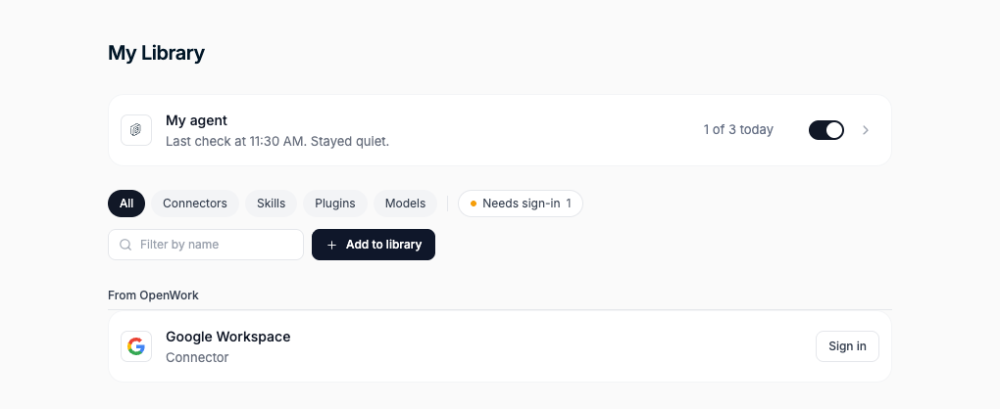
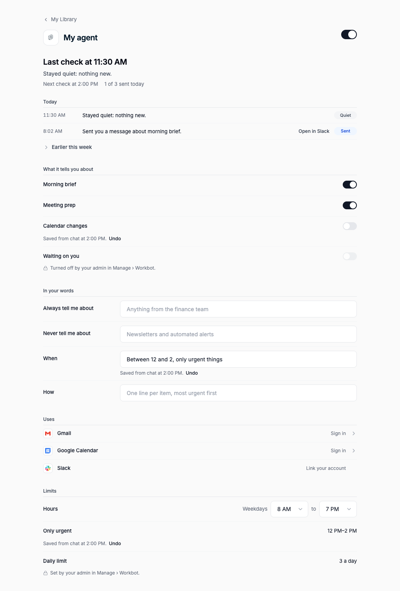

# Workbot: My agent in the Library

Included in `workbotProactive` (cloud and self-hosted, off by default). Author: `benjaminshafii`.
It needs Workbot on the deployment. [Your agent](../workbot-proactive/README.md), its member view and the admin health
view share one rollout: turn it on for one organization or one member in `/admin`. There is no separate Library gate.

Members can see what their agent did and why it stayed quiet, and tell it what they care about in their own words.
Chat (Workbot in Slack or on the web) is the main way to change it; the Library page shows the same agent with an
Undo next to every change. Nothing new runs: the existing wake writes the records and follows the member's words.





## What a member gets

| Where | What |
| --- | --- |
| Den › My Library | A pinned **My agent** row above the filters: "Last check at 11:20 AM. Stayed quiet.", "1 of 3 today", the on/off switch and a chevron. Locked with the reason when the admin turned agents off. |
| Library › My agent | The last check and why (the focal line), the next check, "1 of 3 sent today"; today's checks with a Sent / Quiet / Waited / Failed pill and **Open in Slack**, "Earlier this week" collapsed; **What it tells you about** (switches with "Saved from chat at … Undo", locked when the admin turned one off); **In your words** (Always tell me about, Never tell me about, When, How); **Uses** (a switch per source, with its last read, a Connect action, the admin's lock and the member's instruction; see [Your agent](../workbot-proactive/README.md#member-controls)); **Limits** (their hours inside the admin's, an only-urgent window, the daily limit locked: "Set by your admin in Manage › Workbot"). |
| Chat | "between 12 and 2 only urgent stuff, stop telling me about calendar changes" → Workbot calls `putMeAgent` once and replies with `saved.reply`: exactly what was saved, `Reply "undo" to revert.` and the link. Text only, no Slack buttons. "Why so quiet?" is answered from `lastCheck` / `getMeAgentChecks`. |

## How it works

```
existing wake (wake.ts) ──▶ agent_member_check  (one row per check: outcome, reason, sentence, DM reference)
          ▲                         │
          │ member's words,         ▼
          │ narrowed limits   GET /v1/me/agent (+ lastCheck, todayChecks, preferences, limits, changes)
          │                   GET /v1/me/agent/checks?days=7
agent_instance.overrides  ◀── PUT /v1/me/agent (preferences, hours, dailyCap, quietWindow, undo)
agent_instance.preferences       ▲                     ▲
                                 │ Den web (page)      │ Connect putMeAgent (chat)
```

- **Check records** (`agent_member_check`, migration 0164). The wake writes one per check of a member's agent, only
  while the feature is on for them: `sent`, `quiet` (nothing new, already told, daily limit, nothing to check),
  `waited` (outside their hours, inside their only-urgent window, snoozed) or `failed` (couldn't read Gmail, Slack
  not linked or not installed, nowhere to send, couldn't send, couldn't run). Each has a reason code and the
  sentence the member reads, which responsibilities it was about and, for a DM, the channel, timestamp and Slack
  link (`chat.getPermalink`, no new scope). No email or message text. A skip that repeats for the same pass (Google
  still disconnected) stays one row whose time moves. Pruned after 14 days. The organization counters behind the
  admin's health view (`agent_check`, 0162) are unchanged.
- **Their words and the change log** (`agent_instance.preferences`, encrypted): four plain-text fields, 400
  characters each, and the last 40 changes (field, value, before, `chat` or `page`, when, the save it belongs to).
  A change through Connect is saved as from chat (Den signs that header), one from Den web as from the page.
  `undo: "last"` reverts the last save, every field it changed; `undo: "<change id>"` reverts one change if it is
  still the latest for its field.
- **Narrower limits** (`agent_instance.overrides`): `hours`, `dailyCap`, `quietWindow`. The server refuses wider
  hours or a higher limit (400 `limit_wider_than_admin`, with a message chat relays) and reads what is stored clamped
  to the admin's current policy, so an admin who narrows theirs later always wins.
- **The wake** follows the narrowed hours and limit in code, holds a message inside the only-urgent window unless
  the agent marks it `"urgent": true` (it is then not recorded as told, so it can come up later), and adds the
  member's words to the wake prompt as data they wrote: they shape what to tell them, when and how, and never widen
  what the agent may do (it still only reads).
- **Connect** adds one sentence to the instructions while the feature is on for a member who may write: "To change
  what Your agent tells the user, use putMeAgent; to explain why it was quiet, read the user's agent checks."

## API

`GET /v1/me/agent` (`getMeAgent`) adds, with the feature on: `timeZone`, `lastCheck`, `todayChecks`, `sentToday`,
`preferences` `{always, never, when, how}`, `limits` `{workingDays, startHour, endHour, dailyCap, quietWindow, admin,
narrowed}`, `changes` `[{id, field, summary, source, at, undone}]` and `link`; `nextCheckAt` becomes the next
scheduled check (never inside a snooze or outside their hours). A check is
`{id, at, kind, outcome, reason, headline, summary, responsibilities, slackUrl, fix}`.

`GET /v1/me/agent/checks?days=7` (`getMeAgentChecks`, at most 14 days) lists checks newest first.

`PUT /v1/me/agent` (`putMeAgent`) also takes `preferences`, `hours`, `dailyCap`, `quietWindow` (each `null` to go back
to the admin's) and `undo`, and answers with the agent plus `saved: {changes, reply, link}`. With `workbotProactive` off, all agent endpoints answer 404 `feature_disabled`, including the basic controls.
Response fields remain optional in shared schemas so current clients can still read responses from older servers;
the current server always includes the member view and save receipt when the parent is on.

## Turning it off

The `workbotProactive` kill switch hides the member page and admin health view, refuses all agent endpoints and
stops agent wakes, including writing new member check records. It does not fall back to an agent that ignores the
member's words or narrowed limits. Stored words, limits, the change log and records stay and come back when it is
turned on again; records age out after 14 days.

## Try it

```sh
pnpm dev:den:mysql && pnpm dev:workbot
# /admin › Features › Workbot: Your agent › on for your organization
# Den › Manage › Workbot › Members' agents › on; then My Library
```

`pnpm --filter @openwork/automations test` (prompt, urgent, quiet window, narrowed policy),
`pnpm --filter @openwork-ee/den-api test` (records for each outcome, narrowing, undo, the guidance sentence),
`pnpm --filter @openwork-ee/den-api test:api` with `workbot-agent-library.api.test.ts` (chat and page in sync through
Connect, server-side limits, records and isolation), the Den web render tests in `my-agent.test.tsx`, and
`evals/proofs/workbot-agent-library.proof.test.ts` (the parent rollout off/on, member page, and chat/page sync).
