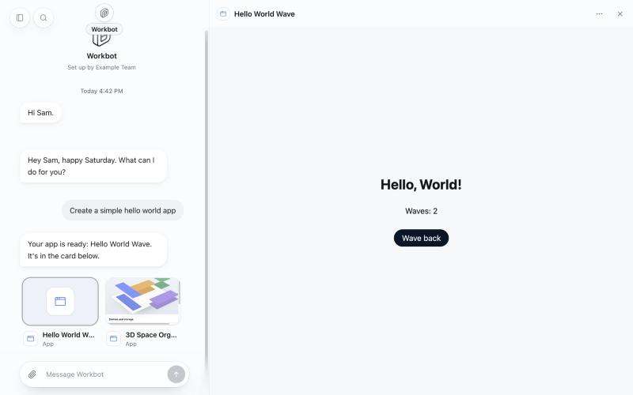

# Open artifacts from Workbot chat (`workbotApps`)

> **Generally available:** `workbotApps` is retired; its enabled behavior is standard on Cloud and self-hosted. Actual settings, permissions, billing rules and consent remain enforced. Rollout/off-state instructions below are historical; see [the retirement guide](../globally-enabled-retirement/README.md).

- **Feature key:** `workbotApps`
- **Deployments:** cloud and self-hosted (`everywhere`), off by default
- **Author:** @reachjalil

## What people get

When Workbot builds, changes or opens an artifact with OpenWork's artifact tools
(`create_app`, `update_app`, or opening an artifact it found), the artifact shows as a
card under the reply, next to any files the reply made. Tapping the card opens
the artifact itself beside the chat (a full-screen sheet on a phone), in the same
panel files open in.

The screenshot is the test fixture screen (`?scenario=openwork-app`), not a
live workspace: the artifact card sits next to an `.html` file's card, and the open
artifact has run its own tool twice.

## Artifact and web page cards

Workbot can make two things a person uses, and the cards say which:

| | Artifact | Web page |
|---|---|---|
| What it is | An interactive view built in OpenWork | One `.html` file Workbot hands over |
| For | Something to keep and come back to, share with a team, or that works with connected apps | A one-off: a mock-up, a game, a visual, something to download |
| Where it lives | In OpenWork, with the person's other artifacts | In the chat's Files |
| Card | "Artifact", window icon | "Web page", globe icon |
| More menu | Expand, Copy link | Also Open in new tab, Download, Share |

With the feature on, Workbot is told to pick by what the person needs, to make
the one they name, and to ask in one line when unsure.

Off: the artifact is still made, but nothing shows in the chat, as before.

## How it works

- **Runner.** A tool result that launches an artifact built in OpenWork (Connect's
  `openwork/mcpApp` launch of the artifact's own `open_app`) keeps the artifact's id and
  title on the stored tool message. The model reads only the result's text.
  This is kept whether or not the feature is on; nothing shows it while off.
- **Workbot's server.** With the feature on, those artifacts are listed among the
  reply's outputs (`app:<appId>`, type `application/vnd.openwork.app`), each
  once, as last named. Workbot is also told the artifact shows as a card, so it does
  not say it opened "in the sidebar".
- **Opening one.** `POST /v1/workbot/apps/<appId>/open` asks the artifact's own MCP
  server (`/mcp/agent/connections/<appId>`) with the person's own sign-in:
  `open_app`, then the artifact's page. Den decides there whether they may use the
  artifact. `POST /v1/workbot/apps/<appId>/call` runs one of the artifact's own tools
  the same way.
- **The page.** The artifact's page runs in a frame with an opaque origin (scripts
  and forms, never `allow-same-origin`), so it cannot read Workbot's page, its
  sign-in or the conversation. Workbot answers the artifact's MCP Apps requests:
  the opening result, calls to the artifact's own tools, and web links (http and
  https, in a new tab).

## Limits

- The artifact's tools run as the person, with no extra prompt, as they do when the
  artifact is opened as a site (`appSites`).
- An artifact cannot send Workbot a message or change what Workbot knows: those
  requests are refused.
- Workbot lists artifacts built in OpenWork. An MCP App from a connected service is not
  shown.
- A card has no picture of the artifact; it shows the artifact type until opened.
- The artifact opens fresh each time, without the input it was first launched with.

## Turning it off

Safe at any moment: cards for artifacts stop being listed and the two routes answer
`feature_disabled`. Artifacts themselves, files and their cards are untouched.

## Verification

`pnpm --filter @openwork-ee/headless-runner test:conversation` (the launch is
kept), `pnpm --filter @openwork-ee/workbot test:steps` (listed once, only when
on) and `test:artifact-ui` (the card, and what the artifact's page may ask for).
The fixture screen runs a small artifact end to end. Not run against a live Den.
