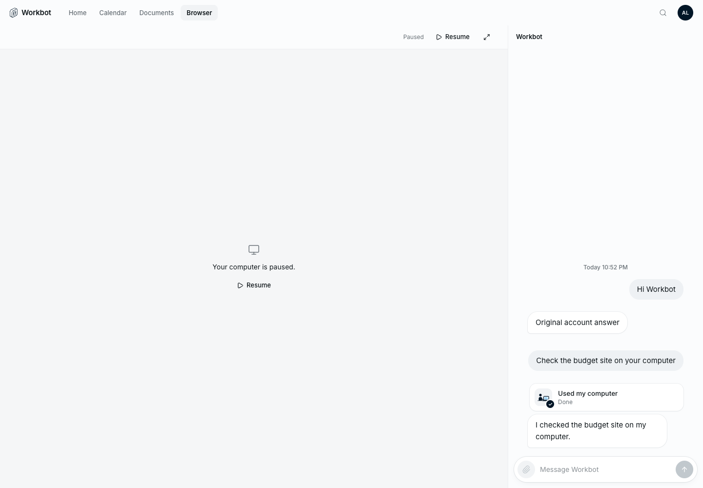
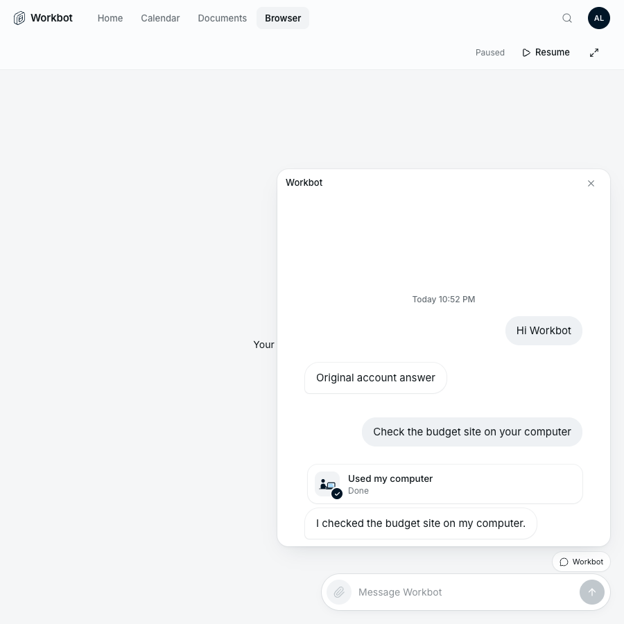

# Workbot: chat beside the browser

Feature key: `workbotBrowserChat` · Deployments: cloud and self-hosted · Default: off · Author: @benjaminshafii

Needs browser use (`browserUse` with `remoteComputers`). Den only reports it on when browser use is on for the member.

## What people see

Without the feature, Workbot's Browser page shows the live browser and nothing else (unless the workspace assistant or teaching is on): to tell Workbot what to do next, people go back to Home and lose sight of the page.

With the feature on, on windows at least 1024px wide, the Browser (and Computer) page keeps the same conversation docked on its right: the earlier messages, Workbot's replies and a message box. A chip at the top names the tab in front of the browser; each message tells Workbot which tab the person means unless they turn the chip off for that tab. Browser context is not read-only: Workbot can keep working in that tab.

On narrower windows the conversation floats over the browser instead (the existing floating chat), so the page is never squeezed.

## How it works

- Den's `GET /v1/workbot/session` returns `browserChat` (`workbotBrowserChat && browserUse && remoteComputers`); Workbot's `/v1/workbot/me` passes it to the page only with browser access.
- The page uses its workspace shell (the same one as the workspace assistant and browser teaching): one conversation shown on Home, in the dock, or in the floating chat, never two at once.
- The docked chat sends through the same `/v1/workbot/messages` call as Home, with the browser tab's `WorkbotViewContext` when the chip is on.

## Turning it off

The next page load shows the Browser page without the conversation beside it, as before. Messages already sent stay in the conversation; nothing is stored by the feature itself.

## Proof

`evals/proofs/workbot-streamline.proof.test.ts` ("the conversation docks beside the browser for browser-heavy work") renders the real Workbot page against a fixture Den, with the feature off and on, and on a narrow window. It does not start a cloud computer: the browser shows its paused state.
