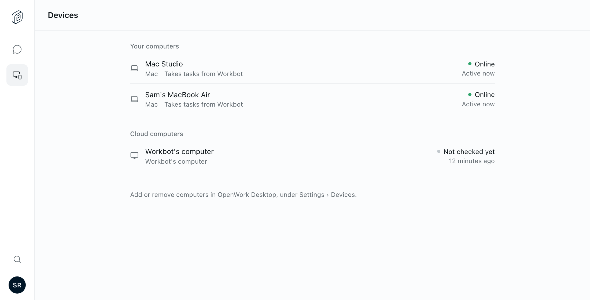
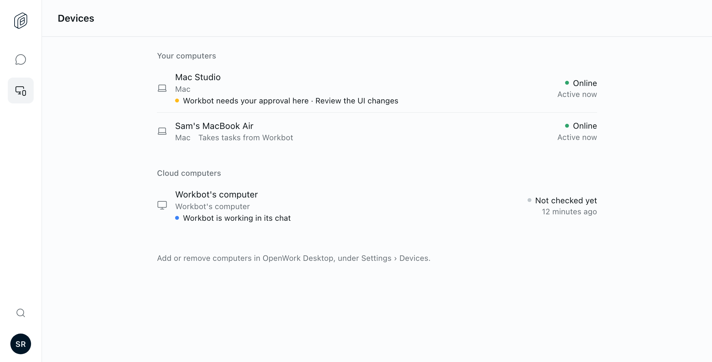
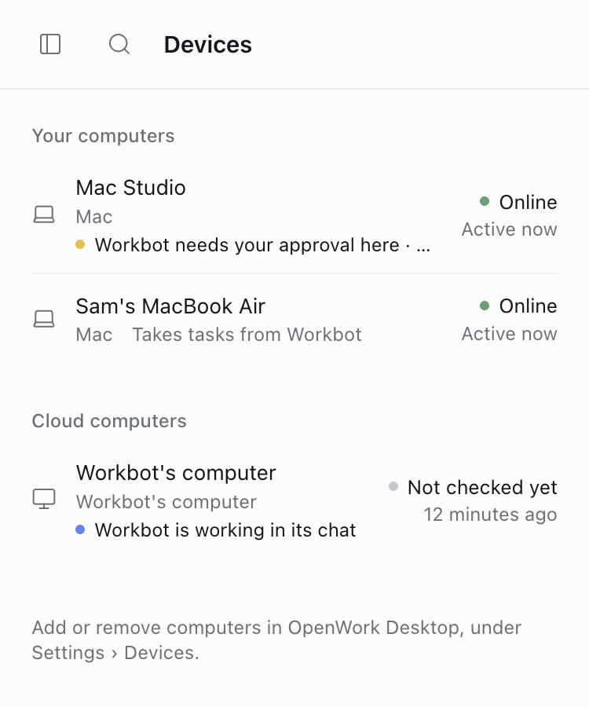

# Workbot: activity on Devices

- Feature: `workbotDeviceActivity`
- Deployments: cloud and self-hosted; default **off**
- Owner: `reachjalil`

Workbot's Devices list (and the Computers tab in its profile, where that is on) says what Workbot is doing on each computer now, on a line under the computer's name:

| Computer | Line |
|---|---|
| One of the person's own computers, a task running | Workbot is working here · *latest step* |
| The same, a task waiting on the person | Workbot needs your approval here · *task* (or "your answer") |
| The same, a task the computer has not taken yet | Workbot's task is waiting to start here · *task* |
| Workbot's own computer, a turn running in its chat | Workbot is working in its chat |

A computer with nothing running looks as it did, including "Takes tasks from Workbot".

## Where the line comes from

- **The person's own computers.** The page already reads the chat's remote tasks for the header and the Tasks tab. A task is shown on the computer whose id its status names. Only a status read just now counts; a stale one adds no line. A task waiting on the person comes before a running one.
- **Workbot's own computer.** Den's device list carries `workingSince`, taken from the runner's report that a turn is running in the computer's chat. A turn Den never hears end stops counting after a day. A running turn does not prove the computer itself is in use, so the line says "in its chat", not "here".

## Limits

- The list only knows remote tasks started in the chat on screen. A task started from another chat or another device adds no line.
- The line on a person's own computer follows the remote task read (every 15 seconds while a task is open). Workbot's own computer follows the list (every minute).

## Try it

Turn the feature on for a test organization with Devices. Ask Workbot to run a task on one of your computers and open Devices: the computer's row names the task, and turns amber when the task asks for approval. Start a long request in a chat whose computer is listed and open Devices from another tab: its row says Workbot is working in its chat.

Turning the feature off removes the line and the page stops reading remote tasks for it. Nothing stored changes; Den keeps returning `workingSince`, which nothing else shows.

## UI evidence

Real Workbot React UI with deterministic fixture API responses (not live Den or runner integration):

To open the same page: `pnpm --filter @openwork-ee/workbot exec tsx test-fixtures/chat-screen-server.ts 3098`, then `http://localhost:3098/devices?scenario=remote&deviceActivity=1`.

Tests: `pnpm --filter @openwork-ee/workbot test:devices` (which line each row gets) and `ee/apps/den-api/test/api/remote-devices.api.test.ts` (the session switch and `workingSince`).
