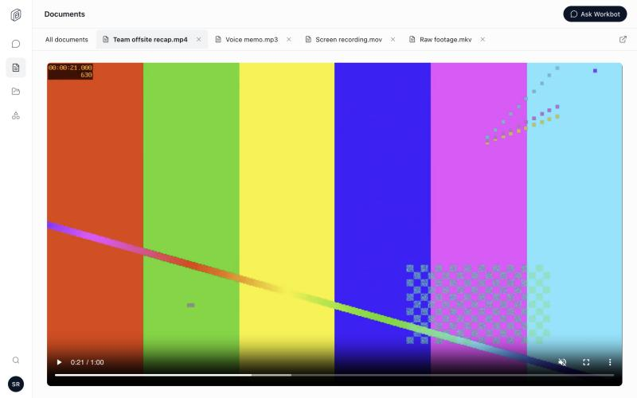

# Workbot Documents: video and audio

Part of `workbotDocuments` (it had its own flag, `workbotDocumentMedia`, until it was folded in) · Cloud and self-hosted · Author: @reachjalil.

Documents lists every file in a person's Drive and OneDrive, but a video or audio file opened to "No inline preview is available" with a link to the original. Now the file plays in its tab.

The screenshot is the Workbot screen in its test fixture with a generated test clip.

## What changes

- **Video and audio play in the tab.** Opening an MP4, WebM, MOV or Ogg video, or an MP3, M4A, AAC, WAV, Ogg, WebM or FLAC audio file, shows the browser's own player with its controls. Seeking works: the player asks for the part of the file it needs.
- **A file the browser can't play keeps the link.** Some files have a container the browser accepts but a codec it doesn't (for example HEVC in a MOV on some browsers). The tab then says "This video can't be played here." with **Try again** and **Open in Drive** (or OneDrive).
- **Playback stops when it leaves the screen.** Switching to another document tab or another Workbot page pauses it.
- Other file types are unchanged. Images (PNG, JPEG, GIF, WebP) and PDFs already preview inline; anything else keeps the link to the original.

## How the bytes are served

The player requests byte ranges. Each request passes Workbot's and Den's existing Documents checks (sign-in, membership, `workbotDocuments`, the member's own Drive or OneDrive connection), then Den reads that one range from the provider, at most 8 MiB, and answers `206` with `Content-Range`. No file is stored or sent whole.

Only the listed video and audio types are served this way, under their own media type with `nosniff` and a sandboxing content security policy. SVG and HTML are never served inline.

## Try it

Turn `workbotDocuments` on for a test organization in `/admin` → organization → Features, open Workbot → Documents, and open a video from Drive or OneDrive. Drag the player's position to check seeking.

## Turning it off

Turning off `workbotDocuments` turns off Documents as a whole. Video and audio files go back to "No inline preview is available" with the link to the original, and Den refuses their bytes again. A player already open stops loading further parts of its file. Nothing is stored.
