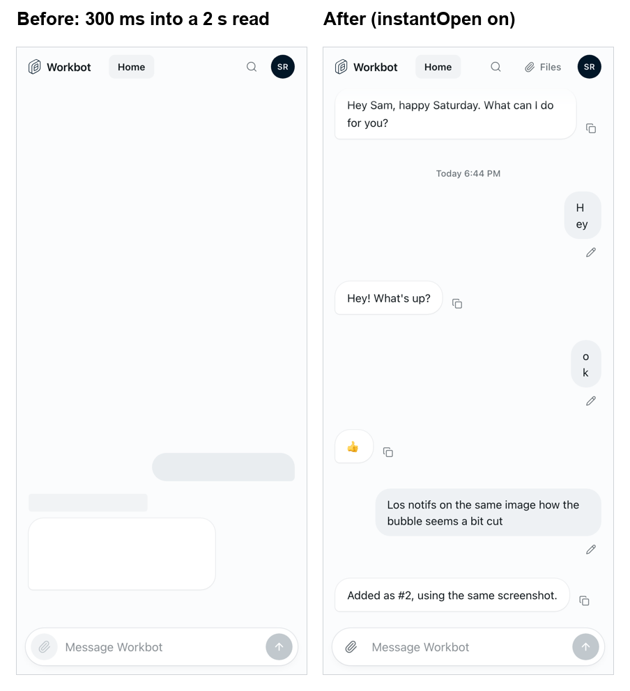

# Workbot: chats open instantly

> **Generally available:** `workbotInstantOpen` is retired; the enabled behavior is now standard. Permissions, organization settings and entitlements still apply. Any rollout, off-state or kill-switch instructions below describe the historical rollout; see [the retirement guide](../ga-rollout-retirement/README.md).

Feature key: `workbotInstantOpen` · Deployments: cloud and self-hosted · Default: off · Author: @benjaminshafii

## What people see

Without the feature, opening Workbot (or switching to a side chat) shows grey placeholders until the conversation has been read from the runner, often more than a second on a phone.

With the feature on, a chat opens on the newest messages from the last visit, kept on the person's device, and quietly updates when the read arrives. The message box works the whole time.

## What is kept, and when it goes

- The newest 8 messages of each chat, in the browser's local storage, keyed by organization, person and chat (`workbot.thread.v1:*`).
- Only a conversation that wasn't answering when it was read, so a reply in progress is never shown from the device.
- Cleared on Sign out, on any signed-out (401) answer, after a week, and on every page load where the feature is off.

Shared devices are the risk: the newest messages stay readable in that browser's storage until one of the above. That is why it is a flag.

## How it works

- Den's `GET /v1/workbot/session` returns `instantOpen`; Workbot's `/v1/workbot/me` passes it to the page (`host.instantOpen`).
- `workbot-ui/src/thread-cache.ts` keeps and reads the page; `useWorkbotThread` uses it as placeholder data for the first read only.

Not behind the flag (same PR): side chats are read when their row is touched or hovered, interrupted turns resume without holding up the read for more than 250 ms, and `GET /v1/workbot` reports `Server-Timing: thread;dur=…`.

## Turning it off

The next page load opens chats as before and deletes every kept page on that device.
