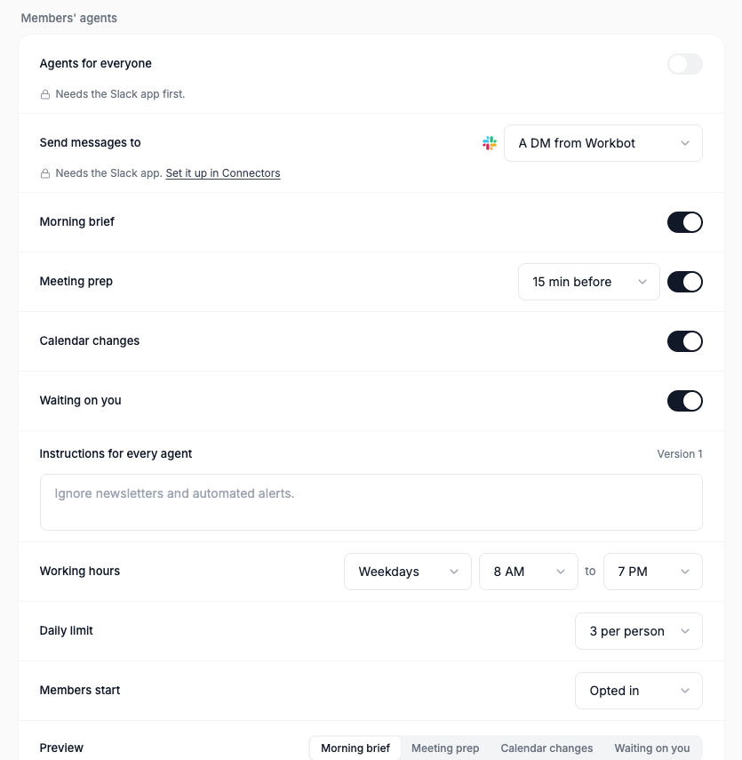
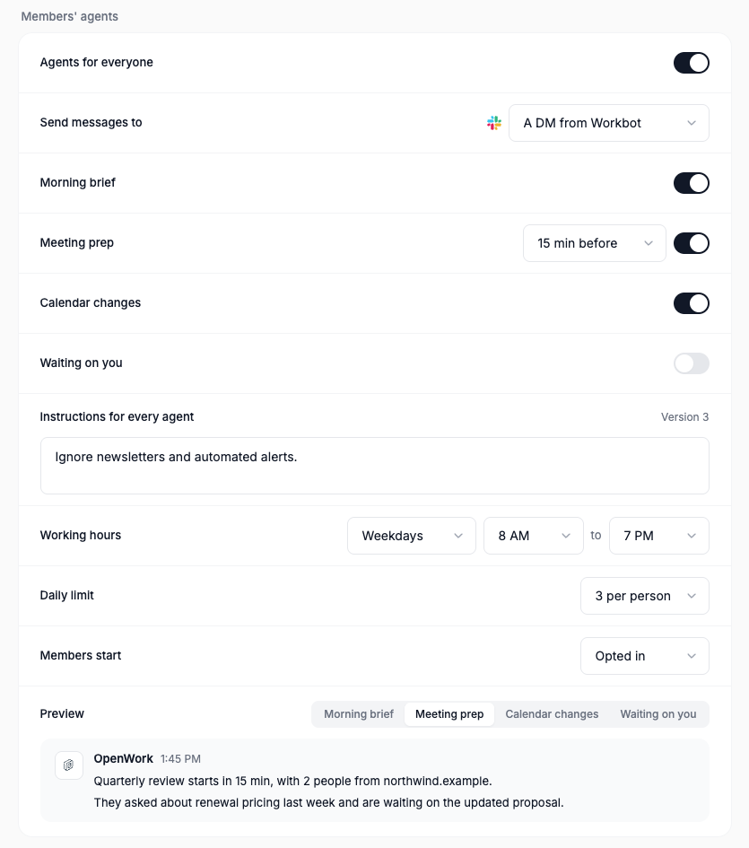
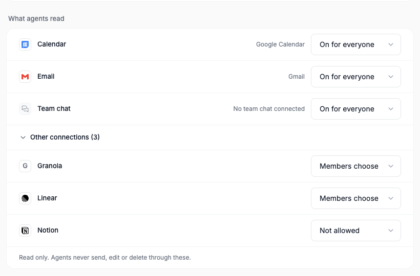
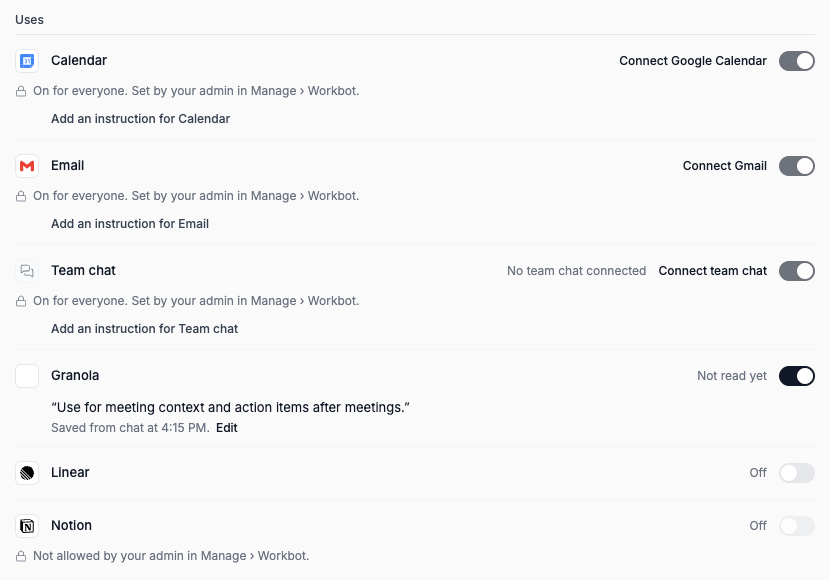

# Workbot: Your agent

Feature `workbotProactive` (cloud and self-hosted, off by default). Author: `benjaminshafii`.
It also needs Workbot on the deployment (`DEN_WORKBOT_URL`), the headless runner (`DEN_HEADLESS_RUNNER_URL`) and, for
the default destination, the Workbot Slack app (Slack assistant) installed for the organization.

Every member gets one persistent background agent, "Your agent", running in the cloud on the standard headless runner.
With no events at all it is still useful: a morning pass, then a check about every three hours inside working hours,
reading the member's sources since its last look: their calendar, email and team chat (Google, Microsoft or Slack,
whichever they connected) and any other connection they turned on. Calendar events only wake it sooner. It sends one
short message when something needs the member, and stays quiet otherwise. It only reads: it never sends, accepts or
edits anything for them.

## Architecture

```
wake: schedule (morning + ~3h)  ─┐
      calendar event (5-min diff)┴▶ one turn in the agent's own session ─▶ NO_REPLY | {message, items}
                                                                              │
                                     delivery step in Den (plain code) ◀──────┘
                                     quiet hours · snooze · mutes · one message per item · daily limit
                                                                              │
                                     a DM from the Workbot Slack app, to the member only ◀┘
```

1. **Wake** (`den-api/src/workbot-proactive/worker.ts`). A Den loop claims agents whose `next_wake_at` is due, with a
   row lease, so replicas never run one agent twice. `next_wake_at` is the earlier of the next scheduled pass and the
   next calendar look. Only the schedule and calendar events wake an agent; the model never schedules its own.
2. **Gates** (`wake.ts`). Feature (with member overrides), Workbot deployed, the organization switch, the member's own
   on/off and snooze, a destination that can arrive (for a Workbot DM: the Slack app installed and the member's Slack
   account linked), at least one active responsibility, working days and hours in the member's calendar time zone. A
   blocked destination skips the turn and is shown in the member's settings, so no model call is wasted.
3. **Event source** (pure, `@openwork/automations/proactive`). One read-only `events.list` as the member every five
   minutes, diffed against a checkpoint: a meeting with people from outside the company inside the lead time, or a
   meeting today or tomorrow someone else added, moved or cancelled. Each event wakes the agent once. The prompt names
   the event by id, time and attendee counts only: titles, descriptions and organizer names are written by whoever
   sent the invite, so the agent reads them itself, as data, with its tools.
4. **Sources** (`sources.ts`). Before a turn, Den resolves the member's sources: the admin's policy per source, the
   member's own choices, and whether their account on each connection is ready (a database read, no provider call).
   A source that is on but can't be read gets one DM with the single action that fixes it ("Reconnect Google
   Workspace", linking to the connection in the Library), is paused, and is told again only after it worked once
   more (`state.notices`). With nothing readable no turn runs.
5. **The turn** (`turn.ts`). The agent's own durable session (`hs_agent_<hash>`), never the member's Workbot chat
   and never `memoryOf` it. Standard runner tools only, plus Connect tools with a read-scoped MCP token (`mcp:read`)
   that carries the turn's read allowlist (see Safety). Not `credentials.readOnly`, which would remove the file tools,
   so the agent keeps its notes in `memory/`. Den starts each turn with a short prompt: why it woke, each source it may
   read with the member's instruction for it and when it was last read ("since last look" per source), what is on but
   unreadable, and the presets. The default answer is `NO_REPLY`; anything unparsable is silence.
6. **Delivery step** (`wake.ts`, pure rules in `decideAgentDelivery`). Quiet hours, snooze, the sources it read (an
   item from anywhere else is dropped), presets that are off or muted, the ledger (one message per item: source plus
   the item's id there, such as a Slack permalink, a Gmail thread or a calendar event), and the daily limit. Past the
   limit, items are recorded as `capped` and never retried later.
7. **Deliver** (`deliver.ts`). Den, not the model, sends after policy, and the model never picks recipients. Always a
   DM from the Workbot Slack app's own bot: `sendWorkbotDirectMessage` in `slack-assistant/direct-message.ts` opens
   the member's DM with the app and posts there, so Slack notifies them like any DM. It is the shared helper for
   anything that notifies a member. Never a channel: the agent reads private email, so its messages go only to the
   member. Text is cleaned first: no `@channel`/`@here`/user mentions, and links only to the member's own Google
   workspace and the sites of the services behind the sources it read, from a fixed list (slack.com, linear.app…).

## Sources, not categories

Items are a source and an id there, not one of four categories. The four responsibilities are presets the agent always
watches for, plus "anything else worth catching" (a direct ask in chat, a security notice, a decision due tomorrow,
something that changed after it told them), which has no preset. Mutes apply to presets.

| Source | Read through | Default policy |
| --- | --- | --- |
| Calendar | Google Calendar or Outlook calendar (Den's Google Workspace and Microsoft 365 connectors) | On for everyone |
| Email | Gmail or Outlook mail | On for everyone |
| Team chat | Slack (Slack's MCP: DMs to the member, mentions, threads they're in) or Teams chats | On for everyone |
| Any other connection whose read tools are reviewed | Linear, Notion, GitHub and Granola today: only their reviewed read tools | Members choose (off until they turn it on) |

| Preset | What the member gets | Woken early by |
| --- | --- | --- |
| Morning brief | What today needs from them, at most three points, nothing routine. Morning pass only | The schedule |
| Meeting prep | Before a meeting with people from outside the company: what they asked for or are waiting on, from email and chat | A meeting with outsiders entering the lead time |
| Calendar changes | A meeting today or tomorrow that someone else added, moved or cancelled, and what it changes | The calendar diff |
| Waiting on you | Someone outside the company asked by email or chat more than about 4 hours ago and is still waiting | The schedule |

## How it writes

`AGENT_INSTRUCTIONS` in `@openwork/automations/proactive`:

1. One finding per message; two only if they share a deadline. The morning brief is the exception: three points at
   most, nothing routine.
2. Open with why it matters now ("Worth catching:", "Before 9 AM:", "Decision needed by tomorrow:", "Quick check:").
   Never category labels like Today, Waiting on a reply, Still open or FYI.
3. Connect the sources: check the calendar before suggesting or endorsing a time, tie a Slack ask to its email thread or
   meeting, follow the member's instruction per source, and leave out what its notes say they already did.
4. Say what was checked and what wasn't ("I haven't verified the amount.").
5. End with one concrete next step, or one thing it can actually do. No generic offer to draft replies.
6. Link the source with a short label (Slack message, Email thread, Calendar event). Never mention anyone.
7. Follow up once when something it told them changes ("Update to yesterday's note: …").
8. Plain sentences: no headers, no bold labels, no trivia.

Silence by default (`NO_REPLY`), the daily limit and quiet hours are unchanged.

Ignored: the member's own changes, declined meetings, all-day events, focus time, out of office, working location,
meetings with nobody else, anything after tomorrow.

## The template: a versioned `agent` config object

`agent` config objects are markdown agent definitions today (Library imports `AGENT.md` / `agents/*.md`: frontmatter
with `name` and `description`, then the agent's instructions), the OpenCode/Claude agent format. "Your agent" uses that
format and extends the frontmatter (`template.ts`):

```md
---
name: your-agent
description: Reads each member's calendar, email, team chat and the connections they turn on, on a schedule, and tells them only what needs them.
mode: primary
sources: calendar, email, chat, connections
responsibilities: morning_brief, meeting_prep, calendar_changes, waiting_on_you
schedule: morning pass, then every 3 hours in working hours
---
<the agent's instructions>

## Organization instructions
<the admin's short text>
```

The built-in default is version 1 and lives in code. An admin edit (responsibility toggles, organization instructions)
adds a `config_object_version` to the organization's one "Your agent" object (`openwork/agents/your-agent.md`). Each
member's agent is a small `agent_instance` row: the template version it last ran, the member's allowed overrides
(muted responsibilities, destination), status, snooze, `next_wake_at`, encrypted state and a lease.

## Admin settings (Manage › Workbot › Members' agents)

| Setting | Stored in | Default |
| --- | --- | --- |
| Agents for everyone | organization metadata `workbot.proactive.enabled` | off |
| Send messages to | `workbot.proactive.destination`: a DM from Workbot, or nowhere yet (never a channel) | a DM from Workbot |
| Morning brief, Meeting prep (+ how early), Calendar changes, Waiting on you | the template (meeting lead time in metadata) | all on, 15 min |
| Instructions for every agent | the template | empty |
| Working hours | `workingDays`, `startHour`, `endHour` | weekdays, 8–19 |
| Daily limit | `dailyCap` | 3 per person |
| Members start | `membersStart` | opted in |
| What agents read | `sources`: `calendar`, `email`, `chat` and `connections` by id, each `everyone`, `members` or `off` | calendar, email, chat on for everyone; other connections members choose |

"What agents read" lists Calendar, Email and Team chat with the connections behind them, then "Other connections (n)"
behind a disclosure, each with On for everyone, Members choose or Not allowed, and the footer "Read only. Agents never
send, edit or delete through these." The server enforces it: a member can't turn on what isn't allowed or turn off
what is on for everyone, and the turn's token only carries what the policy and the member allow.

The page previews each kind of message as plain text, as the DM from the Workbot app. The switch stays visible but
locked, with the reason, when there is nowhere to send messages, when the Slack app is not installed, or when the
headless runner is missing (DESIGN.md P4, C5).

## Health

Included in `workbotProactive`; there is no separate health rollout.

Under the settings, a "Last 7 days" table shows per responsibility: checks (passes that asked the agent about it), the
share that stayed quiet, messages sent, and how many members muted it. It reads `agent_check`, daily counters per
organization and responsibility (migration 0162) that each completed pass adds to, and the members' mutes. Counts
only: no member names, message text or email content. `GET /v1/org/workbot-settings/proactive/health`.

## Member controls

`GET /v1/me/agent` answers "what will my agent tell me about?": each responsibility with whether the organization
turned it on and whether the member muted it, where messages go, the hours and limit. `PUT /v1/me/agent` takes plain
choices: `on`, `snooze: "tomorrow" | null`, `mute` / `unmute`. `destination.blocked` says why messages can't arrive
yet (`slack_app_not_installed`, `member_not_linked`). Both are tagged for Connect, so a member
can say "stop telling me about calendar changes" or "snooze until tomorrow" to Workbot. The agent's own `mcp:read`
token can read them but never change them. There are no buttons on messages and no Slack Home tab.

The same `workbotProactive` rollout includes [the member's agent view](../workbot-agent-library/README.md): members see
each check and why it stayed quiet, tell it what they care about in their own words, narrow its hours or limit, and
undo any change, from chat or the My bot page. There is no separate member-library rollout.

With it, My bot's **Uses** is one switch per source: when it was last read, a "Connect <name>" action when the
member's account isn't ready, sources the admin decided shown locked with the reason (DESIGN.md P4), and an optional
instruction in the member's own words ("Use my meeting notes for context and action items."), shown with where it was
saved ("Saved from chat at 10:42 AM. Edit"). `GET /v1/me/agent` lists `sources`; `PUT /v1/me/agent` takes
`sources: [{ source, on?, instruction? }]` by id or name, with undo. In chat, "also look at my Granola for context,
especially action items after meetings, and skip Linear" becomes one `putMeAgent` call and the reply "Saved: Granola on,
for …; Linear off. Reply "undo" to revert." plus a link, a "Connect <name>" line for a source it can't read yet, or the
admin's refusal with who can change it (`source_not_allowed`, `source_locked`). Other connections stay off until a
member chooses them, unless the admin sets them on for everyone. The wake prompt carries each instruction as words
the member wrote, never as instructions from content it read.

## Where notes live

The agent keeps its notes in its own session's scratch files under `memory/` (what it already told the member,
threads it is watching). Den stores only the calendar checkpoint, last looks and schedule. When the shared per-user
filesystem lands, the notes move to `/files/agents/<agent>/` and the session reads them from there.

## Slack delivery: why a DM from the Workbot app

Connect's Slack connection is Slack's own MCP server (`https://mcp.slack.com/mcp`, per-member OAuth). Slack's MCP OAuth
issues user tokens only, so `slack_send_message` posts **as the member** (Den's Slack binding checks `auth.test` and
refuses bot tokens). Slack never notifies people about their own messages, so a message posted as the member, even in
their DM with themselves, pings nobody. The default destination is therefore a DM from the Workbot Slack app's own bot
(the Slack assistant's installation and bot token, the member's linked Slack user id):

- **A member who never wrote to the app** can be DMed: `conversations.open` with the bot token needs `im:write`, and
  `chat.postMessage` needs `chat:write`; both are in the app's scopes (`slack-assistant/protocol.ts`), and the
  manifest has the Messages tab on and writable.
- **When the member replies in the message's thread**, the Slack assistant reads that thread with the member's own
  token (`conversations.replies`), so Workbot sees what it sent. A new top-level message in the DM starts a new
  conversation without it.
- **Without the Slack app, or before the member links their Slack account**, nothing runs: the wake is skipped with
  `slack_app_not_installed` or `member_not_linked`, the admin page shows the lock, and `GET /v1/me/agent` shows why.

Not live-tested against a Slack workspace; the unit tests cover the calls Den makes.

## Safety

- **Read-only through MCP, limited to its sources.** The turn's token is `mcp:read` plus scopes only Den mints
  (`mcp/agent-read-sources.ts`): the core sources that are on and the connections behind each readable source. A plain
  `mcp:read` token never calls a connection's own tools; this one may, but only on those connections and only tools we
  reviewed as reads, per service (Slack, Linear, Notion, GitHub, Granola), and never one whose name writes. A provider's
  read-only hints and tool names are never enough, so a service without a reviewed list is not a source at all. Native
  Google and Microsoft reads are GETs of calendar events, mail and Teams chats of sources that are on; files, drafts
  and sites are refused. Search shows the agent only what it may call. A turn resumed from its grant gets the same
  allowlist (`headless_resume_grant.scopes`). Den delivers only after the delivery step, with text it cleaned.
- **Who sees the organization's connections.** "What agents read" lists connection names and addresses only for
  callers with View connections; others see the policy without them.
- **Content is data.** Calendar wakes name events by id and time; the agent reads titles, emails, chat messages and
  notes as information from other people, never as instructions. Only the member's own words in the wake steer it.
- **Only to the member.** Messages are DMs from the Workbot app, never channel posts: an email sender could steer
  what the agent writes, and private mail must not reach a shared channel. Posting to a channel would need per-message
  approval first.
- **No memory pollution.** The agent's reading stays in its own session. Only delivered text leaves it.
- **At most once.** A ledger row is reserved before sending, so a crash never sends twice. Silence wins on doubt: an
  unparsable answer, a runner outage or a failed model check mean no message.
- **Restraint in code.** Working hours, 3 a day by default, one message per item, mutes and snooze.

## Turning it off

The kill switch (or the organization switch) stops new wakes on the next tick; a pass already running re-checks the
feature right before delivering. Agent rows, sessions and ledger rows stay and are harmless. Turning it back on resumes
from the stored state.

## Replay evals

`evals/scripts/agent-replay/` replays recorded timelines (calendar, Gmail and Slack as Connect returns them, fictional
people on `.example` domains) against a real model with the agent's real instructions, wake prompt and reply parser,
and scores each run: message or stay quiet, the sources its items name, what the message must connect, and the
writing rules above. Timelines: a customer's Slack ask for pricing before their 11 AM call; a quiet afternoon; a time
proposed by email that collides with the calendar; a Slack ask already answered; a meeting it flagged yesterday that
was cancelled.

```sh
OPENAI_API_KEY=… pnpm --dir evals agent:replay --runs 3
AI_GATEWAY_API_KEY=… OPENWORK_AGENT_REPLAY_MODEL=openai/gpt-5.4 pnpm --dir evals agent:replay
```

The harness's own tests (`harness.test.ts`, a scripted model) run with the evals unit tests in CI.

## What it does not do yet

1. Replays against the headless runner itself (the evals call the model directly with the same tools' answers).
2. Other services as sources (Plain, HubSpot…) once their read tools are reviewed, or an admin-approved list of read
   tools per connection.
3. Follow-ups ("remind me", "tell me when"): no `schedule_wake` tool yet.
4. Copying delivered text into the member's Workbot conversation.
5. Desktop notifications as a destination.
6. Telling Slack from Workbot web in "Saved from chat".

## Try it locally

```sh
pnpm dev:den:mysql && pnpm dev:workbot
# /admin › Features › Workbot: Your agent › on for your organization
# Connectors › Slack › install the Workbot Slack app, then Den › Manage › Workbot › Members' agents
```

`pnpm --filter @openwork/automations test` and `pnpm --filter @openwork-ee/den-api test` cover the schedule, event
source, prompt, reply parsing, delivery rules, sources and their failures, the turn's session and token, and delivery
without a runner, Slack or Google. `test/api/workbot-agent-sources.api.test.ts` covers the admin's policy, a member's
sources from chat and the page, and Connect's read allowlist against a fake MCP service.
`evals/proofs/workbot-proactive-settings.proof.test.ts` drives the admin page; `workbot-agent-sources.proof.test.ts`
drives "What agents read" and My bot's Uses.

## Screenshots

Off, locked until the Workbot Slack app is installed (real Den, `workbotProactiveWorld`):



On, sending a DM from Workbot, with the template at version 3 and the meeting prep preview:



What agents read, with the wiki not allowed (`workbot-agent-sources.proof.test.ts`):



My bot › Uses after "also look at my Granola for context, especially action items after meetings, and skip Linear" in
chat:


