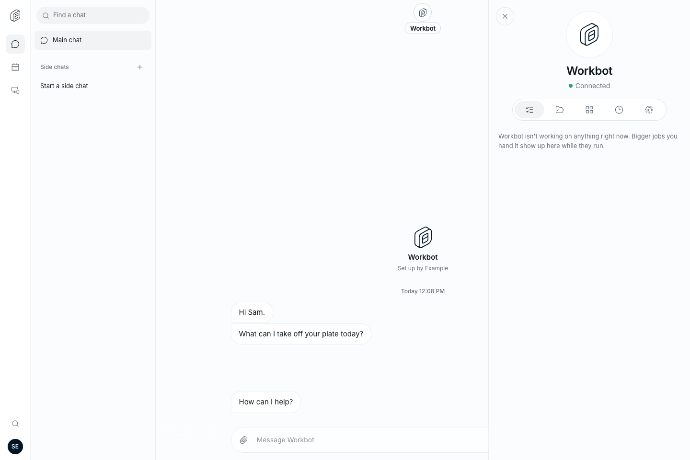
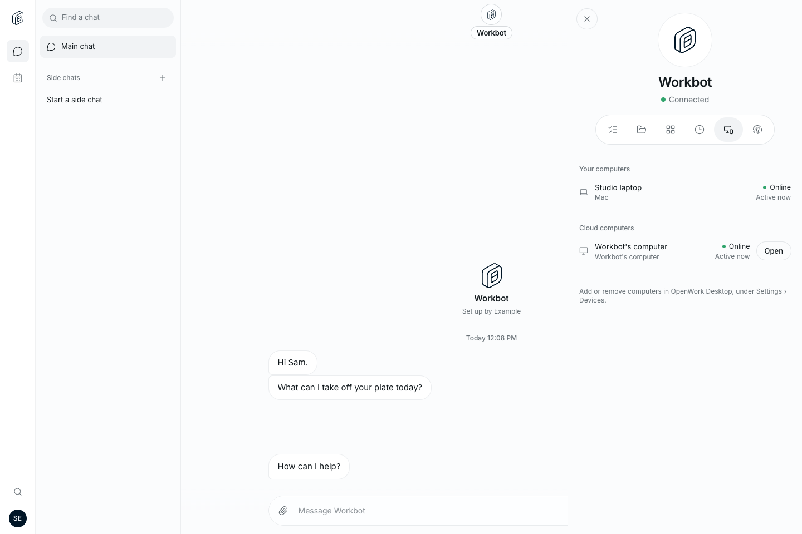
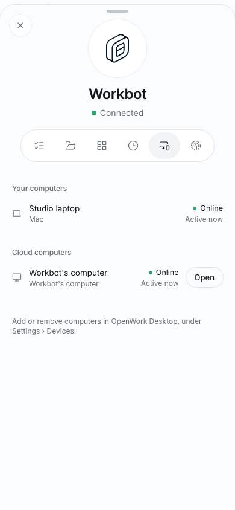
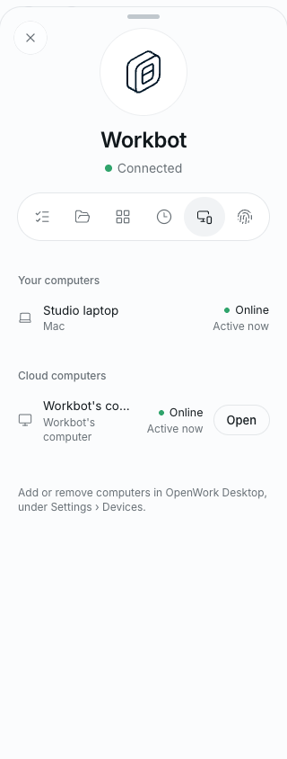

# Workbot: Computers in its profile

- Feature: `workbotProfileComputers`
- Deployments: cloud and self-hosted; default **off**
- Owner: `benjaminshafii`

With the profile sheet and Devices enabled, the existing Devices navigation entry moves into Workbot's profile as **Computers**, using the same monitor-and-device icon, selected state and arrow-key navigation as the other tabs. The centered profile has six equal-width tabs; phone and desktop use the same list.

The list is the existing member-scoped `WorkbotDevices`: loading, empty, retry, last-known data, availability and guarded Open actions are unchanged. Opening a Workbot computer closes the sheet and invokes the same chat/draft checks as the Devices page. No machine is provisioned by opening this tab. Existing `/devices` links still work.

## Try it

Enable the feature only in an isolated test organization with `remoteDevices`, `workbotProfileSheet`, `workbotWorkingStatus`, `workbotProfileNav` and `workbotCenteredProfile`. Open Workbot's profile, select Computers, and inspect the existing inventory. Check desktop and narrow phone widths, arrow keys, Home/End and Escape.

Turning the switch off restores the standalone Devices entry without changing inventory, permissions, chats or running tasks. If Devices or the profile sheet is unavailable, the move does not apply. Watch for duplicate navigation, overflow and failed inventory reads.

## UI evidence

Real Workbot React UI with deterministic fixture API responses (not live Den/runner integration):

See [verification](verification.md) for test commands, the clean-base control and limitations.
