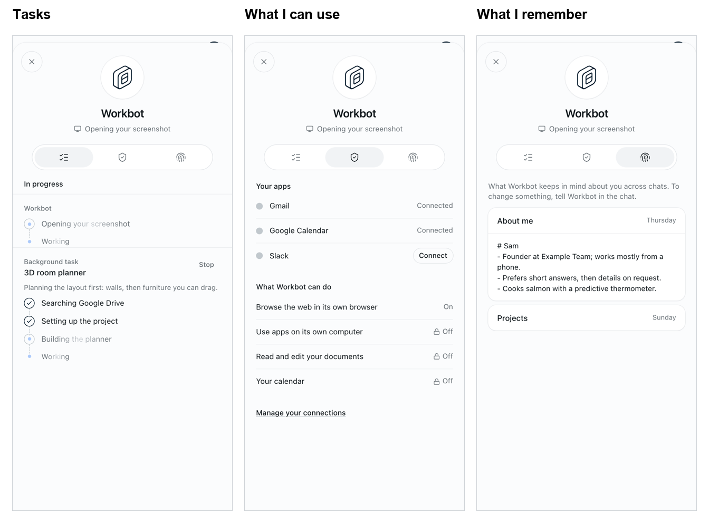

# Workbot: profile

Feature key: `workbotProfileSheet` · Deployments: cloud and self-hosted · Default: off · Author: @benjaminshafii

Needs `workbotWorkingStatus`: Den reports it on only when both are on, since the profile opens from the name that carries the status line.

## What people see

Tapping Workbot's name in the header opens its profile: the mark, its name, and whether it is at work ("Opening your screenshot") or ready. Three tabs, one at a time:

- **Tasks**: the reply in progress and each background task, with their steps, Stop and Watch (the same content as the task sheet).
- **What I can use**: the person's connected apps (Connected, or Connect where they can do it themselves), and what Workbot can do (browser, computer, documents, calendar), with off ones listed and locked rather than hidden. A link to manage connections in Den.
- **What I remember**: Workbot's memory files about the person (`memory/*.md` of their main chat, shared with side chats), newest first, read-only. To change something, they tell Workbot.

Not in this version: editing the name or avatar, a personality ("Soul") editor, browser tabs with thumbnails, and schedules.

## How it works

- Den's `GET /v1/workbot/session` returns `profileSheet`; Workbot's `/v1/workbot/me` passes it to the page.
- `GET /v1/workbot/memory` (404 `feature_disabled` without the flag) lists the runner's scratch files (`GET /v1/sessions/:id/files`), keeps `memory/*.md|txt` at the top level, and reads at most 12 files, 8,000 characters each.
- Permissions come from `GET /v1/workbot/connections` and the page's own switches; nothing new is stored.

## Turning it off

The name opens the task sheet again; `/v1/workbot/memory` answers 404. Nothing is stored by the feature.
