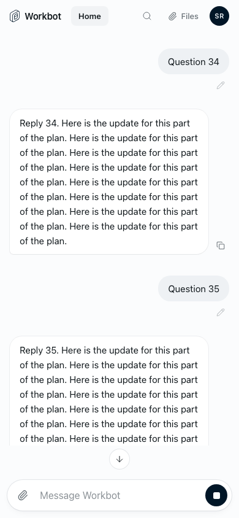

# Workbot: scroll to latest

- Feature: `workbotScrollToBottom`
- Deployments: cloud and self-hosted
- Owner: `benjaminshafii`
- Default: off

A small white down-arrow circle appears in the centre of the conversation, just
above the message box, only when the reader is more than one visible conversation
screen from the bottom. Tap it to scroll smoothly to the latest message. Reduced
motion makes the jump immediate. It fades over 150 ms and has a 44 px touch target.
Its own strip keeps it off reply text and the composer; the page respects the
phone's safe area and visual viewport when the keyboard opens.



## Try it

Enable the feature for one organization in `/admin` after the code is deployed.
Do not change the everyone rollout. Scroll up by more than a screen; the arrow
appears. Scroll closer than a screen; it disappears. Tap it from further up; the
newest message is visible, and the arrow disappears. Turning it off removes the
button without changing chat history, drafts or the reader's position. Older Den
and Workbot servers omit this field, which the client treats as off.

The scroll continuity fix is **not** behind this feature. Fresh app opens follow
the latest message after cached/fetched history, streamed replies and late cards
settle. A reader who switches chats or workspace views in the same app session
keeps their place and loaded history window (up to the existing 200-turn cap).
If new messages push the saved row outside that window while away, Workbot reads
farther back to recover the same row. Only new local sends, returning to
the bottom or the arrow deliberately resume following. Scroll positions are
memory-only and scoped to signed-in person, organization and chat; reloads start
at the newest message. Native scroll anchoring stays disabled, with one explicit
row anchor while reading and bottom-following while at the newest message.

## Verify

```sh
pnpm --filter @openwork-ee/workbot exec tsx test-fixtures/chat-screen-server.ts 3097
# In another shell, with Playwright installed in evals or PLAYWRIGHT_MODULE set:
pnpm --filter @openwork-ee/workbot test:scroll-browser
SCROLL_BROWSER=webkit pnpm --filter @openwork-ee/workbot test:scroll-browser
pnpm --filter @openwork-ee/workbot test:events
pnpm --filter @openwork/features test
```

The browser check renders the real React screen and styles with deterministic
in-memory API responses; it is not a production runner/Den integration test or a
physical iPhone test. Chromium uses phone emulation; WebKit uses the same 390 ×
844 touch viewport (its mobile mode does not expose wheel input in Playwright).
It checks cold 8→30-message loading, late reply growth, keyboard-size viewport
changes, cached/fetched replacement, late browser cards and delayed image decode,
flag-off absence, the one-screen threshold, tap-to-latest, preserved same-session
reading and reduced motion. Screenshots go to `WORKBOT_EVIDENCE_DIR`.

Watch for unexpected scroll movement, a button below/over the composer, or a
reader being pulled away when content arrives. The button is independently
killable through the existing feature system. There is no unread dot in this
initial version.
