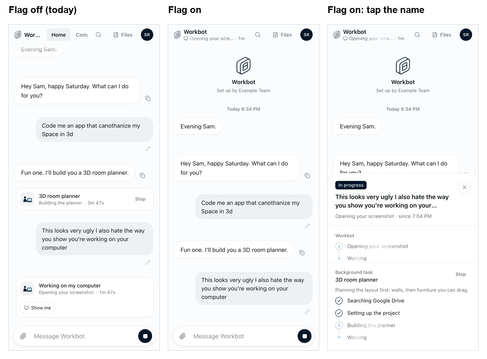
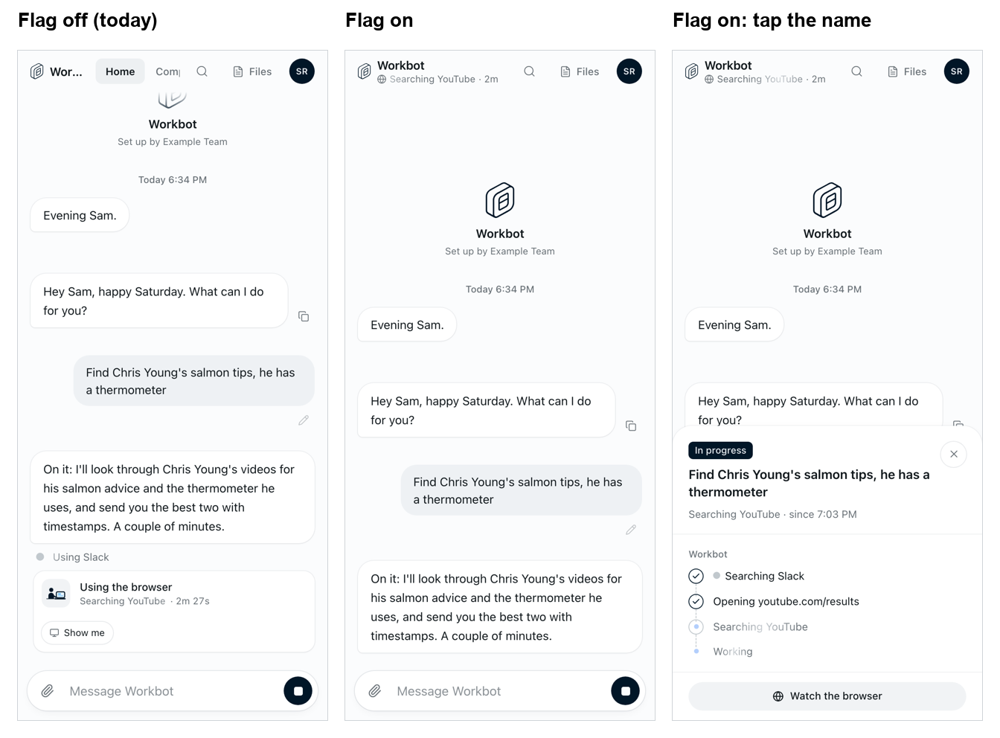

# Workbot: working status and task sheet

Feature key: `workbotWorkingStatus` · Deployments: cloud and self-hosted · Default: off · Author: @benjaminshafii

## What people see

Without the feature, Workbot's work fills the chat: typing dots for as long as a reply runs, a "Working on my computer · Show me" card for every command, a "Using the browser" card with a live preview, a "Using Slack" line, and a card per background task. Its first message is often a bare "Sure, give me a sec."

With the feature on, the chat keeps only what Workbot says, and its work is disclosed in three levels, each on request:

1. **Status line.** Under Workbot's name in the header: what it is doing now and for how long ("Searching YouTube · 2m", "3D room planner · 4m"). On a phone it takes the tabs' place while Workbot works.
2. **Task sheet.** Tapping the name: "In progress", what it's answering, then its steps with a check once done, and each background task's steps, latest note and Stop. A bottom sheet on phones, a panel under the name on wider screens.
3. **Watch.** In the sheet, when Workbot is on its browser or screen. Its screen appears in the chat only when Workbot shows it on purpose (`show: true`, e.g. the person asked to see it).

Typing dots show only before Workbot has said or done anything. A task that failed or was stopped keeps its card in the chat with Try again.

Workbot's instructions change with the flag: the first message stands on its own (what it will do, how it read the request, when they'll hear back), task titles are recognizable, and "how's it going?" is answered from the task's progress, never "still working".

## How it works

- Den's `GET /v1/workbot/session` returns `workingStatus`; Workbot's `/v1/workbot/me` passes it to the page and `createWorkbot` passes it to the instructions.
- `workbot-ui/src/activity.ts` derives the status line and sheet from the conversation the page already reads; `working-status.tsx` draws them.
- Each background task in `GET /v1/workbot` carries `steps`, `stepsDone` and `note` (thread.ts), from its own transcript and never its tools' output. A task starting a step re-reads the page at most every 3 s (events.ts).

Not behind the flag (same PR): the runner tells Workbot's model each unfinished task's current step, steps done and latest note (`tasksSection`, Slack Workbot included); the Browser and Computer views stop saying "Connecting" forever (they give up after 15 s without a picture and offer Reconnect, and say "Starting your computer" when it takes a while to answer).

## Turning it off

The next page load shows the chat as before; the next message uses the previous instructions. Nothing is stored by the feature.
