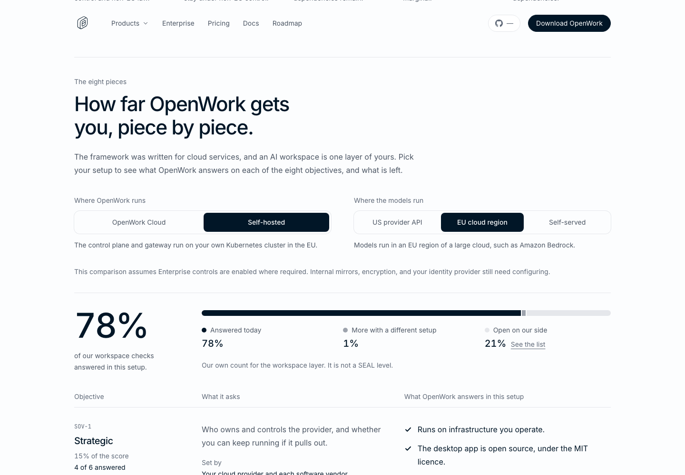
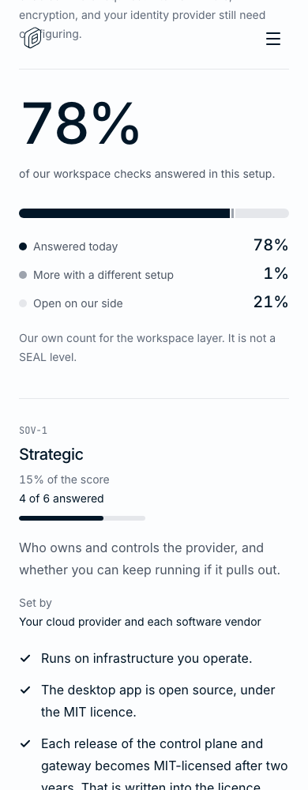
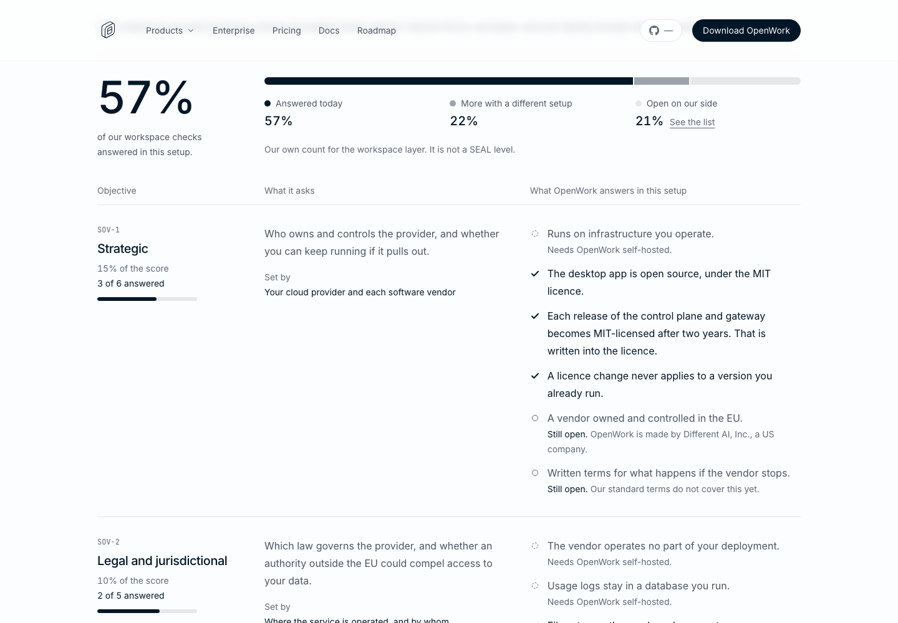
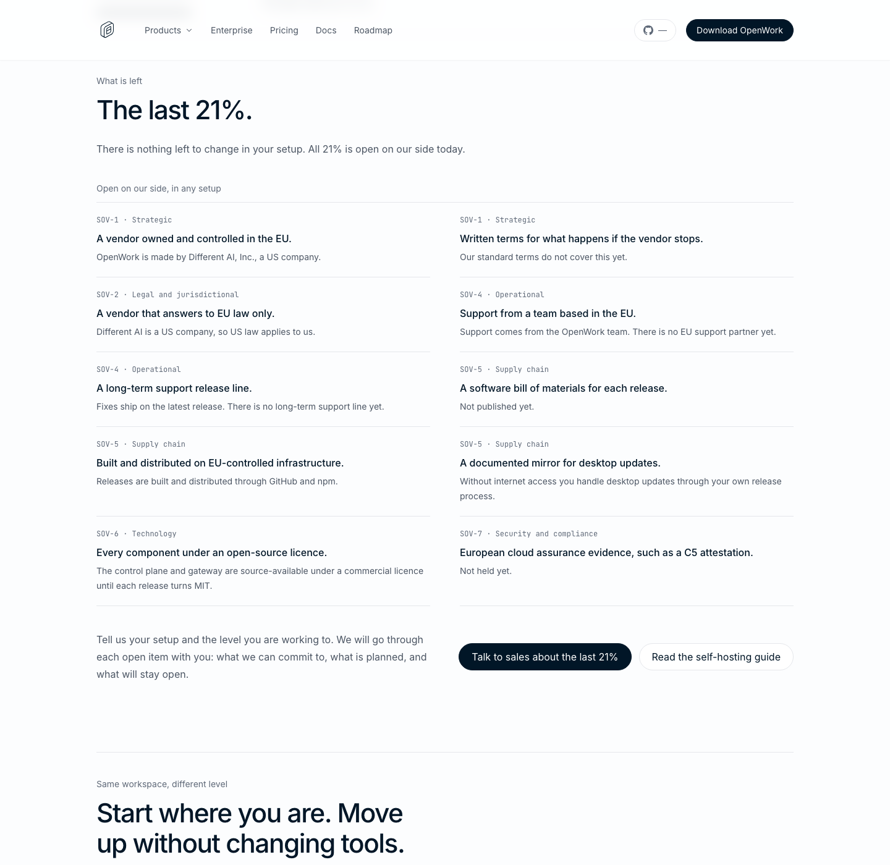

# Sovereign AI landing page

`/sovereign-ai` is an editorial field guide and an interactive workspace checklist, not a certification or a determination of a buyer's eligibility. It does not change the desktop, Den, gateway, or organization behavior; no product feature rollout is involved.

## Coverage method and limits

The 50 checks in `ee/apps/landing/lib/sovereign-ai.ts` are our own selection of workspace capabilities, grouped under the eight Cloud Sovereignty Framework objectives. Checks have equal weight inside each objective. Objective weights are 15 / 10 / 10 / 15 / 20 / 15 / 10 / 5, following framework v1.2.1, section 5. Coverage is calculated from those checks, not set to a marketing target.

This is not the framework's Sovereignty Score, a SEAL level, compliance, or a verified deployment. Adding checks changes our result. Individual gaps may be disqualifying regardless of the percentage. Infrastructure, model provider, hardware supply, and environmental evidence require separate assessment. The page states these limits in its FAQ and keeps all ten vendor gaps visible in every setup.

The default comparison assumes self-hosted infrastructure in the EU, a model in an EU cloud region, and Enterprise controls enabled where required. The self-served model option also explicitly assumes EU hardware. Mirrors, encryption, identity controls, audit recording, and other deployment configuration are not automatic merely because a reader selects an option.

## Product evidence

These are implementation/documentation pointers, not certification evidence:

| Objective | Repository sources |
| --- | --- |
| Strategic | `ee/LICENSE` (future MIT grant and prior-version licences); `packages/docs/start-here/stewardship.mdx`; root `LICENSE`; `packages/docs/start-here/self-host.mdx` |
| Legal | `packages/docs/start-here/self-host.mdx`; `packages/docs/start-here/outbound-network-access.mdx`; `docs/enterprise/outbound-access.json`; `ee/apps/landing/app/terms` |
| Data and AI | `docs/security/openwork-architecture.md`; `packages/docs/cloud/audit-logs.mdx`; `packages/docs/cloud/security-and-operations.mdx`; `packages/docs/self-host/gateway.mdx` |
| Operational | `packages/docs/start-here/enterprise-desktop-deployment.mdx`; `packages/docs/self-host/export-import-configuration.mdx`; `packages/docs/self-host/declarative-configuration.mdx`; `packages/docs/start-here/certificate-trust-and-proxies.mdx`; `packages/docs/self-host/diagnostics.mdx`; `SECURITY.md` |
| Supply chain | `packages/docs/start-here/outbound-network-access.mdx`; `packages/docs/start-here/air-gapped-deployment.mdx`; `packages/docs/start-here/installer-delivery.mdx`; `packages/docs/start-here/enterprise-desktop-deployment.mdx`; dependency manifests and lockfiles (not a complete release SBOM) |
| Technology | `ee/LICENSE`; `docs/security/openwork-architecture.md`; `packages/docs/start-here/self-host.mdx`; pinned OpenCode v2 engine's MIT licence |
| Security | Trust Center (`https://trust.openworklabs.com/`, current audit evidence must be checked there); `packages/docs/cloud/security-and-operations.mdx`; `packages/docs/start-here/self-host.mdx`; `SECURITY.md` |
| Environmental | Local desktop execution and self-hosted topology in `docs/security/openwork-architecture.md`; no claim to measure energy efficiency or emissions |

The Cloud Sovereignty Framework and proposed Cloud and AI Development Act are linked separately on the page. The latter is presented as a proposal, not enacted law. No customer deployments are identified.

## Verification

From `ee/apps/landing`:

```sh
node --test lib/sovereign-ai.test.mjs
pnpm exec tsc --noEmit -p .
pnpm exec next lint
node scripts/check-sovereign-ai-browser.mjs --base-url http://localhost:3418 --cdp http://127.0.0.1:9348 --screenshots /absolute/output/path
```

The browser check uses a dedicated tab in an existing headless Chrome, following the landing app's existing standalone browser-check pattern. It checks the route, canonical metadata, FAQ schema, sitemap, section anchors, native radio interaction and keyboard navigation, setup-change buttons, all ten persistent vendor gaps, the dynamic sales CTA, keyboard FAQ, and horizontal overflow at 1440, 1000, 768, 390, and 320px. It never submits a sales form. The unit tests independently recalculate the published method and check that setup changes cannot erase vendor gaps.

This landing application has no testkit seed/world. The standalone landing browser check and unit tests are used rather than starting an unrelated desktop or Den journey.

## Screenshots

Real rendered page, with the default and Cloud setups and the remaining gaps. Design: P7 (one focal coverage figure), S1 (flat rows and rules), C1 (specific CTA), V2 (neutral state), V6 (reduced-motion support).

### Default setup, desktop



### Default setup, mobile



### Cloud setup



### Remaining gaps


