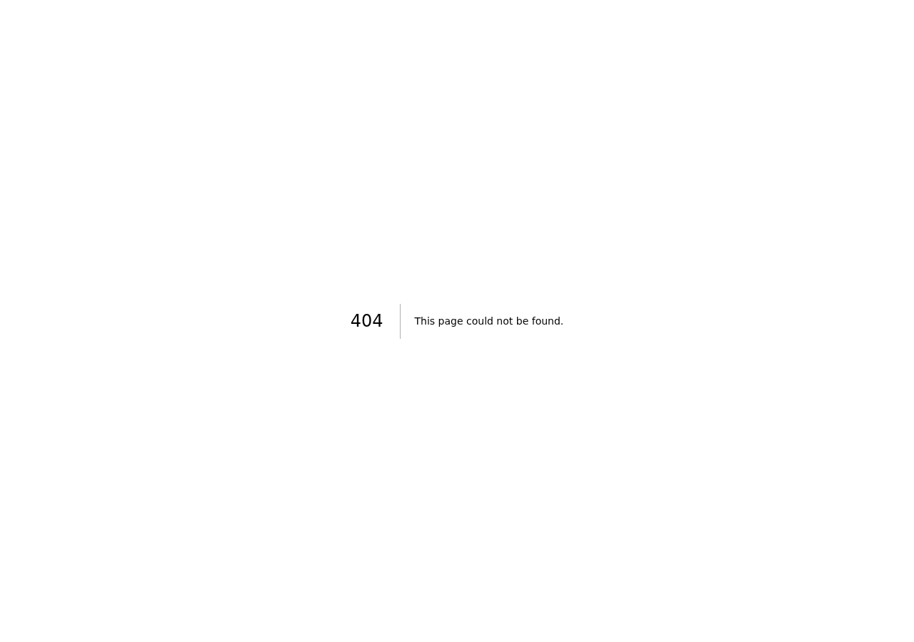
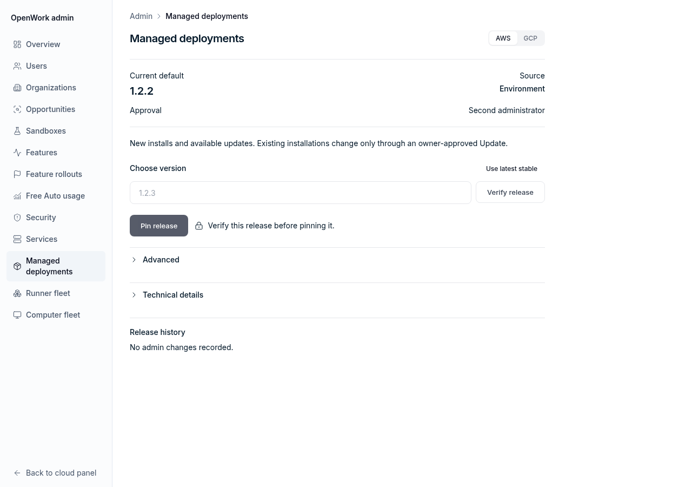

# Managed installer defaults in Admin

Platform administrators manage published installer sources and default versions at
`/admin/managed-deployments`. Organization owners still approve each installation
or version-increasing Update in their own cloud account.

## Pin a published release

1. Select AWS or GCP. **Current default** shows the effective version and whether
   it comes from Admin or the deployment environment.
2. Under **Advanced**, configure the public release folder if it could not be
   inferred from the current environment default. The folder contains one
   subfolder per installer version. It is not a credentials field.
3. Enter a stable numeric version, or choose **Use latest stable** to look up the
   latest published application release. A latest application release is not
   necessarily a published managed installer; an unpublished installer is refused.
4. Choose **Verify release**. Den reads the manifest, template and bundle from the
   supported object-storage provider, checks their hashes and image inventory,
   and resolves immutable object versions. Verification does not create cloud
   resources or count as cloud qualification.
5. Record the successful fresh-install and approved-Update qualification reports
   for those exact bytes. Choose **Pin** to attest to that qualification and make
   the verified release the default.

Verification expires. Editing the source or another administrator changing the
configuration invalidates an older preview. Refresh and verify again rather than
replaying a stale change. An older version or different bytes under the current
version cannot accidentally replace the pin.

## Approval policy

Approval is configured under **Advanced** in this same page, not in GitHub.
The safe default requires a second platform administrator: one verifies the
candidate, another reviews the qualification and pins it. The pending verified
candidate is visible to other platform administrators until it expires.

An administrator can explicitly select **One administrator** when the operating
policy permits a single administrator to verify and pin. Relaxing the policy
requires confirmation, is recorded in history and invalidates existing previews.
Changing the release source or restoring environment defaults does not silently
change this approval policy.

## What changes

A pin changes the version offered for new installations and the available Update
version. It does not rewrite deployment targets, active approval runs, installed
versions, cloud resources or customer credentials. Existing approval runs retain
their snapshotted version, URLs and checksum.

The pin, source configuration, actor, manifest hash and qualification references
are stored durably. Changes use compare-and-swap checks and an append-only history;
multiple API replicas do not rely on process-local environment mutation.

## Existing environment configuration

Without an Admin pin, the existing atomic release environment configuration (or
legacy coordinate fields) remains the default. A present invalid atomic value
continues to fail closed instead of resurrecting older legacy coordinates.

An Admin pin takes precedence over environment-backed promotion. The advanced
**Restore environment default** action explicitly returns control to the
existing environment configuration; it does not upgrade or delete any installation.
Changing an environment variable while an Admin pin exists does not replace that
pin.

## Publishing is separate

This page configures and selects already-published, immutable installer objects.
It does not upload artifacts, build application images, assume a customer cloud
role, run Terraform, create cloud resources or manufacture qualification reports.
Existing protected publisher workflows remain separate. No AWS, Google, GitHub
or Render credential is entered into this page.

## Screenshots

Before: the Admin route is absent on the base product.

The release controls show the inherited default and approval policy before any
administrator changes the configuration. Data is from an isolated test fixture.

## Deployment and verification

Apply the additive database migration before deploying the API, then deploy Den
Web. No existing installer default is changed merely by deploying this feature.
Platform-admin authorization protects every endpoint; organization owners and
members cannot read or change global release settings.

The change proof uses deterministic published-object fixtures and a real isolated
Den, database and browser. It exercises a checksum refusal, the pinning flow,
persistence after reload, unchanged pending approvals and a non-admin denial.
Those fixtures are not real-cloud fresh-install or Update qualification.
