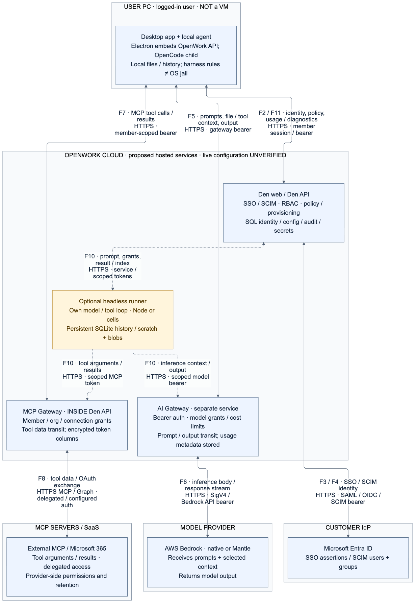
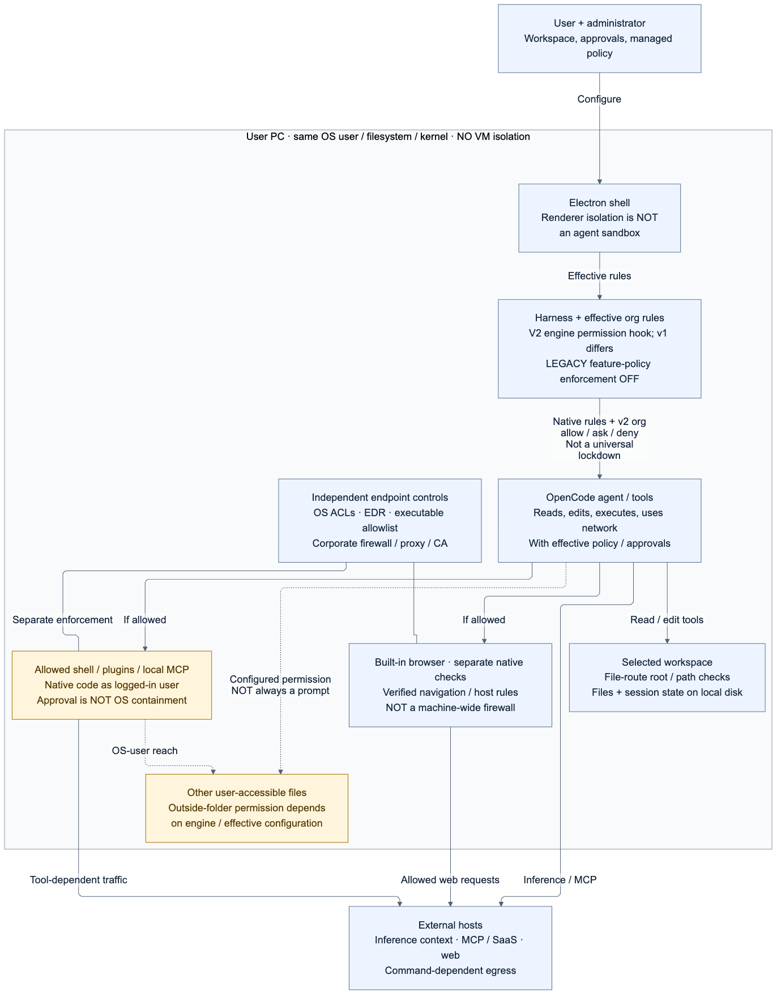

# OpenWork: security architecture and data flows

**Audience:** enterprise IT, internal audit, cybersecurity and AI-governance reviewers.

**Review date:** 2026-10-21. **Source baseline:** [`866db910ef214ce8c5d2377a662473990062acf5`](https://github.com/different-ai/openwork/tree/866db910ef214ce8c5d2377a662473990062acf5).

**Status:** draft, static code review; **not** a penetration test, production configuration attestation, contractual retention schedule or certification report.

This review covers the current Electron desktop, its local OpenCode engines, Den, AI Gateway, MCP Gateway, headless runner and full Cloud worker. The proposed operating model is **local desktop execution with an OpenWork-hosted admin/control plane**, organization-managed AWS Bedrock inference and Microsoft 365 connections. It does not require the customer to host Den or a gateway. Hosting topology, activated URLs, tenant configuration and release artifacts still require operator evidence. Repository deployment options are not proof of the live hosted configuration.[^services]

**Evidence convention:** footnotes cite repository files and source line ranges at the reviewed baseline; relative links resolve against this branch. **UNVERIFIED** means the reviewed code cannot establish the claim or the deployment has not been tested. “Supported” means implemented, not necessarily configured, entitled or enabled for an organization. Recommendations and acceptance tests below are not claims that a control is already in place.

## 1. Summary: what stays on the PC and what leaves

1. Local workspaces and local session state reside on the PC, but selected file contents, prompts, conversation context and tool results can leave in inference requests. The local agent is an ordinary OS-user process, **not a VM**.[^desktop-runtime][^inference]
2. With **organization-managed AI Gateway**, inference goes **PC → OpenWork AI Gateway → Bedrock** and returns through the gateway; it does not bypass OpenWork. Gateway request accounting stores identity/model/usage/cost metadata, not prompt/response bodies in its normal request-log schema.[^inference][^usage]
3. With **OpenWork-managed MCP/Microsoft 365**, tool arguments and results go **PC → Den/MCP Gateway → MCP server or Microsoft Graph** and back. Den handles decrypted delegated tokens; SaaS content may then enter subsequent model context and local/cloud history.[^mcp-runtime][^microsoft]
4. Hosted identity/configuration is **not the only other outbound data**: there are account/team/policy data, integration credentials, usage telemetry, startup diagnostics, conditional PostHog/Sentry reporting, downloads and updates. The analytics preference is not a demonstrated global telemetry-off switch.[^telemetry][^downloads]
5. Optional headless/Cloud execution, workflows and remote handoff expand server-side processing and persistence to prompts, results, files and/or conversation-derived titles. Do not represent those modes as “everything stays on the PC.”[^cloud-content][^headless][^remote-desktop]

### Corrections to common assumptions

| Assumption | Source-grounded answer |
|---|---|
| “Only SSO and configuration ever reach OpenWork.” | **Incorrect** with managed inference/MCP and the operational paths above. Distinguish content **transit**, content **storage**, mandatory usage accounting and optional analytics. |
| “Inference goes only from the PC to the chosen provider.” | **Incorrect for managed Gateway.** Gateway terminates the request and applies upstream credentials. Direct local-provider configurations are a different path. OpenWork Models/Auto can use a different upstream, including OpenRouter; a Bedrock-only design must deliberately exclude unwanted alternatives.[^inference][^models-path] |
| “MCP traffic goes only to the MCP server.” | **Incorrect for Den-managed connections.** Den is an application-layer proxy; OAuth discovery/token services can also be separate hosts. Direct local MCP is a distinct option.[^mcp-runtime][^mcp-network] |
| “Authorized folders are a hard filesystem sandbox; outside access always prompts.” | **Too strong.** Folder grants and engine rules are application controls. Effective config can allow outside access, and an allowed shell/plugin acts with the user's OS privileges.[^folders][^approvals] |
| “All admin desktop restrictions are active on every engine.” | **Incorrect at this baseline.** Legacy desktop feature-policy enforcement is suspended; newer org agent-permission enforcement is v2-specific. Details and offline limitations are in §5.[^legacy-policy][^agent-policy] |

## 2. Component inventory and trust boundaries

| Component | Runs where / separate service? | Data received, stored and sent | Implemented controls and important limits |
|---|---|---|---|
| Desktop UI / shell | User PC. **Electron** main + Chromium renderer processes. The current desktop imports the OpenWork server **in the Electron main process**; it is not a required privileged daemon. Historical Tauri packaging is not the current architecture.[^desktop-runtime] | Local UI/settings/workspace references; Den session; local API credentials; HTTP calls to local engine/server and hosted services. | Context isolation and no renderer Node integration, but main renderer sets `sandbox: false`. Distribution-specific sign-in/activation gates; not OS filesystem containment.[^local-interfaces][^legacy-policy] |
| Local OpenCode engine | User PC; native **child process**, v1 or v2. Pinned versions are v1 `1.18.30` and v2 `2.0.26`. New installs select v2; existing profiles retain their selection unless explicitly changed.[^desktop-runtime] | Prompts, responses, selected file data, tool results and runtime state. Sends inference/MCP/tool traffic. | Native permission system plus v2 org permission hook. Same logged-in OS user; no VM/chroot in reviewed launch paths. V2 uses a restricted inherited environment/private provider-session fd; v1 inherits more environment.[^agent-policy][^engine-env] |
| Den web | OpenWork-hosted in proposed model; separate web app (`ee/apps/den-web`). Can also be customer-hosted, but that is **not** this proposal.[^services] | Sign-in/admin UI; organization, member, team, provider, policy and connection configuration. Browser telemetry can be proxied same-origin. | Server-backed permissions; IdP SSO; configuration of optional controls is required. Web frontend is not the ultimate authorization boundary.[^identity][^den-rbac][^telemetry] |
| Den API / control plane | OpenWork-hosted API (`ee/apps/den-api`), distinct from web and AI Gateway; shares its process with MCP and background loops.[^services][^mcp-runtime] | Identity/SSO/SCIM attributes, config/grants, encrypted selected secrets, session/cache data, usage/audit/diagnostics; optional workflow/assistant/remote-command content. | Organization/member authorization and permission catalog; selected-column AES-GCM; tenant isolation is application-layer in a shared schema, not per-tenant DB/process/key.[^den-rbac][^encryption][^cloud-content] |
| AI Gateway | OpenWork-hosted **separate deployable** (`ee/apps/gateway`). Not `den-gateway`. Uses Den DB/schema and deployment encryption material.[^services] | Full inference request/response transiently; server-held upstream credentials; durable metadata accounting. | Member bearer key, model-group/credential-set grants, live membership/access recheck, usage admission, guarded upstream egress. Not end-to-end encryption hiding inference from OpenWork.[^inference][^model-access][^bedrock] |
| MCP Gateway | `/mcp/agent` and connection surfaces **inside Den API**, not an independently isolated service.[^mcp-runtime] | Tool discovery, arguments/results, OAuth/API credentials, scope/account metadata; best-effort usage records. | Token issuer/audience/use/scope/liveness + membership and connection grants; shared or per-member credentials; HTTPS/public-address egress guard. Ordinary external argument-schema warnings are advisory, not a universal pre-execution rejection.[^mcp-auth][^connector-secrets][^mcp-network] |
| Headless runner | Optional OpenWork-hosted **separate agent runtime**, with Node/SQLite or cell-hosted SQLite implementations (`ee/apps/headless-runner`). **Not an OpenCode subprocess.**[^headless] | Durable prompts, message bodies/tool results, scratch files, optional blobs; encrypted resume grant; per-turn model/MCP credentials. | Trusted service bearer, scoped per-turn capabilities; cell owner/session checks and internal HMAC. Shared Node service is not an OS sandbox per tenant. Optional remote computers can run bash.[^headless] |
| Full Cloud/Web worker + browser edge | Optional remote worker runs OpenWork server + managed OpenCode; separate `ee/apps/den-gateway` proxies browser sessions. Current member Cloud contract uses Daytona; backend/lifecycle are configured.[^cloud-worker] | Cloud workspace/files, engine DB/history, checkpoints, tokens and activity metadata. Stop/pause is not data deletion. | Den ownership/entitlement resolution, worker tokens, signed-expiring public endpoint, persistent volume subpaths. Internal worker listens on `0.0.0.0`; it is not the desktop loopback boundary. Worker tokens are an exception to selected-column encryption.[^cloud-worker] |

### Rendered architecture

[SVG](diagrams/architecture-data-flow.svg) · [Mermaid source](diagrams/architecture-data-flow.mmd). This overview shows the **proposed managed route**, with optional headless execution; it does not imply all inference must use Gateway. See the [detailed alternatives diagram (PNG)](diagrams/architecture-detailed.png), [SVG](diagrams/architecture-detailed.svg) and [Mermaid](diagrams/architecture-detailed.mmd) for direct providers, OpenWork Models/OpenRouter, full Cloud workers/browser edge, and conditional external telemetry/downloads. First-party usage/diagnostics go to Den, separately from external analytics/error reporting.

Solid arrows describe implemented managed paths, **not proof that the proposed tenant has them configured**. Dashed arrows are conditional features. The MCP node is separated for clarity but shares the Den API process. Cloud storage, logs and internal legs are detailed below rather than inferred from the box boundary. “OpenWork Cloud” includes hosting/storage subprocessors; it does not imply OpenWork-owned physical infrastructure.

## 3. Network and data-flow register

Responses travel back over the initiating connection unless indicated. Public configured HTTPS protects transport to the endpoint; the endpoint process can read plaintext. **UNVERIFIED:** live TLS versions/ciphers, edge-to-service encryption, inter-service mTLS, WAF/proxy body logging, infrastructure routes and actual deployed certificates. Reviewed code does not establish ubiquitous mTLS.[^services][^mcp-network]

| ID | Direction / data | Protocol / authentication | Storage / control boundary |
|---|---|---|---|
| F1 | Renderer ↔ Electron/local OpenWork API ↔ engine: prompts/history, file operations, approvals, config and tool execution | IPC and plain loopback HTTP. OpenWork bearer scopes/host token; engine random Basic-auth credentials. UI-control bearer is separate; CDP is an important exception (§4). | PC state; no TLS on loopback. Server is embedded in main; engine is a child. Loopback does not exclude other local processes/users.[^desktop-runtime][^local-interfaces] |
| F2 | PC/browser ↔ Den: login handoff, member/org/team identity, policy, library, model/connection config | HTTPS; member session/bearer. Handoff exchanges grant for token/user/org; `openwork://` is a local OS handoff, not an inbound internet listener. | Den DB/cache; local session token. Sign-in and provider/integration OAuth are distinct credentials.[^identity][^hosted-network][^local-secrets] |
| F3 | Browser ↔ Entra ↔ Den: SSO assertions/codes; Den ↔ OIDC issuer: metadata, token/JWKS/userinfo | HTTPS, SAML signed assertions or OIDC code/client auth; configured callback origins. SAML and OIDC callbacks can use different origins. IdP MFA/conditional access is upstream, not native OpenWork MFA proof. | Den identity/config and external attributes. Verified/tested/enabled SSO and optional enforced SSO must be configured.[^identity][^sso-network] |
| F4 | **Entra provisioning service → hosted Den**: Users/Groups/lifecycle updates; responses back | HTTPS SCIM v2, `application/scim+json`, SCIM bearer. Not employee-PC outbound traffic. | Token hash in encrypted column; user/group metadata and lifecycle state. `metadata_only` group default; team creation/mapping opt-in; delivery/retry delays matter.[^scim][^sso-network] |
| F5 | PC engine → AI Gateway: model request, prompt/context (possibly files, MCP outputs, images), tool schemas; streamed/nonstreamed response back | HTTPS configured Gateway public URL; `ow_gw_` member bearer; native provider routes or model aliases. | Gateway sees body in memory; must record accounting before egress, then recheck access. No body columns in normal request-log schema.[^inference][^usage] |
| F6 | AI Gateway → AWS Bedrock: inference body/model; output/usage back | HTTPS native Converse or Mantle; SigV4 with stored AWS keys/temporary role credentials, or supported Bedrock API-key bearer mode. | Upstream credentials remain server-side in this path. AWS account/region/credential mode and provider retention are deployment-specific.[^bedrock] |
| F6a | Den/Gateway → AWS IAM Identity Center/STS; browser → returned AWS verification page | HTTPS device authorization/refresh; role-credential exchange; SigV4 STS account check. Separate from Den Entra SSO. | Member OAuth/refresh secrets encrypted; short-lived role credentials cached in memory. No reviewed ambient AWS task-role/default-chain implementation in this route.[^bedrock][^aws-network] |
| F7 | PC engine or external MCP client → Den MCP Gateway: search, arguments, results, resource data | HTTPS MCP; scoped member token/OAuth JWT with issuer/audience/use/liveness/membership checks. Headless opaque run-token exception is bounded. | Den processes tool plaintext; connection and tool policy/grants applied. Native capabilities re-enter Den REST with an **in-process** `app.fetch`, not a network hop to `den-api.local`.[^mcp-runtime][^mcp-auth] |
| F8 | Den → external MCP, authorization server or Graph: arguments/results, delegated tokens, code/refresh exchange | HTTPS MCP/REST/OAuth; OAuth+PKCE, configured API key or no-auth connector. Native M365 uses tenant-scoped delegated OAuth and Graph bearer. | Selected token fields AES-GCM; metadata ordinary columns. Shared connector mode uses a shared upstream identity, not necessarily the invoking user's identity. Graph/OneDrive content can redirect to other storage hosts.[^connector-secrets][^microsoft][^mcp-network] |
| F9 | Conditional other inference: PC → direct configured provider; or Gateway → OpenRouter for OpenWork Models/Auto | Provider-dependent API/OAuth; configured transport. Managed Models default upstream is HTTPS OpenRouter with server key; managed requests add member/request trace identifiers. | Not automatically the organization's Bedrock account. Direct BYOK and managed Models are different data paths; do not silently combine their assurances.[^models-path][^hosted-network] |
| F10 | Optional Den/MCP → headless/Cloud runtime: prompts, control, model/MCP grants; results/index/callbacks back; optional desktop runner **polls outward** for remote work | Headless HTTPS except loopback development; service bearer plus scoped run/resume/index grants. Cloud uses service/worker tokens and signed endpoints; internal transport varies. Registered desktop handoff uses audience/time-bound runner credentials, not an inbound tunnel. | Content can persist in runner SQLite/blobs, worker volumes/checkpoints and Den command/results/title stores. No automatic claim that every turn is human-approved.[^headless][^cloud-worker][^remote-desktop] |
| F11 | PC → Den usage/startup diagnostics; conditional PC → PostHog/Sentry; web/API/Gateway → configured observability/export services | HTTPS; Den member auth; PostHog publishable project key; Sentry DSN/project transport. Backend stdout collectors are deployment-level. | Account/session/usage/build/error metadata; survey answers can be user-entered; error text may be sensitive. Distinct gates and retention (§7).[^telemetry][^logs] |
| F12 | PC → release/download/package/catalog services: manifests, model catalog, binaries/assets/packages | HTTPS; public feeds; updater signing/checksum controls are separate from TLS. Optional chain repair may fetch HTTP(S) AIA certificate URLs. | Download/cache/installed binaries and local logs. Channel/artifact and actual redirects require validation.[^downloads][^tls] |
| F13 | PC tools/browser/shell/plugins/local MCP → configured/user-approved hosts | Tool-dependent: HTTPS is not guaranteed for arbitrary user code or a custom local server. | Application website rules are not a device firewall. OS/firewall/application-control policy must bound general egress.[^folders][^agent-policy][^mcp-network] |
| F14 | Den/AI Gateway → shared DB/cache and storage/logging backends | PlanetScale HTTP driver or MySQL; MySQL TLS depends on connection parameters. Remote Redis requires `rediss` unless explicit insecure-internal override. No universal internal mTLS claim. | Selected-column encryption, **not** whole-database encryption. Live storage/backup/log encryption, residency and network access are **UNVERIFIED**.[^encryption][^services] |

## 4. Desktop machine-access model

[SVG](diagrams/desktop-machine-access.svg) · [Mermaid source](diagrams/desktop-machine-access.mmd).

### Identity, authorized folders and approvals

- **Execution identity:** ordinary child processes inherit the launching OS user's authority. No VM/container/changed UID/chroot appears in the reviewed local launch paths. Do not run elevated for ordinary work. OS ACLs/privacy controls and endpoint enforcement remain the hard boundary; a compromised same-user process or an authorized arbitrary command is not contained by the workspace label.[^desktop-runtime]
- **Folder authorization:** the UI adds `permission.external_directory` allow patterns, including potentially broad roots. Effective permission inspection merges engine defaults → global config → OpenWork-injected config → workspace config, with last-match behavior. Its no-rule `ask` fallback does **not** prove every real engine action prompts; broader effective rules may allow it.[^folders]
- **Run modes:** `approve` writes catch-all `ask`; `run-everything` writes catch-all `allow`, preserving narrower rules; `default` removes the catch-all. These are permission configurations, not stronger/weaker VMs. The exact pinned engine's complete built-in defaults were not independently source-audited here: **UNVERIFIED**.[^approvals]
- **Different approval systems:** OpenWork API mutation approval defaults manual in standalone server but desktop passes **`approvalMode: "auto"`**. That is separate from runtime engine tool approvals. The tool UI supports once/always/reject; thread “always” approvals persist/replay, and collaborator API credentials can approve requests. An agent-supplied Microsoft send/delete confirmation boolean is not independent proof of a human approval.[^approvals][^microsoft]
- **Path checks are surface-specific:** open-with-default-app uses realpath containment; the reviewed HTTP file helper uses lexical resolve/prefix checks. Universal symlink/race-safe confinement across file APIs, shell, plugins and MCP is **UNVERIFIED**; do not generalize one route's checks to the machine.[^folders]
- **Local code:** approved shell commands, interpreters, native plugins and local MCP subprocesses can affect user-accessible files/processes/network. Shell parsing and tool permissions are not semantic confinement of arbitrary scripts or a syscall policy. Browser navigation restrictions do not constrain unrelated processes or remote SaaS effects.[^agent-policy]

### Local listeners and authentication

| Interface | Binding / port | Authentication / residual concern |
|---|---|---|
| Embedded OpenWork server | Desktop explicitly `127.0.0.1`; sticky available/dynamic fallback port. Standalone defaults `127.0.0.1:8787`, but operator can rebind. | Bearer owner/collaborator/viewer scopes and host credential. Some public health/static metadata; desktop CORS `*` is not authentication. No loopback TLS.[^local-interfaces] |
| Managed OpenCode | Loopback; v1 configured/selected port, v2 OS-selected port. | Random Basic-auth credentials; direct engine endpoint is not automatically protected by every OpenWork proxy check.[^local-interfaces] |
| UI-control HTTP bridge | `127.0.0.1`, dynamic port | Random 32-byte bearer except public health. Discovery JSON contains raw token under userData; privileged renderer control interface.[^local-interfaces] |
| Chromium CDP | Probes **9223–9227** or positive configured remote-debugging port; `127.0.0.1` | Not gated to dev builds in reviewed startup. No OpenWork application bearer check shown for this endpoint. Actual Chromium handshake/cross-user protections and production exposure need targeted validation; **not all local control ports are token-authenticated**.[^local-interfaces] |

### Local credentials and encryption

The **managed local MCP OAuth vault** uses AES-256-GCM and an OS-protected key via Electron `safeStorage`; Linux `basic_text` is refused. A configured `OPENWORK_ENCRYPTION_KEY` is a separate operator-held override. The vault's unencrypted index still exposes server/connection/status metadata.[^local-secrets]

This protection is **not universal**: desktop `openwork-server-tokens.json` writes raw client/host/owner credentials, Den session uses renderer localStorage, UI-control discovery contains a raw token, and runtime SQLite has no application encryption in the reviewed implementation. Whole-disk encryption, profile ACLs and protection from other same-user software are therefore material controls. The reviewed v2 launch restricts inherited environment; v1 inherits much more. Neither prevents all same-user file/process access.[^local-secrets][^engine-env]

### Installation, update and executable trust

- Current packaging is Electron/electron-builder, Windows NSIS and macOS DMG/ZIP. macOS hardened runtime/notarization and Windows signing code/workflows exist; exact downloaded artifact signature/notarization must be checked. macOS entitlements do **not** declare App Sandbox. Signing/notarization is provenance/integrity, not a workspace sandbox.[^signing]
- `electron-updater` selects feeds by distribution/channel; defined downgrade cases exist. Do not promise all updates are monotonic upgrades or require no elevation. TLS interception compatibility does not replace artifact signature verification.[^downloads][^signing]
- [PR #6335](https://github.com/different-ai/openwork/pull/6335) is **open/unmerged at review time**, not part of this baseline. Its [Windows evidence](https://github.com/different-ai/openwork/pull/6335#issuecomment-6329709153) and [versioned install note](https://github.com/different-ai/openwork/blob/7574a0ee9e/docs/install-without-admin-rights.md) support non-admin **public x64 v0.18.59 installation/removal on a clean Windows Server 2025 VM**, not an unconditional managed Windows/macOS lifecycle claim. First launch failed; same-user reinstall later reached the composer; update **check** passed, but actual update download/apply/restart was not tested. Uninstall left profile/workspace/handler residue. Enterprise flavor, Windows 10/11 with endpoint controls, and macOS non-admin flow remain **UNVERIFIED** by that evidence.
- No privileged daemon/driver is required by the reviewed normal local engine launch. User-writable install/profile directories, executable allowlisting, EDR, corporate TLS and optional macOS privacy permissions still matter. CrowdStrike/zero-trust allowlisting compatibility is **UNVERIFIED** until tested on the actual managed image; no exclusion or bypass is recommended here.[^desktop-runtime][^signing]

## 5. Administration and effective policy enforcement

### Do not confuse policy storage/UI with active enforcement

**Legacy desktop feature-policy enforcement is explicitly suspended**: `DESKTOP_POLICY_ENFORCEMENT_ENABLED = false`. Execution policy is stripped from the runtime projection. The old settings/workspace/extensions/terminal/command-blocklist/upload/approved-origin code is not evidence those legacy features are enforced today. Model access, distribution-required sign-in and allowed desktop versions are separate exceptions.[^legacy-policy]

The **new agent-permission system** has families `shell`, `edit`, `webfetch`, `websearch`, `skill`, `mcp`. V2 injects rules and an evaluation hook that cannot make an org decision less restrictive. V1 explicitly does not enforce that new engine mapping, despite a shared-type comment saying “both engines.” Native browser and install checks have separate paths. A strict deployment must pin/verify the engine and test switching/downgrade paths before relying on these controls.[^agent-policy]

| Control | Implemented behavior | Limitation / acceptance requirement |
|---|---|---|
| Shell allow/ask/block and patterns | V2 parses composed command syntax and tightens effective engine decision. Blocked file edits also generate deny-all shell because commands can edit files. | Best-effort syntax inspection, not proof arbitrary scripts/interpreters cannot perform an equivalent effect. Some org deny rules map to native `ask` with plugin final denial; missing plugin fallback is not the same as an immutable native deny.[^agent-policy] |
| Local skills / MCPs | V2 category restrictions, plus install-path checks. Org-registered MCP name **and URL** are exempt from local-MCP switch. | Not a claim that all organization connectors are blocked or that native code already loaded is OS-contained.[^agent-policy] |
| Website rules | Main-process built-in-browser hooks cover navigation/redirects/frames/request paths; engine `webfetch`/search have applicable v2 rules. | `about`/`data`/`blob` are exceptions in browser network check; shell, other browsers, remote MCP/computer effects are not a device-wide firewall.[^agent-policy] |
| Model access | Gateway validates active org/member/key/provider/group/set/grant; supports member/team/org audience and pre-egress recheck. Local “only provided models” filter is separate. | Local last-known model filter permits when no restrictive policy known, exempts `opencode` provider and is not immutable enrollment. Server Gateway authorization is the stronger managed-inference boundary.[^model-access][^policy-lifecycle] |
| Policy refresh / offline | Authenticated `/v1/me/desktop-config`; UI refresh about every **5 minutes** plus events; last-known same-sign-in policy can support offline work. | No instantaneous revoke guarantee. Sign-out clears policy; cache is explicitly not enrollment. Cold-start/unreachable Den and offline behavior need restrictive-policy tests.[^policy-lifecycle] |
| Den RBAC | Owner, direct/inherited Admin and Member defaults plus authoritative team permission sets; sensitive management can be explicitly delegated. Default SSO/SCIM/API-key management is owner-only. | API authorization, not just UI hiding. Privileged-session recency is **2 hours**, not the public doc's 15 minutes; API keys skip it and internal MCP has fresh-session semantics. This is not per-action MFA.[^den-rbac] |
| Model grants | Model groups plus credential sets with member > team > org selection; ambiguous equal-priority credential sets require explicit choice. Provider empty model-policy list means catalog-all; empty group means none. | No permission inferred solely from model alias or provider existence. Newly appearing models do not automatically join an existing group's creation snapshot.[^model-access] |
| Cost limits | Configurable per-member estimated spend policies, org/team assignment and provider override; day/week/month windows reset at 05:00 UTC. Effective selection favors the highest allowance; usage remains accounted with no limit policy. | No assigned policy means unlimited admission. Team assignment creates member buckets, not one shared pool. Settled-spend checks can overshoot with concurrent work; LiteLLM per-user budget is delegated to LiteLLM.[^cost] |
| Audit | Structured Den actions, identity/outcome/resource/policy metadata; selected security alerts. Capture/entitlement/category gates apply. | Not every desktop tool or external MCP effect is proven audited. Read capture off by default in pilot; no WORM guarantee, configured SIEM drain or functioning audit-retention cleanup established.[^audit] |

### Identity and upstream authorization are separate

Entra SAML/OIDC supports verified domains, test/enable lifecycle, safe JIT **Member** role, signed SAML assertions and timestamp/algorithm policy. Generic IdP `role`, `groups` or `admin` attributes do not automatically confer OpenWork Admin. SCIM default is metadata-only groups; team sync and an approved Admin-team designation are separate decisions. Offboarding depends on event delivery, processing/retry and currently valid credentials, not an immediate universal kill switch.[^identity][^scim]

Bedrock supports shared server-held AWS credentials/API key or **per-member IAM Identity Center** connection. Den Entra sign-in is not itself an AWS API credential. Shared AWS credentials appear as a shared AWS principal; per-person CloudTrail attribution requires member AWS credentials **and** customer CloudTrail setup. Already-issued role credentials can outlive an IAM assignment change. No reviewed ambient ECS/EC2 role-chain path is asserted.[^bedrock]

Microsoft 365 uses delegated tenant-configured OAuth and enabled feature scopes. Den checks connection use/feature/scope, and Graph enforces the delegated account's upstream access. Shared external MCP mode can instead use one stored service identity. These are not interchangeable with SSO, SCIM or inference credentials.[^microsoft][^connector-secrets]

## 6. Network allowlist and TLS inspection

### Fixed destinations versus deployment-specific endpoints

**This is a source-derived manifest, not an operationally complete wildcard list.** The exact Gateway origin, Sentry host, Entra dependencies, AWS region and Microsoft storage redirects are not all constants. Obtain them from activated runtime/provider config, the shipped artifact and the actual tenant before issuing the firewall change. Default external HTTPS below is TCP **443**; local loopback ports are separate. Avoid blanket `*.amazonaws.com`, `*.microsoft.com` or internet-wide approval.[^hosted-network][^aws-network][^mcp-network]

| Caller | Exact source-known origin / endpoint | Required for / qualification |
|---|---|---|
| PC / user's browser | `https://app.openworklabs.com/`, `/api/auth/*` | Canonical hosted sign-in/admin UI. Deep-link `openwork://` is an OS scheme.[^hosted-network] |
| PC / engine | `https://api.openworklabs.com`: `/v1/*`, `/api/auth/*`, `/mcp/agent` | Canonical hosted API/config/Connect. Sign-in uses `POST /v1/auth/desktop-handoff/exchange`; config uses `GET /v1/me/desktop-config`. Public OAuth/well-known/register/token routes must pass, not only MCP POST.[^hosted-network][^mcp-network] |
| PC, mixed/unpinned clients only | `https://api.app.openworklabs.com` | Actual renderer fallback exists; alias DNS/TLS/availability **UNVERIFIED**. Use active `apiBaseUrl`, not guesswork. Do not misclassify canonical `api.openworklabs.com` as legacy.[^hosted-network] |
| PC / engine | **UNVERIFIED exact origin:** returned Gateway public base (`GATEWAY_PUBLIC_BASE_URL`), `/api/v1/models`, `/api/v1/providers/{id}/…`, native `/api/v1/…` routes | Required managed Bedrock inference. Do not assume `models.openworklabs.com` or the free Auto origin is this gateway.[^hosted-network][^inference] |
| PC / engine; Den separately | `https://models.openworklabs.com/api.json` | Default model **catalog**, not prompt endpoint. Override/cached-offline behavior needs testing. `models.dev` is not automatically needed on the PC for this default.[^hosted-network] |
| Browser | Configured Entra entrypoint; commonly `https://login.microsoftonline.com/{tenant}/…` plus actual MFA/frontend dependencies | SSO and M365 browser consent. Exact IdP/CDN/MFA endpoint set is tenant-specific; use its published manifest.[^sso-network][^microsoft] |
| Entra provisioning → hosted Den | `${BETTER_AUTH_URL}/api/auth/scim/v2/{Users,Groups,…}` | **Inbound to hosted Den**, not PC egress. Allow SCIM methods/content type and noninteractive bearer auth through any access gateway.[^sso-network] |
| Browser / Entra → Den | SAML `${BETTER_AUTH_URL}/api/auth/sso/saml2/sp/acs/{providerId}`; metadata `/api/auth/sso/saml2/sp/metadata?providerId=…`; OIDC `${API_PUBLIC_URL ?? BETTER_AUTH_URL}/api/auth/sso/callback/{providerId}` | Use values actually advertised. SAML ACS permits POST; web/API origins can differ. Den also needs issuer discovery/token/JWKS/userinfo egress.[^sso-network] |
| **Hosted AI Gateway** | `https://bedrock-runtime.{region}.amazonaws.com/model/{encodedModelId}/converse` and `/converse-stream` | Native managed Bedrock. Gateway, **not PC**, needs this access. Region must be substituted with approved exact value.[^aws-network] |
| Hosted AI Gateway | `https://bedrock-mantle.{region}.api.aws/openai/v1` | Only if separate Mantle provider selected; not needed for native Converse.[^aws-network] |
| Hosted Den/Gateway; browser verification separately | `https://oidc.{ssoRegion}.amazonaws.com/{client/register,device_authorization,token}`; `https://portal.sso.{ssoRegion}.amazonaws.com/federation/credentials`, `/logout`; `https://sts.{region}.amazonaws.com/`; returned verification/start URL | Conditional member IAM Identity Center. Exact browser URL comes from configured AWS flow; validation suffixes are **not** wildcard firewall recommendations.[^aws-network] |
| **Hosted Den** | `https://login.microsoftonline.com/{tenantId}/oauth2/v2.0/{authorize,token}`; `https://graph.microsoft.com/oidc/userinfo`; `https://graph.microsoft.com/v1.0` | Native M365 OAuth/API. Default commercial cloud; national-cloud configuration is not proven by this list. Microsoft content may redirect to tenant storage/download hosts: **UNVERIFIED exact host set**, obtain current Microsoft manifest and observed tenant destinations.[^microsoft][^mcp-network] |
| Hosted Den, and browser for consent | Configured external MCP HTTPS URL **plus** protected-resource/authorization metadata, registration, authorize/token/refresh endpoints | Only selected connections. OAuth can require more hosts than the MCP URL; private/customer VPN/browser cookie access is not inherited by hosted Den.[^mcp-network] |
| PC | `https://github.com/different-ai/openwork/releases/latest/download/*`, versioned `/releases/download/v{version}/*`, selected distribution/alpha feeds; `release-assets.githubusercontent.com`, possible `objects.githubusercontent.com` | Installation/update/recovery. Redirect CDN paths dynamic; source inventory records them, but live redirects not re-probed in this review. Preserve large/range downloads; distribution manifest must match.[^downloads] |
| PC | `https://us.i.posthog.com/batch/` (host override possible) | Optional desktop analytics; default preference true. Den-web `/ow` is same-origin proxy and separately reaches regional PostHog backend; blocking desktop PostHog does not stop all telemetry.[^telemetry] |
| PC / each hosted service | **UNVERIFIED exact host:** shipped/configured Sentry DSN → project envelope endpoint | Conditional observability. Extract from packaged `openwork-sentry.json` / deployment DSN; do not guess a subdomain or permit all `*.sentry.io`.[^telemetry] |
| PC → API base | `POST /v1/telemetry/ingest`, `POST /v1/diagnostics/desktop-startup` | First-party usage/diagnostics; no PostHog-preference gate demonstrated. Blocking whole API to suppress these breaks core functionality.[^telemetry][^logs] |
| PC, conditional | `https://registry.npmjs.org`, package-defined tarball/download hosts | Packaged `npx -y openwork-ui-mcp` fallback / selected package MCP/plugins. Preseed/mirror policy must be tested. Package scripts can expand egress.[^downloads] |
| PC, optional | `https://inference.openworklabs.com` | Free Auto inference, not required for a deliberately Bedrock-only design; override/disable controls exist.[^hosted-network] |
| PC, optional | `cdn.simpleicons.org`, `www.google.com`; configured BYOK/model/MCP/browser/tool destinations | Cosmetic icons/new-tab or explicitly selected capabilities. Not a minimal Bedrock/M365 control-plane requirement. `ghcr.io` is a self-hosted container-pull concern, not a hosted workstation runtime requirement.[^downloads] |
| PC, certificate-dependent | AIA CA-Issuers URL from peer certificate, **HTTP 80 or HTTPS 443** | Optional bounded chain repair. Prefer complete served chains/provisioned CA bundle rather than broad HTTP egress. Can disable repair.[^tls] |

### TLS interception, custom CAs and zero-trust constraints

- No leaf/SPKI certificate-pinning mechanism was identified in the reviewed first-party desktop/MCP transports. That is **not an exhaustive assurance about every bundled binary/SDK**. Updater signing identity, OAuth resource/issuer binding and SigV4 are not TLS certificate pinning.[^tls][^downloads]
- Electron external fetch uses Chromium trust/proxy. Windows roots are collected from LocalMachine/CurrentUser Root and CA stores; macOS collection uses system keychains, **not the user login keychain**. Explicit `NODE_EXTRA_CA_CERTS` is supported and takes precedence over auto-export. A root bundle augments Node and is passed to children; v2 forwards certificate env fields.[^tls]
- The Chromium fallback is restricted to authority-invalid chains with hostname, validity, EKU, CA/signature and trusted-anchor checks; not blanket certificate-error disabling. Optional repair fetches intermediates and validates them. Exact enterprise-root/revocation-policy parity remains **UNVERIFIED**.[^tls]
- **Proxy support is runtime-specific:** v2's environment allowlist does **not** forward `HTTP_PROXY`, `HTTPS_PROXY`, `ALL_PROXY`, `NO_PROXY`. Do not assume OS/PAC, 407 integrated auth, Chromium, Bun/OpenCode, Sentry, npm, backend fetch and Gateway direct `https.request` behave identically.[^tls][^engine-env]
- Managed inference rejects redirects and binds guarded DNS results to its connection; managed MCP normally requires public HTTPS and validates redirects. A browser-only zero-trust challenge is not machine/API authentication. No general client-certificate provisioning path for arbitrary MCP mTLS was established.[^mcp-network][^aws-network]
- Gateway standard Bedrock names resolving to private IPs fail default public-address egress guard unless exact-origin operator exception exists. There is no automatic route from OpenWork-hosted Gateway into the customer's private VPC/VPN. Private endpoint connectivity is **UNVERIFIED**, not a required customer-hosted component.[^aws-network]
- Preserve authorization/challenge/MCP-session headers, SAML POSTs, OAuth queries, cookies and streaming bodies. Do not rewrite AWS-signed host/path/body/auth headers. Do not force `Cross-Origin-Opener-Policy: same-origin` on the sign-in handoff; the web code explicitly avoids breaking the IdP popup/opener flow.[^tls]
- TLS inspection can itself see prompts, tokens, SaaS data and files. Compatibility with CrowdStrike and the chosen allowlisting/TLS inspection stack must be tested on the managed endpoint with controls **enabled**, not inferred from CA support or a clean VM test.

## 7. Storage, encryption, logs and retention

**No blanket “zero retention,” “all encrypted,” “30-day deletion” or data-residency guarantee follows from this source review.** Location means the logical store identified in code, not a verified country/region. Separate content, credentials, operational metadata, provider-side history and backups.

| Data class / logical location | Code-grounded behavior | Retention / encryption qualification |
|---|---|---|
| Local workspaces, runtime SQLite, engine history/profile | User PC; ordinary local filesystem/SQLite; engine DB/config paths configured. | No universal local session TTL or app-level full DB encryption established. User/MDM deletion and device/backup encryption policy required.[^desktop-runtime][^local-secrets] |
| Local managed OAuth vault | PC encrypted vault + OS-protected key; separate plaintext metadata index | AES-GCM applies to vault payload, not every local token. Raw local API tokens and renderer Den token are separate (§4).[^local-secrets] |
| Local logs/audit | Startup log 256 KiB plus `.1`; server file log default 20 MiB plus `.1`; workspace JSONL audit | Size rotation, not age-based universal erasure; local JSONL audit has no TTL in inspected implementation. Redaction is not proof all sensitive free text is absent.[^logs] |
| Den identity/config/session/cache | Shared SQL; optional Redis caches include user/session/IP/user-agent context | Ordinary identity/session columns are not all app-encrypted. Redis transport conditional; retention, backup, region and live full-storage encryption **UNVERIFIED**.[^encryption] |
| Den provider/SSO/connector secrets | Selected SQL columns: AES-256-GCM under deployment `DEN_DB_ENCRYPTION_KEY` | Shared deployment key, not demonstrated per-tenant KMS/automatic rotation. Gateway key has encrypted retrievable copy + hash; SCIM token hash is in encrypted column. Den decrypts integration/provider secrets in memory.[^encryption][^connector-secrets] |
| Gateway request accounting | SQL attribution, upstream/model/group/grant, usage/tokens/cost/status/time/byte metadata; no normal body column | Rollup defaults raw **2 days**, hourly **90 days**, then daily aggregates. Requires functioning caller/job; Helm retention off by default. Thresholds are eligibility, **not hard maximum lifetime**; no daily-aggregate expiry established.[^usage] |
| First-party usage telemetry / startup diagnostics | Den org/member/session dimensions; startup build/platform/status/duration records | Generic telemetry TTL not established. Startup diagnostics have **30-day threshold with opportunistic bounded pruning**, not global deletion SLA.[^telemetry][^logs] |
| PostHog / Sentry / hosted logs / optional analytics exports | Distinct desktop/web/backend reporting and configured external services | Preference/gates differ. Sentry errors/breadcrumbs can contain sensitive text despite `sendDefaultPii:false`. Provider retention, collector settings, regions and actual DSNs **UNVERIFIED**. Optional task analytics excludes prompt/output/tool-body content; mandatory accounting is separate.[^telemetry][^usage] |
| Den operation audit | Structured action/principal/resource/outcome/policy, not intended body capture | Entitlement/category-dependent. Pilot says retention **preview only**, no scheduled cleanup/deletion or configured drains. No WORM or automatic SIEM delivery claim.[^audit] |
| Workflow/assistant/remote handoff data | Workflow encrypted input/result/rendered output; optional assistant encrypted queue/context/output; desktop remote command/receipt/progress state | These are content paths, not only SSO/config. Contractual retention/backups and complete content minimization **UNVERIFIED**.[^cloud-content][^remote-desktop] |
| Headless histories / scratch / blob files | Node or cell SQLite stores prompt/message/scratch content; local blob store writes bytes, S3 adapter signs requests | No app-level transcript/blob encryption in inspected store; provider/disk encryption **UNVERIFIED**. Segment offload is not deletion; orphan cleanup eligibility 24h is not conversation TTL. No universal chat lifetime established.[^headless] |
| Den headless session index | SQL includes **plaintext title** as well as IDs/state/sizes/retention/legal-hold labels | Admin projection omits title, but storage is not literally “content-free.” Columns/labels do not prove a retention worker or legal-hold enforcement.[^headless-index] |
| Cloud worker volumes/checkpoints/tokens | Persistent workspace/data subpaths; checkpoints include engine DB and workspace; engine `auth.json`/logs excluded, not all secrets | Stop/pause retains data; auto-delete default can be `-1`. Worker client/host/activity tokens use ordinary SQL varchar columns. Live volume/backup encryption, purge/rotation/residency **UNVERIFIED**.[^cloud-worker] |
| Bedrock / Graph / external MCP provider records | External provider receives supplied content/credentials under its service model | Upstream retention, model-training use, CloudTrail, tenant logs and regional processing need provider contract/config evidence. Not established by this repository. |

## 8. Governance evidence and unresolved items

### Evidence to collect before enterprise approval (recommendations)

1. **Freeze the operating profile:** desktop release/hash/distribution/engine; local versus optional cloud/headless; activated web/API/Gateway URLs; allowed model groups/credential mode; authorized MCP/Graph scopes; telemetry/update/package policy.
2. **Demonstrate the proposed route:** successful Gateway→approved Bedrock account/model/region; packet/proxy evidence of PC egress; verify no unintended Auto/OpenRouter/direct-provider fallback. Keep test content non-sensitive.
3. **Prove authorization/revocation:** negative cross-org/member/team tests; disabled provider/grant; Entra SSO enforcement, MFA, SCIM deactivate/group removal, stale sessions and existing AWS temporary credentials; verify no automatic privilege from IdP attributes.
4. **Prove desktop constraints on the shipped v2 build:** outside-folder read/write, symlinks, shell/interpreter/child-session rules, blocked websites including redirects, local skills/MCPs, offline cold start/sign-out, run-everything and engine switching. Review loopback/CDP exposure and same-user threat model.
5. **Validate the actual managed endpoint:** standard-user install, first launch, sign-in, Bedrock stream, M365 read/write/download with approved scope, CA/inspection/PAC/407, EDR/app allowlist, full update download/apply/restart and uninstall/data cleanup. No security-agent exclusions assumed.
6. **Obtain operational evidence:** subprocessor/region inventory; deployment TLS/internal network and at-rest/backup encryption; key custody/rotation; log sampling/redaction; actual jobs and deletion/backups/legal-hold schedule; SIEM coverage and retention; restore/incident procedures.

### Top open questions / UNVERIFIED

| Priority | Item requiring evidence / decision |
|---|---|
| P0 | **Tenant configuration:** actual hosted Gateway public origin, region, Bedrock family, shared versus member AWS credentials, IAM policy/model scope, all alternative inference paths. Implementation exists; customer setup/live delivery is not attested. |
| P0 | **Policy guarantee:** suspended legacy features and v1/v2 difference; pinning/upgrade/downgrade and tamper/offline behavior. Do not sell a blanket enforced desktop lockdown from the old policy UI. |
| P0 | **Endpoint isolation:** local CDP without demonstrated app bearer gate, token file/profile access, direct engine APIs, symlink-safe file confinement and arbitrary allowed code. Which same-user/local-adversary risks does the customer accept? |
| P0 | **Hosted storage/transport:** production topology, internal encryption/mTLS, at-rest encryption/keys/backups, regions, plaintext worker-token exposure and rotation, deletion completion. Repo docs/config are not a live attestation. |
| P1 | **Actual network manifest:** Gateway and Sentry hosts, API alias fleet usage, Entra/MFA dependencies, Microsoft download redirects, selected MCP/OAuth hosts and optional AIA paths. No safe exhaustive fixed list exists before configuration. |
| P1 | **Audit completeness and retention:** external MCP usage is not demonstrated comprehensive security audit; pilot audit deletion/drains unimplemented; exact telemetry/content/log/backups lifetime and SIEM integration. |
| P1 | **Managed-device compatibility:** CrowdStrike + application allowlisting + TLS MITM on customer Windows/macOS image, and real non-admin first-launch/update lifecycle. PR #6335 is narrow evidence, not complete acceptance. |
| P1 | **Provider commitments:** Bedrock/model-provider data use/training/retention, Microsoft tenant boundaries, connector shared identities, IAM/SCIM propagation and in-flight credential lifetime. |

### Trust Center and certification evidence

The repository links the hosted [Trust Center](https://trust.openworklabs.com/) and the website labels SOC 2 Type II/audit complete.[^trust] That confirms a **published representation**, not the audit period, scope, exceptions, legal entity or current report. **TODO:** obtain the actual SOC 2 report and bridge letter/scope as appropriate through the approved Trust Center process. **ISO 27001: UNVERIFIED; TODO request certificate, scope and validity if claimed.** No certification is inferred from implementation code or a badge.

## 9. Existing diagrams/docs that need correction or qualification

This review does not silently revise those documents. The following should not be sent as unqualified current architecture/security evidence:

| Existing source | Verified issue / current evidence |
|---|---|
| [`docs/enterprise/outbound-access.json`](../enterprise/outbound-access.json#L49) | Calls `api.openworklabs.com` legacy/optional; canonical desktop bootstrap/SDK uses it. Runtime renderer fallback alias also exists, so derive active origin rather than replace one blanket assertion with another.[^hosted-network] |
| [`docs/desktop-app-policies.md:121`](../desktop-app-policies.md#L121) | One-hour refresh description differs from current five-minute UI refresh. More fundamentally, old broad feature enforcement is suspended; new agent permissions are separate.[^legacy-policy][^policy-lifecycle] |
| [`packages/types/src/den/agent-permissions.ts:3–7`](../../packages/types/src/den/agent-permissions.ts#L3) | “Both engines” comment conflicts with v2 mapping's explicit statement that v1 does not enforce those org rules.[^agent-policy] |
| [`docs/opencode-engine-migration.md:8`](../opencode-engine-migration.md#L8) | Blanket v1-default statement needs profile qualification: fresh installs select v2; existing profiles retain selection.[^desktop-runtime] |
| [`packages/docs/cloud/security-and-operations.mdx:61`](../../packages/docs/cloud/security-and-operations.mdx#L61) | Says 15-minute privileged session; code uses two hours and machine-principal exceptions. Hosted HA/PlanetScale backup claims elsewhere on this page need live infrastructure/vendor evidence, not only source review.[^den-rbac][^encryption] |
| [`ee/apps/headless-runner/README.md` opening diagram/overview](../../ee/apps/headless-runner/README.md#L1) | One Node process/no shell/no VM overview is not universal: cell hosting, blob stores and opt-in remote computers/bash exist. Later sections acknowledge options; the entire README is not thereby invalid.[^headless] |
| [`headless-session-index.ts` “content-free” description](../../ee/packages/den-db/src/schema/headless-session-index.ts#L4) | Actual schema/writer persists plaintext conversation title. Admin response omission is narrower than storage omission.[^headless-index] |
| [`docs/features/models-task-analytics/README.md` Mermaid figure](../features/models-task-analytics/README.md#L30) | Original figure still shows Models/Activity/Consumption UI. Its own October status notice says those screens/settings routes are removed and collector stays off; historical diagram is not current UI/retention proof.[^analytics-history] |
| [`docs/remote-chat-over-mcp-architecture.md`](../remote-chat-over-mcp-architecture.md#L1) | Marked proposal and uses indicative capability/automation naming. Current session offloading has registered-target/session-runner contracts and durable content receipts; use implementation and newer offloading doc, not proposal-only promises.[^remote-desktop] |
| [`ee/apps/den-worker-runtime/README.md`](../../ee/apps/den-worker-runtime/README.md#L3) | Legacy Render build instructions are not the whole current member Cloud architecture (Daytona contract + shared bootstrap).[^cloud-worker] |
| [`capability-credentials.ts` ownership/metadata comments](../../ee/packages/den-db/src/schema/sharables/capability-credentials.ts#L224) | Unqualified shared/admin-only/extraneous client-token comments are not authoritative for current per-member persistence/limited member creation. Actual encrypted fields and current writer govern.[^connector-secrets] |
| [`audit/routes/types.ts` external MCP coverage comment](../../ee/apps/den-api/src/audit/routes/types.ts#L79) | Service-audit assertion needs targeted confirmation: traced external capability/proxy path records best-effort usage, not the full native-route audit wrapper.[^audit] |

A root `ARCHITECTURE.md` is absent at this baseline. [`apps/app/src/react-app/ARCHITECTURE.md`](../../apps/app/src/react-app/ARCHITECTURE.md) is a current UI-layer guide, not a complete deployment/security diagram. Related local repositories `different-ai/opencode-browser` (`9d1b2130c2b807796a609f4ca974725096d31aa0`) and `different-ai/opencode-scheduler` (`d6947dcb0ef52d507f46d0e39631d3a2559f54b2`) were checked: their plugin/broker/native-host and launchd/systemd implementations are distinct from this checkout's integrated Electron browser/automation paths. No direct references to those package names were found in current `apps/`; their diagrams/defaults must not be projected onto all current desktops.[^related]

## Source evidence

Footnotes group related implementation paths; line numbers are for the baseline above. They support the associated statements, not uninspected deployments or every third-party dependency.

[^services]: [Helm service inventory and Gateway deployment contract](../../packaging/helm/openwork-ee/README.md#L3) (3–13, 60–88, 111–117); [Gateway configuration](../../ee/packages/utils/src/gateway-env.ts#L40) (40–106); [separate browser/runtime gateway](../../ee/apps/den-gateway/src/app.ts#L75) (75–107); [Gateway readiness](../../ee/apps/gateway/src/app.ts#L62) (62–71). Internal HTTP is allowed by configuration; live hosted service count/topology is not verified.
[^desktop-runtime]: [Electron entry/build](../../apps/desktop/package.json#L11) (11–23); [embedded server import/start](../../apps/desktop/electron/runtime.mjs#L1936) (1936–1996); [v1 child launch](../../apps/server/src/managed-opencode.ts#L151) (151–192); [v2 child launch](../../apps/server/src/managed-opencode-v2.ts#L334) (334–348, 416–439); [fresh-install selection](../../apps/desktop/electron/runtime.mjs#L269) (269–292); [pinned versions](../../constants.json).
[^engine-env]: [v1 inherited environment](../../apps/server/src/managed-opencode.ts#L165) (165–179); [v2 allowlist and private fd](../../apps/server/src/managed-opencode-v2.ts#L359) (359–374, 416–439).
[^inference]: [Gateway routing/body checks](../../ee/apps/gateway/src/gateway.ts#L132) (132–153, 205–309); [credential/admission/egress and forwarding](../../ee/apps/gateway/src/gateway.ts#L955) (955–1012, 1106–1108); [member bearer middleware](../../ee/apps/gateway/src/middleware/gateway-auth.ts#L15) (15–30); [native API contract](../../ee/apps/gateway/README.md#L89) (89–153).
[^usage]: [request log schema](../../ee/packages/den-db/src/schema/inference.ts#L196) (196–242); [write-ahead and completion](../../ee/apps/gateway/src/request-log.ts#L216) (216–274, 296–341); [metadata reporting scrubbers](../../ee/apps/gateway/src/inference-reporting.ts#L48) (48–137); [rollup retention defaults](../../ee/apps/gateway/src/rollups.ts#L78) (78–107); [retention off by default](../../packaging/helm/openwork-ee/values.yaml#L323) (323–346); [consented analytics](../../ee/packages/telemetry/src/models-analytics.ts#L15) (15–65); [analytics body minimization](../../ee/apps/gateway/src/task-analytics.ts#L20) (20–90).
[^models-path]: [OpenRouter default](../../ee/apps/gateway/src/env.ts#L98); [managed inference rewrite/trace and forwarding](../../ee/apps/gateway/src/proxy.ts#L491) (491–504, 558–584, 665–709, 747–764, 855–889).
[^bedrock]: [Bedrock credential families](../../ee/packages/utils/src/inference-credentials.ts#L25) (25–31); [AWS provider credential resolution](../../ee/apps/gateway/src/provider-credentials.ts#L78) (78–111, 124–223); [Bedrock destination/auth](../../ee/apps/gateway/src/gateway.ts#L181) (181–202, 243–260, 997–1004, 1084–1103); [SigV4](../../ee/apps/gateway/src/credentials/aws-sigv4.ts); [AWS SSO flow/account validation](../../ee/apps/den-api/src/llm/inference-provider-aws-sso.ts#L33) (33–107); [role cache](../../ee/apps/gateway/src/credentials/aws-sso-role-credentials.ts#L10) (10–74); [AWS refresh](../../ee/apps/gateway/src/credentials/oauth-refresh.ts#L156) (156–170).
[^model-access]: [live model/credential grants](../../ee/apps/gateway/src/provider-access.ts#L26) (26–71, 101–179); [model policy/group semantics](../../ee/apps/gateway/README.md#L64) (64–87); [Gateway member-key liveness](../../ee/apps/gateway/src/keys.ts#L53) (53–64).
[^cost]: [usage-limit API semantics](../../ee/apps/den-api/src/routes/org/gateway-usage-limits.ts#L34) (34–41); [member and assignment queries](../../ee/packages/den-db/src/gateway-usage-read.ts#L48) (48–111); [admission](../../ee/apps/gateway/src/usage-limits.ts#L28) (28–100); [LiteLLM exception](../../ee/apps/gateway/src/gateway.ts#L961) (961–977); [provider-limit availability](../../ee/packages/den-db/src/gateway-usage-features.ts#L3) (3–9).
[^den-rbac]: [authoritative resolver](../../ee/apps/den-api/src/permissions/resolve.ts#L173) (173–242); [permission defaults](../../packages/types/src/den/permissions.ts#L176) (176–211, 289–338); [org context guard](../../ee/apps/den-api/src/middleware/organization-context.ts#L21) (21–110); [privileged-session two-hour gate/exceptions](../../ee/apps/den-api/src/privileged-session.ts#L3) (3–8, 57–77); [invitation/role assignment](../../ee/apps/den-api/src/organization-access.ts#L64) (64–128).
[^identity]: [SAML/OIDC configuration/discovery](../../ee/apps/den-api/src/sso.ts#L21) (21–48, 97–180); [SSO plugin and stored attributes](../../ee/apps/den-api/src/auth.ts#L1737) (1737–1790); [SAML policy](../../ee/apps/den-api/src/sso-saml-policy.ts); [safe JIT role](../../ee/apps/den-api/src/sso-jit.ts#L1) (1–13); [verified domain routing](../../ee/apps/den-api/src/enterprise-auth-requirement.ts#L63) (63–128); [optional requireSso](../../ee/apps/den-api/src/organization-limits.ts#L34) (34–45); [Entra issuer helper](../../ee/apps/den-api/src/sso-entra-domain.ts#L1) (1–18).
[^scim]: [SCIM plugin](../../ee/apps/den-api/src/auth.ts#L1705) (1705–1735); [token hash/constant-time verification](../../ee/apps/den-api/src/scim-token-storage.ts#L4) (4–51); [encrypted hash and group default](../../ee/packages/den-db/src/schema/auth.ts#L338) (338–346); [mapping options](../../ee/apps/den-api/src/routes/org/scim.ts#L43) (43–92); [lifecycle/retry/identity fields](../../ee/apps/den-api/src/scim.ts#L27) (27–31, 64–66, 106–155); [approved Admin-team/delivery caveats](../../packages/docs/cloud/members-and-rbac.mdx#L107) (107–119).
[^encryption]: [AES-GCM selected-column helper](../../ee/packages/den-db/src/columns.ts#L12) (12–105); [Gateway/provider encrypted fields](../../ee/packages/den-db/src/schema/inference-providers.ts#L86) (86–177); [ordinary session/account columns](../../ee/packages/den-db/src/schema/auth.ts#L22) (22–54) and [SSO encrypted fields](../../ee/packages/den-db/src/schema/auth.ts#L385) (385–392); [DB clients](../../ee/packages/den-db/src/client.ts#L150) (150–183); [MySQL TLS parameters](../../ee/packages/den-db/src/mysql-config.ts#L13) (13–50); [session cache data](../../ee/apps/den-api/src/cache.ts#L44) (44–65); [Redis transport](../../ee/apps/den-api/src/env.ts#L408) (408–416, 688–690). Schema column type alone does not establish how an auth library hashes passwords; no plaintext-password claim is made.
[^mcp-runtime]: [Den app surfaces](../../ee/apps/den-api/src/app.ts#L285) (285–311); [shared server/background loops](../../ee/apps/den-api/src/server.ts#L2) (2–37); [agent authentication](../../ee/apps/den-api/src/mcp/agent.ts#L490) (490–499, 1272); [handler](../../ee/apps/den-api/src/mcp/agent-http.ts#L122) (122–155); [in-process native invocation](../../ee/apps/den-api/src/mcp/invoke.ts#L72) (72–163); [external tool forwarding](../../ee/apps/den-api/src/mcp/external-connection-proxy.ts#L196) (196–236, 426–448).
[^mcp-auth]: [token claims/liveness/membership](../../ee/apps/den-api/src/mcp/auth.ts#L394) (394–498); [bounded headless-token exception](../../ee/apps/den-api/src/mcp/headless-run-token.ts#L1) (1–20); [connection access](../../ee/apps/den-api/src/mcp/external-connection-proxy.ts#L508) (508–528); [external write scope/advisory schema](../../ee/apps/den-api/src/mcp/external-capabilities.ts#L1442) (1442–1494, 1537–1569).
[^connector-secrets]: [credential ownership/encrypted fields/grants](../../ee/packages/den-db/src/schema/sharables/capability-credentials.ts#L33) (33–115, 224–257, 287–335); [current credential runtime](../../ee/apps/den-api/src/capability-sources/external-mcp-client-runtime.ts#L35) (35–71); [OAuth persistence bindings/transactions/refresh](../../ee/apps/den-api/src/capability-sources/enterprise-mcp-oauth-persistence.ts#L205) (205–258, 544–615, 727–909); [client JSON exclusions](../../ee/apps/den-api/src/capability-sources/enterprise-mcp-oauth-persistence.ts#L164) (164–167, 381–393); [restricted member creation route](../../ee/apps/den-api/src/routes/org/mcp-connections.ts#L3077); [OAuth response binding](../../packages/enterprise-mcp-client/src/authorization-response.ts#L33) (33–110).
[^microsoft]: [OAuth registry/scopes](../../ee/apps/den-api/src/capability-sources/provider-registry.ts#L86) (86–121); [signed state/PKCE callback](../../ee/apps/den-api/src/routes/org/oauth-providers.ts#L217) (217–254, 650–722); [refresh/current member](../../ee/apps/den-api/src/capability-sources/generic-oauth.ts#L427) (427–559); [argument/confirmation/scope checks](../../ee/apps/den-api/src/routes/org/microsoft-365.ts#L72) (72–87, 140–151, 173–180, 213–278, 325–460); [Graph client/redirects/mail/files](../../ee/apps/den-api/src/capability-sources/microsoft-graph.ts#L388) (388–469, 473–548, 570–631, 705–711); [headless tool results into model messages](../../ee/apps/headless-runner/src/mcp.ts#L61) (61–108, 159–168) and [model input](../../ee/apps/headless-runner/src/model.ts#L13) (13–19).
[^folders]: [external-directory grants](../../apps/server/src/server.ts#L2606) (2606–2678); [effective permission merge/fallback](../../apps/server/src/effective-permissions.ts#L1) (1–10, 78–88, 122–155); [open-file realpath checks](../../apps/desktop/electron/workspace-file-access.mjs#L23) (23–77); [lexical HTTP path helper](../../apps/server/src/routes/files.ts#L182) (182–192, 580–594, 1015–1035); [ordinary read/write/root defaults](../../apps/server/src/config.ts#L316) (316–338).
[^approvals]: [workspace modes](../../apps/server/src/workspace-run-mode.ts#L20) (20–35, 102–136); [API manual/auto approval](../../apps/server/src/approvals.ts#L28) (28–64); [desktop API auto mode](../../apps/desktop/electron/runtime.mjs#L1960) (1960–1969); [tool approval UI](../../apps/app/src/react-app/domains/session/chat/permission-approval-modal.tsx#L220) (220–239); [persistent thread approval](../../apps/server/src/thread-approvals.ts#L1) (1–16, 56–107, 151–155); [collaborator approval authority](../../apps/server/src/server.ts#L706) (706–725).
[^legacy-policy]: [suspended enforcement and exceptions](../../packages/types/src/den/desktop-policies.ts#L3) (3–44); [inactive execution rules](../../apps/server/src/managed-policy-rules.ts#L12) (12–21); [model-only enforcement branches](../../apps/server/src/managed-desktop-policy.ts#L212) (212–217, 269–284, 369–370); [distribution sign-in/activation](../../apps/desktop/electron/desktop-distribution.mjs#L1) (1–48).
[^agent-policy]: [v2-only mapping](../../apps/server/src/agent-permission-engine.ts#L1) (1–5, 28–69, 84–143, 158–179, 238–375); [rule families/default/ordering](../../packages/types/src/den/agent-permissions.ts#L32) (32–37, 66–152, 542–617); [v2 plugin tightening/MCP controls](../../apps/server/src/opencode-plugins/openwork-agent-permissions-v2.ts#L32) (32–65); [hook wiring](../../apps/server/src/engine-v2-preview.ts#L1007) (1007–1019); [main browser request policy](../../apps/desktop/electron/browser-panel.mjs#L274) (274–298, 2138–2158).
[^policy-lifecycle]: [policy identity/offline/signout/model behavior](../../apps/server/src/managed-desktop-policy.ts#L85) (85–111, 124–210, 269–308, 326–367); [cleared persisted policy](../../apps/server/src/runtime-opencode-config-store.ts#L591) (591–602); [five-minute refresh](../../apps/app/src/react-app/domains/cloud/desktop-config-provider.tsx#L79) (79–82).
[^local-interfaces]: [desktop binding/port](../../apps/desktop/electron/runtime.mjs#L1549) (1549–1566, 1902, 1932–1969); [API token scope/guard](../../apps/server/src/server.ts#L2379) (2379–2447, 1105–1122, 1148–1169); [engine auth](../../apps/server/src/managed-opencode.ts#L151) (151–170, 282–283) and [v2 auth](../../apps/server/src/managed-opencode-v2.ts#L147) (147, 334–348, 416–425); [UI-control auth/discovery](../../apps/desktop/electron/ui-control-server.mjs#L23) (23–25, 61–75, 129–140, 227–241); [CDP startup](../../apps/desktop/electron/main.mjs#L1082) (1082–1115); [main renderer isolation/sandbox](../../apps/desktop/electron/main.mjs#L2646) (2646–2656).
[^local-secrets]: [safeStorage key lifecycle](../../apps/desktop/electron/secure-vault-key.mjs#L53) (53–112); [override/wiring](../../apps/desktop/electron/main.mjs#L1420) (1420–1426); [local vault AES/index](../../apps/server/src/local-managed-mcp.ts#L185) (185–205, 302–366); [raw local server credential JSON](../../apps/desktop/electron/runtime.mjs#L1469) (1469–1523); [Den localStorage token](../../apps/app/src/app/lib/den.ts#L1635) (1635–1651); [runtime SQLite](../../apps/server/src/runtime-db.ts#L35) (35–68).
[^signing]: [packaging/signing targets](../../apps/desktop/electron-builder.base.yml#L48) (48–78, 102–126); [macOS entitlements](../../apps/desktop/build/entitlements.mac.plist#L4) (4–14); [notary/signature verification](../../apps/desktop/scripts/electron-after-sign.cjs#L66) (66–140); [release notarization gate](../../.github/workflows/release-macos-aarch64.yml#L710) (710–728); [conditional Windows signing](../../apps/desktop/scripts/windows-sign.cjs#L28) (28–43); [updater/downgrade cases](../../apps/desktop/electron/updater.mjs#L220) (220–253).
[^hosted-network]: [canonical hosted origins](../../apps/desktop/electron/workspace-store.mjs#L118) (118–119); [SDK default](../../packages/sdk/src/client.ts#L21); [renderer alias fallback](../../apps/app/src/app/lib/den.ts#L793) (793–865); [sign-in/auth routes](../../apps/app/src/app/lib/den.ts#L1414) (1414–1439, 2922, 3016–3095, 3760, 3873); [handoff response](../../ee/apps/den-api/src/routes/auth/desktop-handoff.ts#L27) (27–55); [Gateway provider URL](../../ee/apps/den-api/src/llm/inference-provider-config.ts#L184); [catalog default](../../apps/server/src/opencode-models-url.ts#L3) (3–17); [free inference default](../../apps/server/src/free-auto/settings.ts#L20).
[^sso-network]: [advertised SAML/OIDC callbacks and discovery](../../ee/apps/den-api/src/sso.ts#L67) (67–144); [SCIM base](../../ee/apps/den-api/src/scim.ts#L277); [SCIM methods/resources](../../ee/apps/den-api/src/routes/auth/scim.ts#L73) (73–89, 301, 434–679, 850–879).
[^aws-network]: [Bedrock region hosts/public egress exceptions and pinned DNS transport](../../ee/packages/utils/src/inference-egress.ts#L19) (19–120); [native protocol](../../ee/apps/gateway/src/protocols.ts#L100) (100–101, 173–178); [Mantle base](../../ee/packages/utils/src/bedrock-mantle-catalog.ts#L35); [AWS OIDC/portal/STS/verification URLs](../../ee/packages/utils/src/aws-identity-center.ts#L54) (54–64, 109–227).
[^mcp-network]: [public/private URL and redirect guard](../../ee/apps/den-api/src/capability-sources/url-guard.ts#L24) (24–26, 168–315); [guarded adapter/auth](../../ee/apps/den-api/src/capability-sources/enterprise-mcp-client-adapter.ts#L41) (41–105, 228–254); [OAuth login metadata requirement](../../packages/enterprise-mcp-client/src/oauth-login-discovery.ts#L21) (21–62); [MCP routes](../../ee/apps/den-api/src/audit/routes/platform.ts#L69) (69–93); [OAuth discovery/registration aliases](../../ee/apps/den-api/src/routes/auth/index.ts#L179) (179–182, 889–898, 1058); [presets](../../apps/app/src/app/constants.ts#L100) (100–149); [Graph redirects](../../ee/apps/den-api/src/capability-sources/microsoft-graph.ts#L403) (403–414, 630–631).
[^downloads]: [release feed/channel/override](../../apps/desktop/electron/updater.mjs#L46) (46–107, 202, 220–253, 491); [recovery URL restriction](../../apps/desktop/electron/recovery.mjs#L127) (127–130); [recorded CDN inventory](../enterprise/outbound-access.json#L229) (229–244); [npx UI-control fallback](../../apps/desktop/electron/main.mjs#L1990) (1990–1992); [optional new-tab](../../apps/desktop/electron/browser-panel.mjs#L31); [existing optional endpoint inventory](../enterprise/outbound-access.json#L94) (94–100, 121–127, 256–271, 319–325).
[^tls]: [Chromium external fetch](../../apps/desktop/electron/main.mjs#L481) (481, 875, 1274–1285, 2441–2451, 2939); [trust/proxy regression guard](../../apps/desktop/electron/no-bare-external-fetch.test.mjs#L54); [OS root enumeration](../../apps/desktop/electron/system-ca.mjs#L144) (144–213); [CA fallback/repair/export](../../apps/desktop/electron/runtime.mjs#L59) (59–141, 1019–1208, 1318–1403); [web popup/opener policy](../../ee/apps/den-web/next.config.js#L15) (15–19). No blanket third-party transport or OS-policy equivalence assertion is made.
[^telemetry]: [desktop PostHog fields/default/gates/flush](../../apps/app/src/app/lib/analytics.ts#L4) (4–8, 21–35, 48–72, 87–148, 176); [first-party reporter without preference gate](../../apps/app/src/app/lib/den-telemetry.ts#L1) (1–19, 41–149); [ingest schema/writes](../../ee/apps/den-api/src/routes/telemetry/index.ts#L51) (51–123); [desktop Sentry DSN/gate/user/error capture](../../apps/desktop/electron/sentry.mjs#L5) (5–7, 31–74, 101–133); [auth lifecycle activation](../../apps/app/src/react-app/domains/cloud/den-auth-provider.tsx#L240) (240–251); [Den-web same-origin telemetry proxy](../../ee/apps/den-web/next.config.js#L38) (38–94); [Den-web privacy/scrubbing](../../ee/apps/den-web/instrumentation-client.ts#L16) (16–86); [Gateway scrubbing](../../ee/apps/gateway/src/instrumentation.ts#L51) (51–95).
[^logs]: [startup diagnostics and opportunistic cleanup](../../ee/apps/den-api/src/diagnostics/desktop-startup.ts#L33) (33–53); [30-day threshold](../../ee/apps/den-api/src/diagnostics/desktop-startup-summary.ts#L17); [local startup-log permissions/rotation](../../apps/desktop/electron/startup-log.mjs#L15) (15–49, 85–88); [server log/redaction/rotation](../../apps/server/src/server-log-file.ts#L4) (4–78, 103–138); [local workspace audit](../../apps/server/src/audit.ts#L11) (11–38); [Den logger](../../ee/apps/den-api/src/observability/logger.ts#L27) (27–68).
[^audit]: [audit columns](../../ee/packages/den-db/src/schema/audit.ts#L5) (5–100); [legacy actions/alerts](../../ee/apps/den-api/src/audit-events.ts#L7) (7–143); [capture/entitlement initialization](../../ee/apps/den-api/src/audit/capture.ts#L8) (8–46); [read default / retention preview](../../ee/apps/den-api/src/audit/pilot-policy.ts#L10) (10–12, 103–110); [coverage exclusions/status](../../ee/apps/den-api/src/audit/coverage.ts#L277) (277–290); [request body exclusions/gates](../../ee/apps/den-api/src/audit/request-capture.ts#L21) (21–25, 335–375); [outcome failure semantics](../../ee/apps/den-api/src/audit/service-capture.ts#L60) (60–82); [external dispatch/usage rather than universal service wrapper](../../ee/apps/den-api/src/mcp/capability-registry.ts#L620) (620–635), [external usage](../../ee/apps/den-api/src/mcp/external-capabilities.ts#L1547) (1547–1554), [usage schema/write](../../ee/apps/den-api/src/capability-usage.ts#L45) (45–51, 75–102).
[^cloud-content]: [encrypted workflow inputs/results/rendered output](../../ee/packages/den-db/src/schema/workflows.ts#L10) (10–38); [assistant queue/context/output](../../ee/packages/den-db/src/schema/slack-assistant.ts#L60) (60–83).
[^headless]: [Node runtime](../../ee/apps/headless-runner/src/server.ts#L11) (11–52); [cell runtime/owner/HMAC/service auth](../../ee/apps/headless-runner/src/worker/index.ts#L20) (20–37, 70–81, 106–142, 182–188, 267–300, 335–342, 403–423); [service auth/optional owner fence](../../ee/apps/headless-runner/src/app.ts#L192) (91–92, 192–205, 288); [prompt/message/scratch schema](../../ee/apps/headless-runner/src/store.ts#L348) (348–386, 597–607, 752–789, 838–850, 1290–1296); [plain SQLite WAL](../../ee/apps/headless-runner/src/node-sqlite.ts#L7) (7–12); [blob persistence](../../ee/apps/headless-runner/src/blobs.ts#L33) (33–46, 93–138); [resume grant TTL/hash/binding](../../ee/apps/den-api/src/headless-runner/resume-grants.ts#L16) (16–100, 181–220); [runner grant encryption](../../ee/apps/headless-runner/src/resume-grants.ts#L16) (16–35); [configured URLs/credential refresh/computer lifecycle](../../ee/apps/headless-runner/src/config.ts#L6) (6–15, 40–48, 63–68, 97–113, 129–131, 247–267); [optional computers](../../ee/apps/headless-runner/src/runtime.ts#L78) (78–135); [computer bash/lifecycle](../../ee/packages/headless-computer/src/computer.ts#L211) (211–245, 281–292); [segment/deletion design](../../ee/apps/headless-runner/README.md#L113) (113–158). Provider storage encryption/backup claims are not independently verified.
[^headless-index]: [actual title column](../../ee/packages/den-db/src/schema/headless-session-index.ts#L17) (17–36); [signed index capability](../../ee/apps/den-api/src/headless-runner/session-index.ts#L18) (18–34); [title write](../../ee/apps/den-api/src/headless-runner/session-index.ts#L281) (281–290); [admin omission](../../ee/apps/den-api/src/headless-runner/session-index.ts#L465) (465–478, 546–569).
[^cloud-worker]: [Daytona contract/config](../../ee/apps/den-api/src/workers/cloud-runtime.ts#L20) (20–55, 114–153); [lifecycle defaults](../../ee/apps/den-api/src/env.ts#L941) (941–960); [persistent subpaths/deletion](../../ee/packages/cloud-runtime/src/orchestrator/orchestrator.ts#L211) (211–237, 693, 785–815); [worker bootstrap/bind/auth/checkpoints](../../ee/packages/cloud-runtime/src/bootstrap/openwork-runtime.ts#L146) (146–212, 255–325, 344–379); [ordinary worker-token columns](../../ee/packages/den-db/src/schema/workers.ts#L99) (99–109); [raw token/ownership lookup](../../ee/apps/den-api/src/workers/worker-access.ts#L157) (157–206); [browser edge resolution/token injection](../../ee/apps/den-gateway/src/app.ts#L445) (445–504, 552–563).
[^remote-desktop]: [current offloading boundary/protocol](../session-offloading-architecture.md#L9) (9–24, 32–48, 52–92, 133–145); [outbound desktop runner paths](../../apps/desktop/electron/automation-runner.mjs#L1137) (1137, 1258–1260, 1304, 1327, 1418, 1481, 1513, 1558, 1637, 1706, 1736, 1752); [Den command/request schema](../../ee/packages/den-db/src/schema/automations.ts). The offloading document is explanatory; implementation/schema, not proposal language, governs persisted fields.
[^trust]: [Trust Center constant](../../ee/apps/landing/lib/trust-center.ts); [published SOC 2 representation](../../ee/apps/landing/components/landing-home.tsx#L121) (121–126); [Trust Center redirect](../../ee/apps/landing/next.config.js#L40) (40–45). No report/certificate was examined.
[^analytics-history]: [historical diagram and current status notice](../features/models-task-analytics/README.md#L3) (3–12, 30–38, 76–102); current accounting/consent implementations are cited separately above.
[^related]: [Browser repository broker socket and 0600 permission](https://github.com/different-ai/opencode-browser/blob/9d1b2130c2b807796a609f4ca974725096d31aa0/bin/broker.cjs#L389) (389–422), [browser package/plugin entry](https://github.com/different-ai/opencode-browser/blob/9d1b2130c2b807796a609f4ca974725096d31aa0/package.json#L1) (1–12); [scheduler launchd/systemd/spawn implementation](https://github.com/different-ai/opencode-scheduler/blob/d6947dcb0ef52d507f46d0e39631d3a2559f54b2/src/index.ts#L553) (553–647, 801). These related local checkouts were inspected read-only, not updated or claimed to be active dependencies. The full pinned OpenCode engine source was not present as a subrepo in this worktree; wrapper code is the evidence for the assertions made here.
