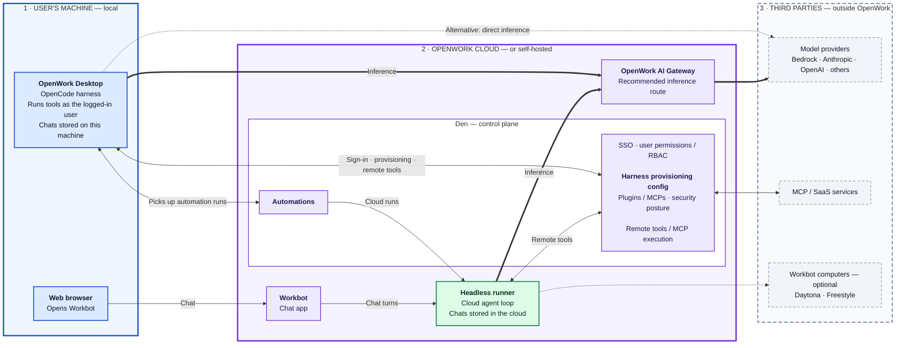
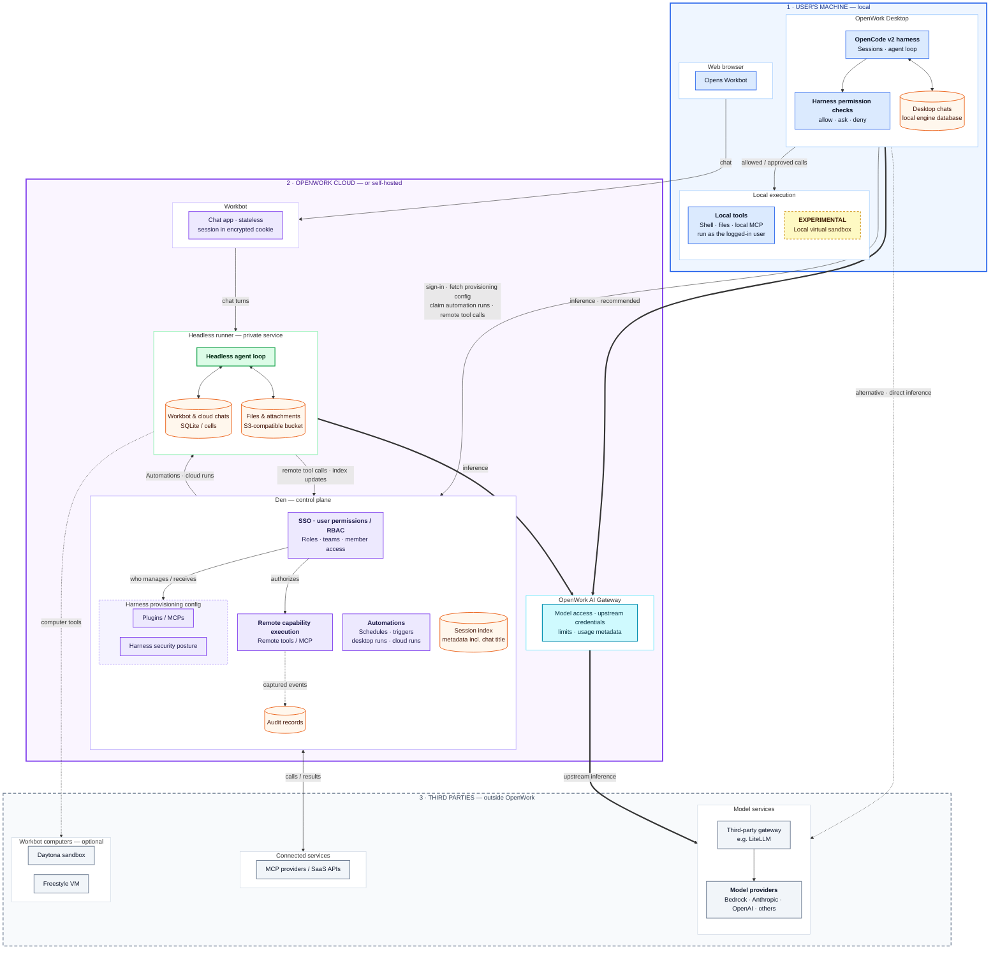
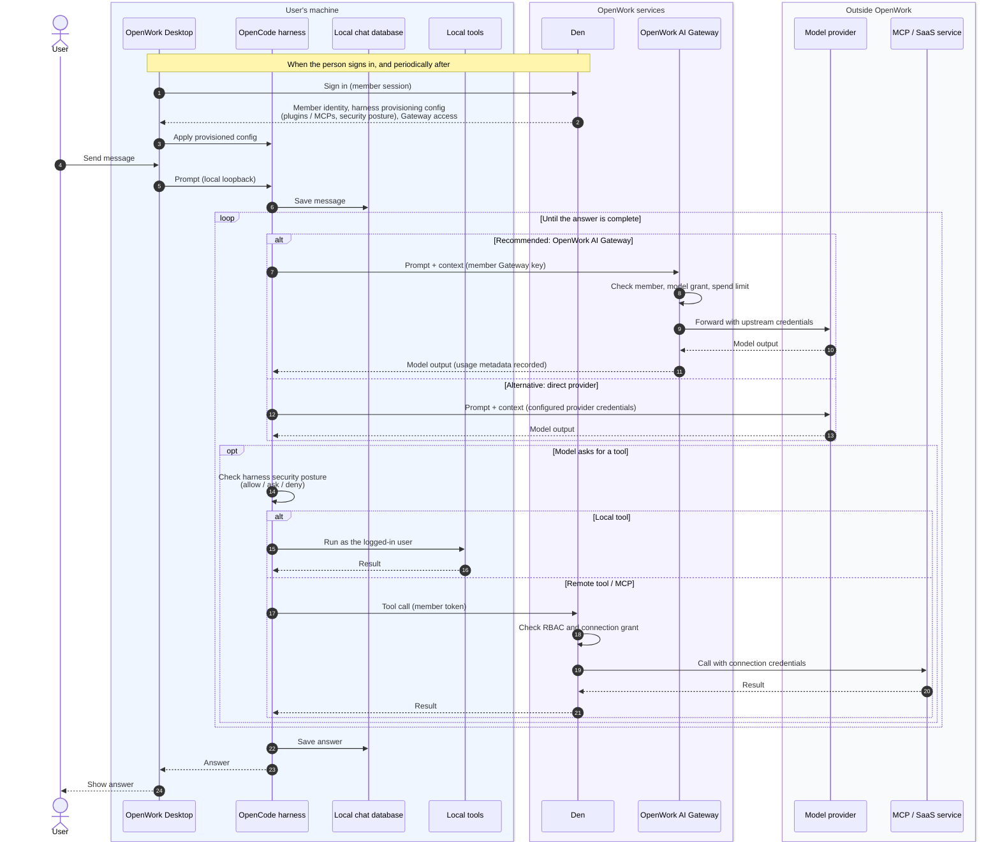
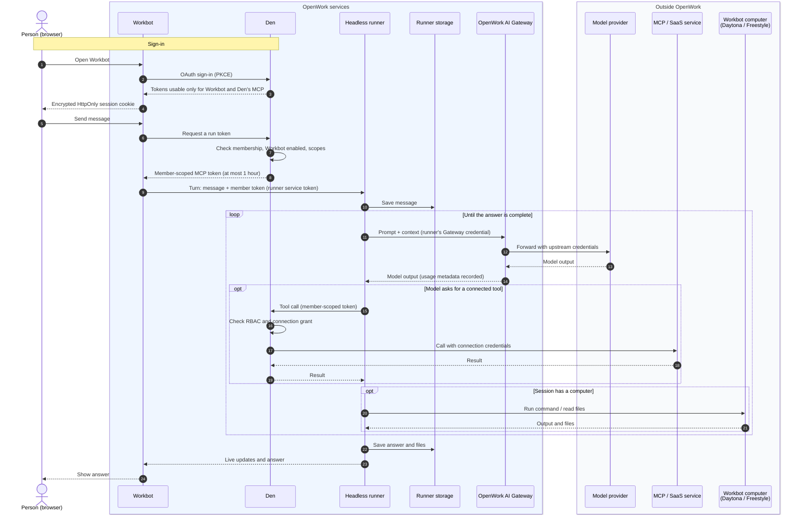
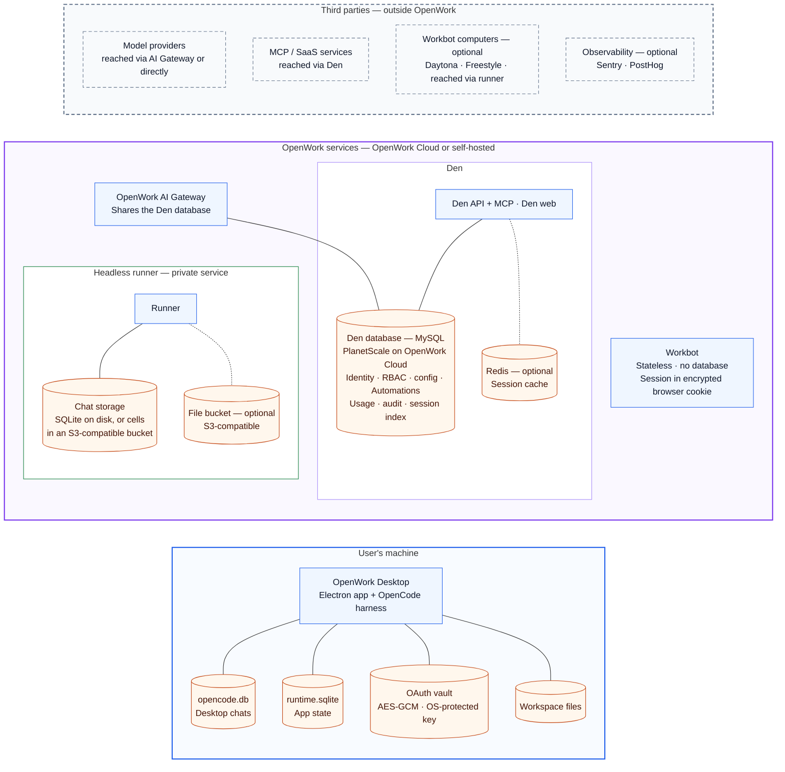

# OpenWork architecture for security review

**Status:** reviewed · **Last reviewed:** 2026-10-22 · **Source:** `docs/security/openwork-architecture.md`

This document explains how OpenWork is put together, where work runs, which credentials are used, and where data is stored. It has five diagrams:

1. [System overview](#1-system-overview): the main parts and where they run.
2. [Detailed architecture](#2-detailed-architecture): every component inside each part.
3. [Desktop chat sequence](#3-desktop-chat-what-happens-when-a-person-sends-a-message): one message in the desktop app.
4. [Workbot sequence](#4-workbot-what-happens-when-a-person-sends-a-message): one message in Workbot.
5. [Infrastructure and data stores](#5-infrastructure-and-data-stores): databases, buckets and external services.

> **How to read this document.** It describes the product design and code-supported behavior. It is **not** an attestation of a specific deployment, a penetration test, or a contractual retention schedule. Statements about the hosted service describe OpenWork Cloud; self-hosted operators run the same components on their own infrastructure.

## Key facts

| Question | Answer |
|---|---|
| Where does the desktop agent run? | On the user's machine, as the logged-in user. Desktop chats are stored on that machine. |
| Where does Workbot's agent run? | On the **headless runner**, an OpenWork cloud service. Workbot chats are stored in runner storage. |
| What does Den do? | Sign-in, user permissions (RBAC), harness provisioning (plugins, MCPs, security posture), Automations, and remote tool execution. |
| How does inference work? | Recommended route: through **OpenWork AI Gateway** to a configured model provider. The desktop can alternatively call a configured provider directly. |
| Do prompts pass through OpenWork? | Yes when the AI Gateway or Den-managed remote tools are used. The Gateway sees prompts in memory to forward them; its normal request log stores usage metadata, not prompt or response bodies. |
| Who decides what a user may do? | Den RBAC decides access to configuration and connected tools. The desktop harness enforces the provisioned security posture during a run. |
| Is the desktop harness an OS sandbox? | **No.** Harness permissions are application controls. An allowed shell command runs with the user's OS permissions. A local virtual sandbox is **experimental**. |

## 1. System overview



The three boxes are **locations**: the user's machine (local), OpenWork Cloud (or the customer's own hosting), and third parties. Solid lines are core paths. Heavy lines are the recommended inference route. Dashed lines are alternatives or optional features.

| Part | Runs where | What it does |
|---|---|---|
| **OpenWork Desktop** | User's machine | Runs the OpenCode harness: sessions, agent loop, local tools and harness permission checks. |
| **Web browser** | User's machine | Opens Workbot. Holds Workbot's encrypted session cookie; the conversation itself runs in the cloud. |
| **Den** | OpenWork Cloud or self-hosted | Identity, RBAC, harness provisioning config, Automations, remote tools / MCP execution. |
| **Workbot** | OpenWork Cloud or self-hosted | Chat app for one ongoing conversation per member. Stateless; it keeps no conversation data itself. |
| **Headless runner** | OpenWork Cloud or self-hosted | Cloud agent loop for Workbot and cloud Automations. Private service; not the desktop harness. |
| **OpenWork AI Gateway** | OpenWork Cloud or self-hosted | Checks model access and limits, applies upstream provider credentials, records usage. |
| **Outside OpenWork** | Third parties | Model providers, MCP / SaaS services, and optional Workbot computers (Daytona or Freestyle). |

**Automations.** An Automation is defined in Den and runs either on a person's **OpenWork Desktop** or in the cloud on the **headless runner**. A desktop picks up its work by connecting out to Den; Den does not open a connection into the user's machine. Each cloud run is one turn in its own runner session.

## 2. Detailed architecture

The same three locations, with every component inside each part. Arrows connect the boxes and start on the side that opens the connection; the sequences in §3 and §4 show which component makes each call.



**Colours:** blue — user's machine · purple — Den and Workbot · green — headless runner · teal — OpenWork AI Gateway · orange cylinder — data store · grey — third party · yellow, dashed — experimental.

## 3. Desktop chat: what happens when a person sends a message



| Step | Security note |
|---|---|
| Sign-in and config (1–3) | Den sends the provisioned config. The desktop refreshes it periodically and on events, so revocation is not instantaneous. Signing out clears the policy. |
| Inference (7–13) | With the Gateway, the provider receives OpenWork's configured upstream credentials, never the member's. With direct access, the provider receives the desktop's configured credentials. |
| Tool check (14) | The security posture is enforced by the **OpenCode v2** harness. These are application controls, not an OS sandbox. |
| Local tools (15–16) | Run with the logged-in user's OS permissions. Endpoint controls (EDR, application allowlisting, disk encryption) remain the hard boundary. |
| Remote tools (17–21) | Den decides access from RBAC and connection grants. The external service also applies its own permissions. A connection can use the member's own account or a shared service account. |
| Storage (6, 22) | Desktop chats stay in the local engine database. The model provider and any called service receive what was sent to them. |

## 4. Workbot: what happens when a person sends a message



| Step | Security note |
|---|---|
| Sign-in (1–4) | Den is the identity provider. Workbot never sees the person's Den web session. Tokens live in an encrypted, `HttpOnly`, `SameSite=Lax` cookie; Workbot keeps nothing on disk. Workbot rechecks the person with Den, caching the answer for at most 30 seconds, so a revoked membership signs them out quickly. |
| Run token (6–8) | Each turn gets a fresh, member-scoped token for at most one hour. Den refuses it when the membership ended or Workbot is off. Turns that include the person's current view use read-only tokens. |
| Runner (9–10) | The runner is a private service reachable only with its service token. Per-turn tokens are held in memory, not written to disk or logs. |
| Inference (11–14) | The runner uses its configured Gateway credential; the Gateway still enforces access, limits and usage for that credential. |
| Tools (15–19) | Same Den authorization path as the desktop, limited to the member token's scope. As on the desktop, a connection can use the member's own account or a shared service account. |
| Computer (20–21) | Optional, per session. One computer per conversation; it holds no credentials. Paused after inactivity and deleted after a configured idle period or with the conversation. |
| Storage (10, 22) | Chats and files are stored by the runner (see §5). Den keeps a session index with metadata, including the chat title. |

## 5. Infrastructure and data stores



Each data store sits next to the service that owns it. Dashed links are optional components. Traffic between services is shown in the [system overview](#1-system-overview) and the sequences above.

### Where data lives

| Data | Stored in | Protection |
|---|---|---|
| Desktop chats | `opencode.db` on the user's machine | Ordinary local files; no app-level database encryption. Rely on disk encryption and OS account controls. |
| Desktop connection tokens | Local OAuth vault | AES-GCM; key protected by the OS (Keychain on macOS, DPAPI on Windows). Some other local credentials (for example, local API tokens) are stored as ordinary files. |
| Workbot and cloud Automation chats | Runner storage: SQLite on a persistent disk, or celld cells kept in an S3-compatible bucket (OpenWork Cloud) | Provider or disk encryption at rest. Resume grants are AES-256-GCM encrypted by the runner. |
| Workbot uploads and outputs | S3-compatible bucket, separate from chat storage, under the session's prefix | Bucket-level encryption; credentials scoped to the runner. Neither the storage nor computer-provider credentials enter a computer. |
| Workbot sign-in tokens | Browser cookie | AES-256-GCM, `HttpOnly`, `__Host-` prefix. Workbot has no database. |
| Identity, RBAC, config, Automations | Den MySQL | OpenWork Cloud uses PlanetScale: TLS required, storage and backups encrypted at rest. Selected secret columns (provider keys, connector tokens, SSO secrets) are also AES-256-GCM encrypted by Den. |
| Inference usage | Den MySQL (Gateway request log) | Identity, model, token counts, cost and status. No prompt or response bodies in the normal request log. |
| Audit records | Den MySQL | Structured actions and outcomes. Coverage depends on the operation and organization settings. |
| Session index | Den MySQL | Metadata, including the plaintext chat title. Not the full transcript. |
| Automation results | Den MySQL | Run status, a result summary, and an encrypted validated result. |
| Cached session data | Redis (optional) | `rediss://` (TLS) required for non-local Redis unless explicitly overridden for a trusted private network. |
| Computer files | Daytona or Freestyle | Third-party environment per conversation; separate from the authoritative chat history but may contain conversation-derived files. |
| Error reports and analytics | Sentry (optional, per service) and PostHog (optional desktop analytics) | Each service's reporting is configured separately. Error reports may contain sensitive text. Turning off desktop analytics does not stop all first-party usage reporting to Den. |
| Prompts sent for inference or tools | Model providers and called services | Governed by each provider's own terms, retention and region. |

## Trust boundaries in one list

1. **User's machine.** The harness runs as the logged-in user. Harness permissions are application controls, not an OS sandbox. Endpoint security controls remain the hard boundary.
2. **Desktop ↔ OpenWork services.** HTTPS with member credentials. Den sends config and receives remote tool calls; the Gateway receives prompts when it is used.
3. **Workbot ↔ Den ↔ runner.** Den issues short-lived, member-scoped tokens per turn. The runner is a private service behind a service token.
4. **OpenWork services ↔ data stores.** Den and the Gateway share the Den database. The runner owns its chat and file storage.
5. **OpenWork ↔ third parties.** Model providers, MCP / SaaS services and Workbot computers receive the data sent to them and apply their own controls.

## What this document does not establish

- The exact hosted topology, regions, network policy or certificates of a specific deployment.
- Retention or deletion schedules, backup lifetimes, or data residency.
- That every tool call or local action is audited.
- That harness permissions confine arbitrary code; the local virtual sandbox is experimental.
- Third-party data handling (model providers, SaaS services, Daytona, Freestyle).

Request these from OpenWork for your deployment, or verify them in your own environment.

## Updating this document

This file is the source of truth; edit it like any other doc and review changes in a pull request. Diagrams are Mermaid, so they render on GitHub and diff as text.

To make a PDF for sharing:

```sh
pnpm docs:pdf docs/security/openwork-architecture.md
```

The PDF is written to `docs/security/dist/openwork-architecture.pdf` (ignored by git) and is stamped with the commit it was built from. The script uses the repository's locked `marked` and `mermaid` packages and an installed Google Chrome or Chromium; set `CHROME_PATH` if Chrome is not found.
