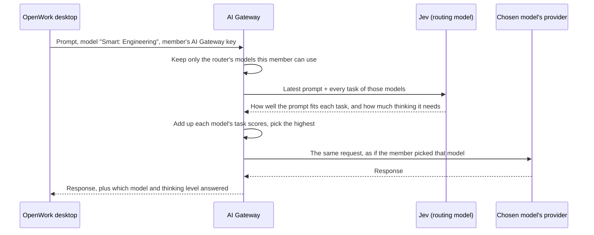

The Smart Model Router lets members choose a **Smart** model instead of a specific one. You create Smart Routers, each with a name, the people it applies to, and a few AI Gateway models tagged with the tasks they're good at. For every prompt, OpenWork sends it to the model whose tasks fit it best, and decides how much that model should think.

You set it up in OpenWork Cloud under **AI Gateway → AI Providers**, where Smart Routers are listed above your providers. Members don't configure anything: each Smart Router that applies to them appears at the top of their model picker as **Smart:** followed by the router's name, for example **Smart: Engineering**.

<Note>
The Smart Model Router is rolling out on OpenWork Cloud. If you don't see **Add a Smart Router** under AI Providers, ask OpenWork to turn it on for your organization.
</Note>

## Why use it

- **Lower cost without thinking about it.** Members no longer run every small question through the most expensive model.
- **Better answers on hard work.** Difficult prompts go to the model you tagged for that work, with more thinking, even when a member forgot to switch.
- **Different setups for different teams.** Engineering can route code review and debugging to one set of models while Support routes summaries and translations to another.
- **Same rules as any other model.** Smart Routers only use models already in your AI Gateway. Access, limits, usage counting and costs work exactly as if the member had picked the model themselves.

## Set it up

<Steps>
  <Step title="Add the models to your AI Gateway">
    A Smart Router can only use models that are already in your AI Gateway, in an active model group. If you haven't yet, [add a provider](/cloud/share-with-your-team/managed-llm-provider) and its models first.
  </Step>
  <Step title="Add a Smart Router with its models and tasks">
    Open **AI Gateway → AI Providers** and select **Add a Smart Router**, next to **Add a provider**. Give it a name; a router named Engineering appears to members as **Smart: Engineering**.

    Choose a model, then add the tasks it should handle. Pick tasks your organization already uses from the list, or type a new one and press Enter. A task can be one word ("translation") or several ("debugging failing tests"), and the same task can be added to more than one model. Select **Add model** for each other model you want it to use.

    Select **Continue**.

    <Frame caption="Step one: name the router and give each model its tasks.">
      
    </Frame>
  </Step>
  <Step title="Choose who can use it">
    Choose who the router applies to: everyone in the organization, teams, or individual people. If some of them can't use one of its models, the model is marked; hover over the mark to see who. Those people's prompts go to the router's other models.

    Select **Save**. Until you do, the router applies to nobody and shows **Give access** in the list.

    <Frame caption="Step two: who can use it.">
      
    </Frame>
  </Step>
</Steps>

<Tip>
Give each model a few specific tasks. "Quick questions", "short emails" for a fast model and "debugging", "architecture", "planning" for your strongest model route better than one vague task per model.
</Tip>

Smart Routers are listed at the top of AI Providers, like providers. Select **Manage** to change one's models, tasks or who can use it.

<Frame caption="Smart Routers are listed first under AI Providers.">
  
</Frame>

## What members see

Members see one **Smart:** option (such as **Smart: Engineering**) at the top of the desktop model picker for every Smart Router that applies to them and that has at least one model they can use. Smart manages thinking itself.

<Frame caption="Each Smart Router that applies to a member is at the top of their model picker.">
  
</Frame>

Each reply shows which model answered it and at which thinking level, next to the reply's time.

<Frame caption="Each Smart reply names the model and thinking level that answered it.">
  
</Frame>

## How it works

The Smart Model Router runs inside the AI Gateway. Every Smart request still uses the member's own AI Gateway key, as described in [How requests flow](/ai-gateway/how-requests-flow).

1. **Only your models, only theirs.** The gateway starts from the Smart Router's models and drops any model the member doesn't have access to.
2. **Every task is scored.** At the start of each task the member gives the agent (when they send a message), the gateway asks [Jev](https://docs.typesafe.ai/primitives/score), a fast routing model from TypeSafe, to score how well the message fits each of the router's tasks, from 0 (unrelated) to 1 (clearly that task). Jev sees the member's latest message, a short excerpt of the conversation and your task names. It never sees model names, provider ids or keys. The decision usually takes well under a second.
3. **The best total wins.** Each model's tasks are added up, and the model with the highest total answers. A model with two good matches beats a model with one slightly better match. If totals tie, the model listed first answers.
4. **Thinking to match.** Jev also scores how much reasoning the message needs (none, light, moderate or deep), and the chosen model runs at the closest thinking level it supports.
5. **Consistent within a task.** The steps that follow while the agent works (tool results, follow-up calls) keep the same model and thinking level, so the model's context and prompt cache stay intact.
6. **Sent like a normal request.** The gateway forwards the request to the chosen provider exactly as if the member had picked that model: the same access checks, [limits](/ai-gateway/limits), [usage counting](/ai-gateway/counting-usage) and [costs](/ai-gateway/token-costs) apply, and the request log records the real model. Smart translates the request for the provider when needed, so Anthropic, OpenAI, Google Gemini, Amazon Bedrock, Azure OpenAI and OpenAI-compatible providers can all be mixed.
7. **A safe fallback.** If Jev can't answer in time, the first model in the router answers at its default thinking level.

## Tasks

Tasks are shared across your organization, so every Smart Router offers the same list to choose from. Names are matched without regard to capitals: "Code review" and "code review" are the same task. A task is removed from the list once no Smart Router uses it anymore.

## Remove a Smart Router

Open a Smart Router with **Manage** and select **Remove**. Its Smart model disappears from members' model pickers the next time their app syncs with your organization, and requests already using it stop routing.

## Self-hosted

The Smart Model Router is offered on OpenWork Cloud first. Where it is available on a self-hosted install, give the AI Gateway a TypeSafe API key through the Helm chart's `secret.values.typesafeApiKey` (or the `TYPESAFE_API_KEY` key in your existing Secret). Without a key, Smart is off: **Add a Smart Router** explains how to add the key, and members don't see Smart models. See the chart's README for details.
