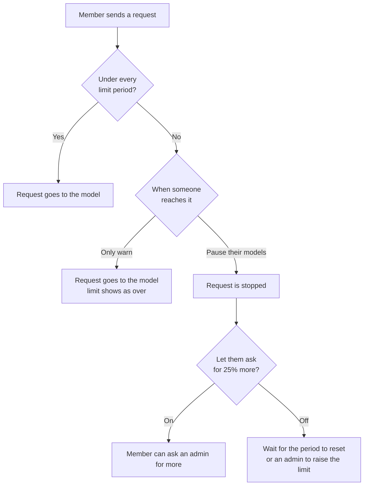
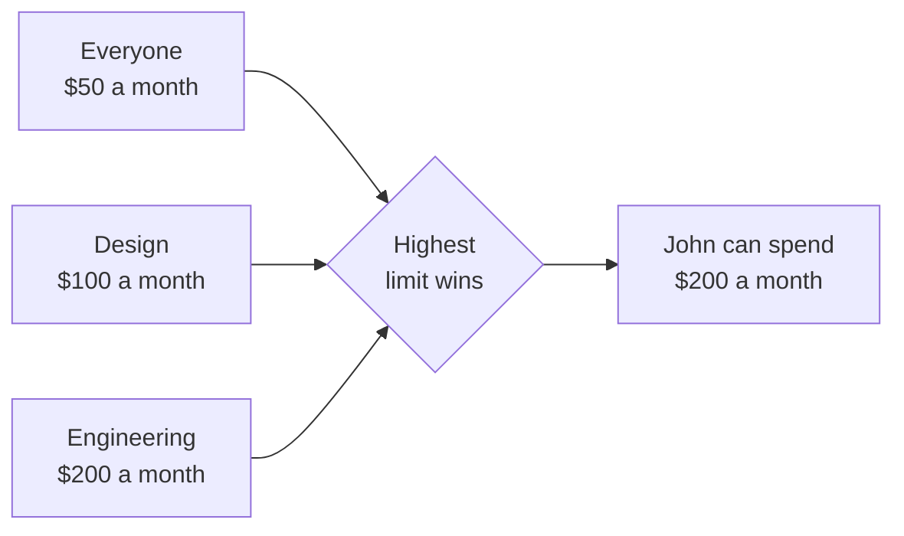
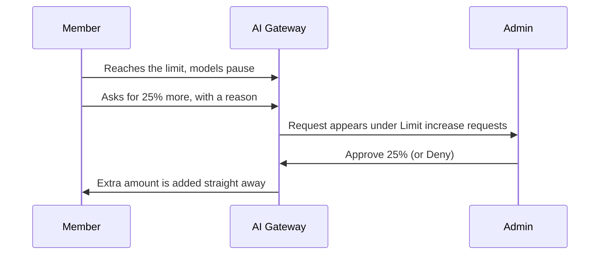
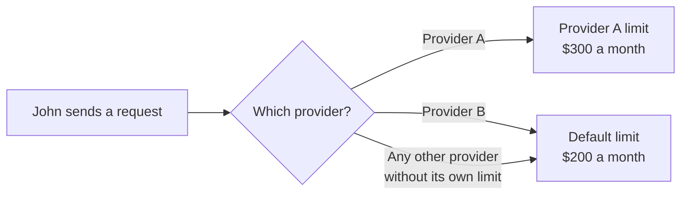

AI Gateway lets your organization set limits on how much its members can use AI models. This page explains which limits exist, how they are counted, and what members see when they reach one.

Limits keep your organization's AI spend predictable. Instead of finding out at the end of the month that a few heavy users or a runaway automation used most of the budget, you decide ahead of time how much each person can spend in a day, week or month. You can give more room to the people who need it, keep everyone else on a sensible default, and choose whether reaching a limit stops work or just raises a flag. Because every request goes through AI Gateway, limits apply the same way whichever app or model a member uses.

You manage limits in OpenWork Cloud under **AI Gateway → Limits**.

<Frame caption="AI Gateway → Limits: each limit shows who it applies to, which providers it covers, its amount and what happens when someone reaches it.">
  
</Frame>

## How limits work

A limit is an amount of money, in US dollars, that a member can spend on AI models in a period of time. Spend is the estimated cost of each request, worked out as described in [Token Costs](/ai-gateway/token-costs).

<Frame caption="Editing a limit: choose the providers it covers, who it applies to, the amount for each period, and what happens when someone reaches it.">
  
</Frame>

### Time windows

Each limit can have a daily, weekly and monthly amount. Turn on whichever periods you need, for example $20 a day and $200 a month. Each period is counted separately, and a member must stay under all of them.

Periods follow the calendar and reset at 05:00 UTC. OpenWork Cloud shows these times in your own time zone.

| Period | Resets |
| --- | --- |
| Daily | Every day at 05:00 UTC |
| Weekly | Every Monday at 05:00 UTC |
| Monthly | On the 1st of each month at 05:00 UTC |

Every member's spend is counted from the start of each period, even before you create any limits. When you add a limit partway through a month, spend from earlier in that month already counts toward it.

<Note>
AI Gateway checks a member's spend before each request starts. Requests already running when the member reaches the limit are allowed to finish, so spend can go slightly over a limit.
</Note>

### When someone reaches a limit

You choose what happens when a member reaches a limit:

- **Pause their models.** Requests through AI Gateway stop working until the period resets or you give them more.
- **Pause their models, but let them ask for more.** Requests stop, and the member can ask for 25% more. An admin approves or denies the request. See [Increase requests](#increase-requests).
- **Only warn.** Requests keep working, and the limit shows as over so you can follow up.

In the limit editor, **Pause their models** and **Only warn** are under **When someone reaches it**. The **Let them ask for 25% more** switch controls whether members can ask for more.

## Applying limits

A limit can apply to:

- **Everyone.** Every current member of the organization, and anyone who joins later.
- **Teams.** Every member of the teams you choose, including people who join those teams later.
- **People.** Specific members you choose.

Set this under **Who** in the limit editor. Turn on **Everyone in the organization**, or use **Add team** and **Add person**.

Each member's spend is counted on its own. An Everyone limit of $50 a month means each member can spend $50, not that the whole organization shares $50.

### When a member has more than one limit

A member can be covered by several limits at once, for example an Everyone limit and a limit for each of their teams. When that happens, **the highest limit applies**, and the lower limits are ignored. This is worked out for each period separately.

#### Example

John is a member of the Design and Engineering teams. The organization has these monthly limits:

| Limit | Applies to | Monthly amount |
| --- | --- | --- |
| Everyone | Everyone | $50 |
| Design | Design team | $100 |
| Engineering | Engineering team | $200 |

All three limits cover John. The highest is Engineering's, so **John can spend $200 a month**. The Everyone and Design limits do not add to it, and they do not lower it.

If the Everyone limit also had a daily amount of $10, and neither team limit had a daily amount, John would also be limited to $10 a day. A period that only one of his limits sets still applies to him.

To check which limit applies to someone, use **Check someone's usage** at the bottom of the Limits tab. Their page lists the limit that applies, where it comes from and how much they have used.

<Frame caption="John's page: his Engineering limit applies to providers without their own limit and is used up, so his models are paused. His Anthropic limit is counted separately.">
  
</Frame>

## Increase requests

When a limit is set to **Pause their models** and **Let them ask for 25% more** is on, members who reach it can ask an admin for more instead of waiting for the period to reset.

### How members ask for more

<Steps>
  <Step title="Open Usage">
    In the OpenWork desktop app, open **Settings → Usage**. It shows how much of each limit is left and when it resets. When a member's models pause during a chat, the message in the chat also offers **Ask for … more**.
  </Step>
  <Step title="Ask for more">
    Under **More usage**, select **Ask for … more** next to the limit that ran out. The amount is 25% of the limit, for example $50 on a $200 limit.
  </Step>
  <Step title="Say what it is for">
    Fill in **What do you need it for?** and select **Send request**. The limit then shows **Asked for … more, waiting for an admin**.
  </Step>
</Steps>

<Frame caption="John has used his $200 monthly limit and asks for $50 more from Settings → Usage.">
  
</Frame>

A few rules apply:

- A member can only ask once a limit has run out. Limits that still have room show **You can ask once it runs out**.
- Each limit period can have one request waiting at a time.
- After an approval, the member can ask again once the extra amount is also used up.
- A request that is still waiting when the period resets, or when an admin changes the limit, expires. The member can ask again if they reach the new limit.

### How admins review requests

People with the **Manage usage limits** permission review requests. People with **View usage limits** can see them but not approve or deny them.

Open **AI Gateway → Limits**. Requests waiting for review are listed under **Limit increase requests**, oldest first. Each request shows:

- Who asked, their reason and when they asked.
- The limit and period it is for, how much they have used, and their current allowance.
- When the period resets, and how much approving adds.

<Frame caption="A waiting request: John has used his $200 Engineering limit. Approving adds $50, for $250 in total this month.">
  
</Frame>

Select **Approve 25%** to add 25% of the limit for the rest of the period, or **Deny** to turn the request down. Select **Refresh requests** to check for new ones, and open **Previous requests** to see past decisions.

When you approve a request:

- The extra amount applies straight away, and the member's models start working again.
- It is 25% of the limit's amount, not of what is left. A $200 limit gets $50 more each time.
- It does not clear what the member has already spent or change when the period resets. When the period resets, the member goes back to the limit's normal amount.
- It cannot be undone, and it can increase what your providers charge you.

<Frame caption="After the approval, John's Usage shows $250 for the month and Added $50.00.">
  
</Frame>

<Tip>
If someone regularly needs more, change their limit instead of approving requests each period. For example, give them a limit of their own, or move them to a team with a higher limit.
</Tip>

## Advanced: per-provider limits

By default, a limit counts spend across every AI provider your organization uses. You can also create a limit for one provider, such as Anthropic or a custom provider your organization added. Choose it under **Provider** in the limit editor. The default choice, **Providers without their own limit**, is a default limit.

<Frame caption="A provider limit: Anthropic spend for the Engineering team counts only toward this $300 monthly limit.">
  
</Frame>

A per-provider limit replaces the default limits for that provider only:

- When a member has a limit for a provider, their spend on that provider counts **only** toward that provider's limit. It does not count toward their default limit.
- Spend on providers without their own limit keeps counting toward the member's default limit.
- If a member has more than one limit for the same provider, the highest one applies, the same as for default limits.
- A provider limit only sets the periods it includes. If the default limit has a daily amount and the provider limit only has a monthly one, that provider has no daily limit for the member.

#### Example

John's default limit is $200 a month, from the example above. The organization also has a limit of $300 a month for Provider A, applied to the Engineering team. There is no limit for Provider B.

| John uses | Spend counts toward | John can spend |
| --- | --- | --- |
| Provider A | The Provider A limit only | $300 a month on Provider A |
| Provider B | His default limit | $200 a month across Provider B and any other provider without its own limit |

If John spends $300 on Provider A this month, he can still spend his full $200 on Provider B. If he uses up his $200 default limit, he can keep using Provider A until he reaches $300 there.

Members see each provider limit separately in **Settings → Usage**, and can ask for more on each one.
