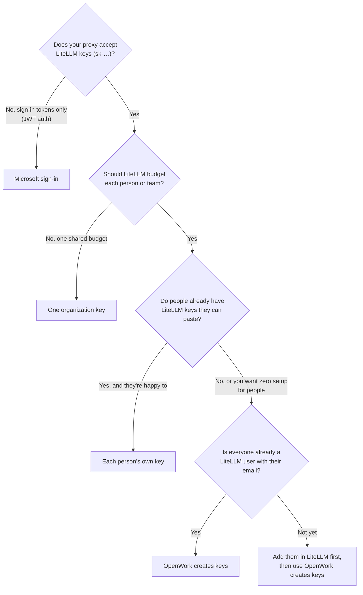
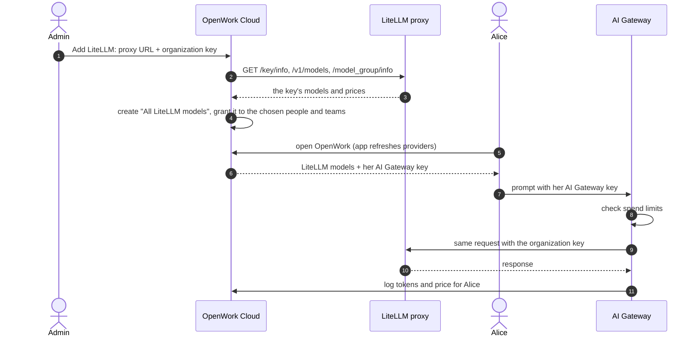
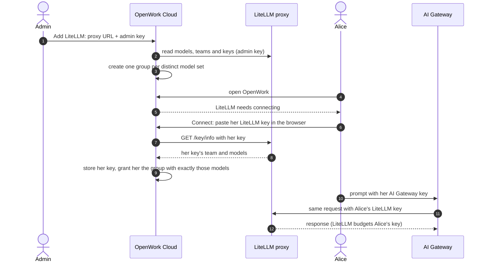
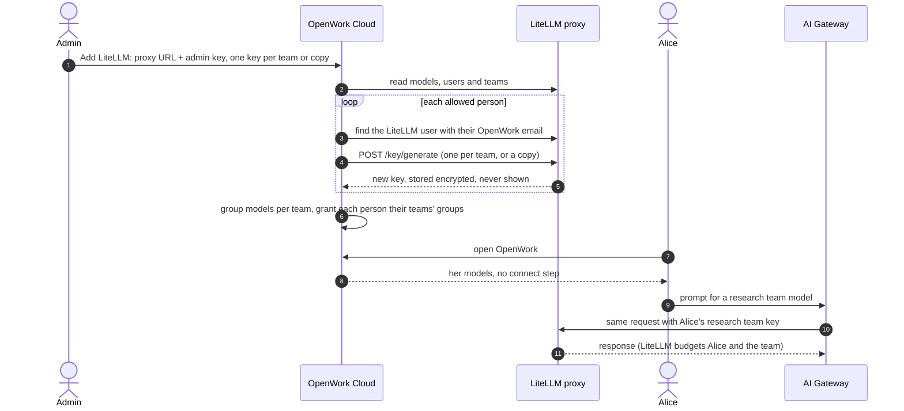
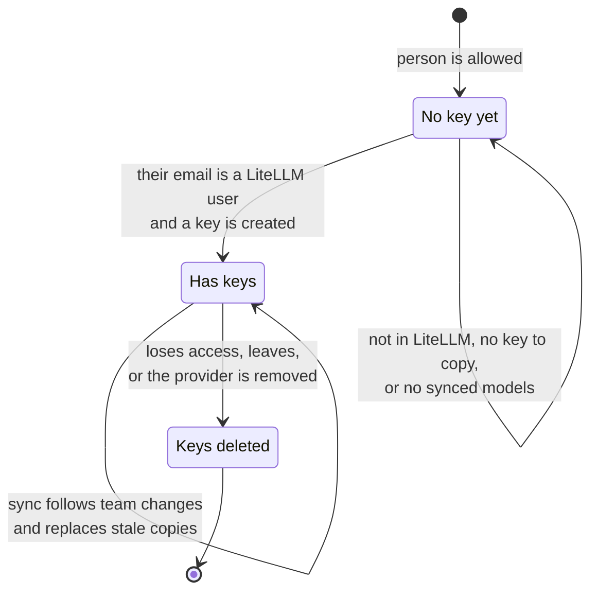
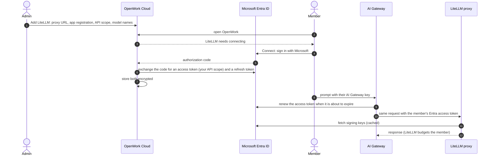

Connect a LiteLLM proxy you already run to OpenWork AI Gateway. With LiteLLM keys, OpenWork reads the proxy's models and creates model groups for them. With Microsoft sign-in, you supply the model list. Both route requests through the gateway to LiteLLM.

## Pick how keys work

OpenWork can use your LiteLLM proxy in three ways with LiteLLM keys:

- **One organization key.** You paste one LiteLLM key and everyone's requests use it. Pick this to get started fast, when one shared LiteLLM budget is fine, or when you want OpenWork to track spend and apply limits per person.
- **Each person's own key.** Each person pastes their own LiteLLM key once in the OpenWork app. Pick this when people already have LiteLLM keys and you want LiteLLM to budget and log each person.
- **OpenWork creates a key for each person.** You paste a LiteLLM admin key, and OpenWork creates a key in LiteLLM for each person, found by their email. Pick this when everyone is already a LiteLLM user and you want per-person LiteLLM budgets without asking anyone to paste a key.

If your proxy has LiteLLM keys turned off and only accepts sign-in tokens (LiteLLM's JWT auth), use [Microsoft sign-in](#microsoft-sign-in) instead: each person signs in with Microsoft Entra ID and their own access token is sent to LiteLLM.

| | One organization key | Each person's own key | OpenWork creates keys |
| --- | --- | --- | --- |
| Key you paste | A LiteLLM virtual key that everyone shares | A LiteLLM **admin key**, used only to sync models and teams | A LiteLLM **admin key**, used to sync and to create each person's key |
| Models people get | Every chat model the organization key can use | The models each person's own key can use | Their LiteLLM teams' models, or a copy of their existing key |
| What people do | Nothing | Paste their own LiteLLM key once | Nothing |
| Spend tracking and limits | On. OpenWork prices usage from LiteLLM's model prices and applies your usage limits | Off. LiteLLM's budgets and rate limits apply | Off. LiteLLM's budgets and rate limits apply |

### Which mode fits



Whatever the mode, people's apps hold one AI Gateway key, never a LiteLLM key or a Microsoft token. See [How a prompt reaches a model](/ai-gateway/how-requests-flow) for the full request path.

## How LiteLLM maps to OpenWork

| LiteLLM | OpenWork |
| --- | --- |
| Model (`model_name`) | Model on the LiteLLM provider |
| Team, or a key's own model list | Model group. People whose keys reach exactly the same models share one group, named after their LiteLLM team when OpenWork knows it |
| Virtual key | The organization key, or one person's own key |
| Budgets and rate limits | Enforced by LiteLLM. With one organization key, OpenWork's usage limits apply too |

Embedding, image and audio models are skipped. Model names, context limits, prices and capabilities come from LiteLLM's `/model_group/info`. OpenWork leaves out facts LiteLLM does not know, such as models missing from its price list.

## Set it up

<Steps>
  <Step title="Add the provider">
    In OpenWork Cloud, go to **AI Gateway → AI Providers → Add a provider → LiteLLM**. Enter your proxy URL, for example `https://litellm.example.com`, with or without `/v1`.
  </Step>
  <Step title="Choose the key mode and paste the key">
    Paste the organization key, or an admin key if each person uses their own key. OpenWork checks the key with your proxy before saving. Keys are write-only and never shown again.
  </Step>
  <Step title="Choose who gets access">
    With one organization key, these people and teams can use the models. With per-person keys, they are the people allowed to connect their own key.
  </Step>
  <Step title="People connect their key (per-person keys only)">
    In the OpenWork app, people choose the LiteLLM provider and select **Connect**. A browser page asks for their LiteLLM key. OpenWork checks it and grants the group that matches the key's models.
  </Step>
</Steps>

## How each mode works

### One organization key



Everyone shares the organization key's models and LiteLLM budget. OpenWork prices each request from LiteLLM's model prices, so per-person reports and OpenWork spend limits work as they do for other providers. In LiteLLM, all usage shows under the one key.

### Each person's own key



The admin key is used only to read LiteLLM. For a key without a team, LiteLLM lists every model on the proxy but only serves the ones its owner may use, so OpenWork checks the owner's own model list and grants just those. Each request uses the person's own key, so LiteLLM's user, team and key budgets apply and LiteLLM's logs show the real person. OpenWork records token usage counts, not cost, and never logs access or refresh tokens. If LiteLLM later rejects a key, the next sync revokes it and the person sees **Connect** again.

### OpenWork creates keys



People do nothing. Spend lands in LiteLLM on the right person and team, and OpenWork records token usage counts, not cost, and never logs access or refresh tokens.

## Keys OpenWork creates

LiteLLM stores only a hash of each key, so OpenWork cannot read anyone's existing key. Instead it finds each allowed person's LiteLLM user by their OpenWork email and creates new keys for them.

Choose what each person gets:

- **One per LiteLLM team**: a key for each LiteLLM team they belong to, so each team's models and budget apply, and spend lands on that team. Someone in no team gets one key that follows their own LiteLLM user settings. In OpenWork, their models are grouped by team.
- **Copy their existing key**: a copy of their oldest active key, with the same team, models, model aliases, tags and expiry. Key-level budgets and rate limits are not copied, because a copy would double the allowance. Team and user budgets still apply. For someone with no key to copy, choose **Use their teams** or **Show an error**.

Created keys can only call models: they can't manage LiteLLM, even if the person is a LiteLLM admin. OpenWork never creates LiteLLM users, because it can't know which teams they belong in. People whose email isn't in LiteLLM are listed on the provider page under **No key yet**, and see why when they select **Connect** in the app. Once a LiteLLM admin adds them, the next sync, or **Check again** on that page, creates their keys.



Keys are created when the provider is added, at each sync, and the first time an allowed person opens OpenWork. When someone loses access or leaves the organization, their keys are deleted in LiteLLM at the next sync. Removing the provider deletes every key OpenWork created there. Deleting the whole organization does not touch your LiteLLM proxy.

## Microsoft sign-in

<Note>
  **Rolling out.** If **Microsoft sign-in** is locked in **Add a provider → LiteLLM**, it isn't on for your account yet. Ask your deployment administrator to turn on **LiteLLM: member Microsoft Entra sign-in**.
</Note>

Use this when your proxy runs LiteLLM's JWT auth (`enable_jwt_auth`) with Microsoft Entra ID as the identity provider. OpenWork holds no LiteLLM key for this provider:

<Note>
  LiteLLM's native JWT authentication requires a valid **Enterprise or trial license**. Start with a working proxy whose models and database are configured. See [LiteLLM's identity-provider setup](https://docs.litellm.ai/docs/proxy/token_auth).

  Enabling JWT authentication does **not** disable ordinary LiteLLM keys. This OpenWork mode needs no member virtual keys or JWT-to-key mapping. Keep the proxy's strong administrative master key private; if your deployment must accept only JWTs from inference clients, enforce that restriction at its client-facing ingress.
</Note>

- Each person signs in with their Microsoft work account once, in the browser. OpenWork keeps the sign-in on the server, renews it, and sends the person's own Entra **access token** to LiteLLM as `Authorization: Bearer …`.
- LiteLLM validates each token (signing keys, issuer, audience), maps it to a user or team, and applies that person's model access and budgets.
- OpenWork can't read your proxy's models, teams or keys without a key, so you enter the model names people may use. There is no **Sync models**. A name that matches a well-known model, such as `gpt-4o-mini` or `azure/gpt-4o`, takes that model's context and output limits and capabilities from the [models.dev](https://models.dev) catalog. Other names, such as your own aliases, get no limits. If your proxy then refuses a request for asking for too much output, the gateway sends it once more within the limit the proxy named. Name the underlying model when you can, so the first attempt is right.
- OpenWork records token usage counts, not cost, and never logs access or refresh tokens, and its spend limits don't apply. LiteLLM budgets each person.



### 1. Register an app in Entra ID

Use an app registration dedicated to OpenWork. In the [Microsoft Entra admin center](https://entra.microsoft.com), open **Identity → Applications → App registrations → New registration**:

1. **Name**: something people will recognize, such as **OpenWork model access**.
2. **Supported account types**: **Accounts in this organizational directory only**.
3. **Redirect URI**: choose **Web** and leave the value empty for now. You add OpenWork's exact URI after you save the provider.
4. Select **Register**, then note the **Directory (tenant) ID** and **Application (client) ID** from **Overview**.

Then, on the app registration:

1. **Expose an API → Add a scope**: accept the Application ID URI (`api://<application-id>`), name the scope, for example `access`, and let **Admins and users** consent. The full scope, `api://<application-id>/access`, is what you enter in OpenWork.
2. **Manifest**: set `requestedAccessTokenVersion` to `2` (under `api`; older manifests call it `accessTokenAcceptedVersion`) and save. See [which tokens LiteLLM receives](#which-tokens-litellm-receives) for why.
3. **Certificates & secrets → New client secret**: create a secret and copy its **Value** right away. Note when it expires: when it does, nobody can sign in or stay signed in until you enter a new one in OpenWork.
4. If your tenant doesn't let people consent to apps: under **API permissions → Add a permission → My APIs**, add the scope you just created, then select **Grant admin consent**. Without consent, sign-in fails with `AADSTS65001`.

<Warning>
  A Microsoft Graph scope such as `User.Read`, or no custom scope at all, does not work. Entra ID then issues a token meant for Microsoft Graph, which only Graph can validate: LiteLLM rejects it. OpenWork refuses Microsoft Graph and Azure Cognitive Services scopes for this reason.
</Warning>

### 2. Let LiteLLM accept the tokens

With `requestedAccessTokenVersion` set to `2`, the tokens OpenWork sends carry:

| Claim | Value |
| --- | --- |
| `iss` | `https://login.microsoftonline.com/<tenant-id>/v2.0` |
| `aud` | The app registration's **Application (client) ID** |

Use a LiteLLM version that supports `litellm_jwtauth.issuers` and audience lists. LiteLLM uses the first entry matching the token's exact issuer, so list each issuer only once. If your tenant's v2.0 issuer is already configured, add the OpenWork app's client ID as an additional audience on that entry. `audience` takes one value or a list:

```yaml
general_settings:
  enable_jwt_auth: true
  litellm_jwtauth:
    issuers:
      - issuer: "https://login.microsoftonline.com/<tenant-id>/v2.0"
        jwks_url: "https://login.microsoftonline.com/<tenant-id>/discovery/v2.0/keys"
        audience:
          - "<the audience you already accept>"
          - "<openwork-application-id>"
```

A proxy set up with the global `JWT_ISSUER` and `JWT_AUDIENCE` variables expects one audience, not a JSON or comma-separated audience list. To accept OpenWork's tokens next to the ones it already accepts, configure the matching `issuers` entry like the one above. For a new proxy, list only the OpenWork application ID, not the placeholder for an existing audience. Keep the claim mappings your proxy already uses to find the user and team.

<Warning>
  LiteLLM's `issuers` list routes validation; it is not an issuer allowlist. An unmatched issuer falls back to global JWT validation. Keep `JWT_ISSUER`, `JWT_AUDIENCE` and `JWT_PUBLIC_KEY_URL` configured for that fallback, or explicitly reject unmatched issuers in your proxy's validation policy. Do not disable issuer or audience validation to make sign-in work.
</Warning>

Two things to know about Entra tokens:

- Entra ID puts a token's scopes in the `scp` claim. LiteLLM's scope settings read `scope`, so they don't see Entra scopes: map people from other claims, such as `oid`, `groups` or `roles`.
- The person must resolve to a LiteLLM user or team that may call the models you list in OpenWork. LiteLLM refuses the others.

### 3. Add the provider in OpenWork

1. In OpenWork Cloud, go to **AI Gateway → AI Providers → Add a provider → LiteLLM** and enter your proxy URL.
2. Choose **Microsoft sign-in**, then enter the **Directory (tenant) ID**, **Application (client) ID**, **Client secret** and **API scope** (`api://<application-id>/access`).
3. In **Models**, enter the LiteLLM model names people may use, one per line, exactly as in your proxy's `model_name`.
4. Choose who can sign in, then select **Connect LiteLLM**.
5. On the provider page, copy the **Redirect URI** and add it to the app registration under **Authentication → Web → Redirect URIs**.

In the OpenWork app, people choose one of the provider's models and select **Connect**. A browser page sends them to Microsoft, and the models are ready when they return.

### Which tokens LiteLLM receives

An Entra access token's format follows the app registration that exposes the scope, not the address OpenWork signs in at:

| `requestedAccessTokenVersion` | `iss` | `aud` |
| --- | --- | --- |
| `2` (recommended) | `https://login.microsoftonline.com/<tenant-id>/v2.0` | The application (client) ID |
| `null` or `1` (the default) | `https://sts.windows.net/<tenant-id>/` | The client ID or resource URI used in the request, such as `api://<application-id>` |

These audience rules come from Microsoft's [access-token claims reference](https://learn.microsoft.com/en-us/entra/identity-platform/access-token-claims-reference#payload-claims). The application that exposes the API controls the [token version](https://learn.microsoft.com/en-us/entra/identity-platform/access-tokens#token-formats), even when OpenWork uses the v2.0 token endpoint.

A version mismatch can make LiteLLM answer `Invalid issuer` or `Audience doesn't match` even though sign-in worked. Set version `2`: newly issued tokens use the new format. Existing tokens keep their original format until OpenWork renews them when needed; changing the manifest does not invalidate them. To obtain a new token sooner, people can sign out in **My Library → Models** and connect again.

### Change or rotate the settings

On the provider page, edit the model list at any time. Changing the tenant, application, API scope or client secret signs everyone out, because a sign-in belongs to the settings it was made with: people select **Connect** again. To change the proxy URL or switch to a key mode, add a new LiteLLM provider.

People stay signed in as long as Entra ID keeps renewing their sign-in, following your Conditional Access policies. **Sign out** on the provider in **My Library → Models** erases the person's sign-in in OpenWork.

During rollout, turning the feature off blocks new connections and new requests through this mode, including starting token renewal for a new request. Saved sign-ins remain encrypted so they can be reused if the feature is turned on again and Microsoft still accepts them. A refresh already in progress may finish storing its rotated token; feature state is checked again before sending inference. Requests already sent to the proxy are not cancelled. The three LiteLLM key modes are unaffected.

## Keep models in sync

Select **Sync models** on the provider page after you change models, teams or keys in LiteLLM. With **Microsoft sign-in** there is nothing to sync: edit the model list on the provider page instead. A sync:

- refreshes the model list and prices
- with per-person keys, rechecks every connected key, moves people to the group that matches their key, and revokes keys LiteLLM now rejects
- with keys OpenWork creates, creates keys for newly allowed people, follows team changes, replaces copies whose original key changed, and deletes keys of people who lost access
- removes the models of people you no longer allow to connect

If LiteLLM can't be read, OpenWork keeps the last synced models and shows the error on the provider page.

## Troubleshooting

| What you see | Why | What to do |
| --- | --- | --- |
| "LiteLLM rejected the key" | The key doesn't exist, is blocked, or has expired | Check the key in LiteLLM, or create a new one |
| The key is refused when you add the provider | The proxy URL is wrong, unreachable, or the key is not valid there | Check the URL opens `/v1/models` with that key. For a private proxy, ask the operator to allow its origin |
| "This LiteLLM key can call models but can't manage LiteLLM" | **Each person's own key** and **OpenWork creates keys** need a key that can read users, teams and keys | Use the master key or a proxy admin key |
| A person's key is refused with "no shared models" | Their key reaches none of the synced models | In LiteLLM, give the key at least one chat model, then **Sync models** |
| A person is under **No key yet**: not in LiteLLM | No LiteLLM user has their OpenWork email | Add them in LiteLLM with that email, then **Check again** |
| A person is under **No key yet**: no key to copy | Copy mode with **Show an error**, and they have no active key | Create a key for them in LiteLLM, or switch the fallback to **Use their teams** |
| A person is under **No key yet**: no models | Their teams and user settings allow none of the synced models | Give them a model in LiteLLM, then **Sync models** |
| Models are missing after a LiteLLM change | OpenWork keeps the last synced list | Select **Sync models** |
| The provider shows a sync error | LiteLLM couldn't be read | OpenWork keeps the last models. Fix the proxy, then **Sync models** |
| Microsoft sign-in: `AADSTS50011` in the browser | The redirect URI is missing or different | Copy it again from the provider page into the app registration's **Web** platform |
| Microsoft sign-in: `AADSTS65001` or a consent screen people can't accept | Nobody consented to the scope | Select **Grant admin consent** on the app registration |
| Microsoft sign-in: **The Microsoft Entra ID app registration requires administrator repair** | The client secret is wrong or expired | Enter a new client secret on the provider page |
| Microsoft sign-in works, but LiteLLM answers `Invalid issuer` or `Audience doesn't match` | The token is a v1 token, or LiteLLM doesn't list the app's client ID as an audience | Set `requestedAccessTokenVersion` to `2` and add the client ID to the issuer's `audience`. See [which tokens LiteLLM receives](#which-tokens-litellm-receives) |
| Microsoft sign-in works, but LiteLLM refuses a model | The person's LiteLLM user or team may not call it | Give them the model in LiteLLM, or remove it from the provider's model list |
| "That is a Microsoft Graph scope" when you save | The scope belongs to Microsoft Graph, not to your app registration | Enter the scope you added under **Expose an API**, such as `api://<application-id>/access` |

## Requirements and limits

- Your proxy must be reachable from OpenWork over HTTPS on a public host. For a private or self-hosted proxy, the operator must allow its origin with `GATEWAY_EGRESS_ALLOWED_ORIGINS` on both Den and the gateway.
- To change the proxy URL or key mode, add a new LiteLLM provider.
- LiteLLM's JWT auth is supported with Microsoft Entra ID through [Microsoft sign-in](#microsoft-sign-in). Other identity providers are not supported: use LiteLLM virtual keys with them.
- With Microsoft sign-in, OpenWork sends the Entra access token, never the ID token, and only for the one API scope you enter.
- API: `POST /v1/inference-providers/litellm` (mode `org`, `member`, `issued` or `entra`), `POST /v1/inference-providers/{id}/litellm/sync`, `PATCH /v1/inference-providers/{id}/litellm` to replace the key, change how keys are created, or change the Microsoft sign-in settings and model list, and `PUT /v1/inference-providers/{id}/litellm/member-key` for a person's own key.
