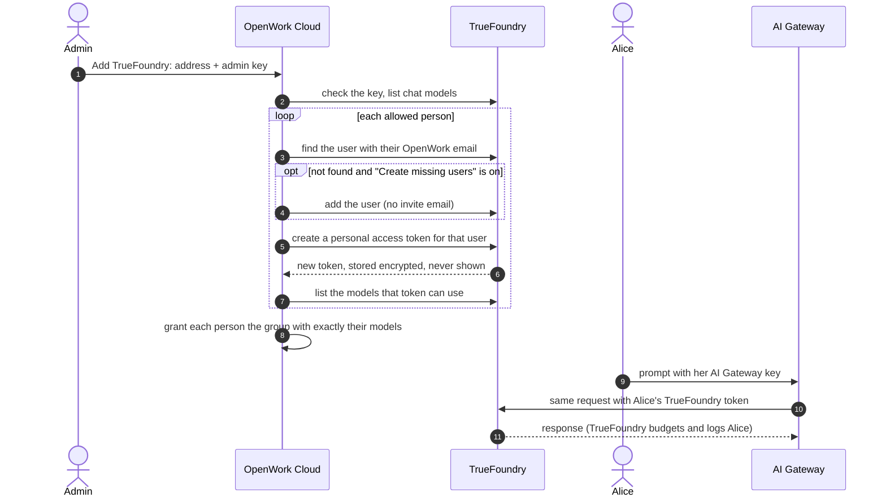

Connect the TrueFoundry AI Gateway you already run to OpenWork AI Gateway. You paste one TrueFoundry admin key. OpenWork finds each person in TrueFoundry by their email, creates a TrueFoundry API key for them, and serves the TrueFoundry models that key can use.

<Note>
TrueFoundry in AI Gateway is a preview. Ask OpenWork support to turn it on for your organization.
</Note>

This replaces the legacy [per-member key recipe](/cloud/share-with-your-team/truefoundry-per-member-keys): keys stay on the server and nobody runs a provisioning script.

## How it works

People do nothing. Their OpenWork apps hold one AI Gateway key, never a TrueFoundry key. Each request reaches TrueFoundry as that person, so their TrueFoundry teams, model access, budgets, rate limits and request logs apply. OpenWork records tokens but not cost.

## How TrueFoundry maps to OpenWork

| TrueFoundry | OpenWork |
| --- | --- |
| Chat model on your gateway (`provider/model`) | Model on the TrueFoundry provider |
| The models one person's token can reach | Model group. People whose tokens reach exactly the same models share one group |
| User, found by email | The OpenWork member with that email |
| Personal access token owned by the user | That person's key, created and stored by OpenWork |
| Teams, budgets and rate limits | Enforced by TrueFoundry |

Embedding, image and audio models are skipped. TrueFoundry lists model IDs only, such as `openai/gpt-5.5`, so OpenWork looks each one up in its model catalog to get its name, capabilities and context limits. It searches the providers the first part of the ID points at first (`openai`, `azure-prod`, `my-claude`), then the major model vendors and OpenRouter, then every other provider. A model it can't match keeps its ID as its name and works without known limits. Prices aren't copied: TrueFoundry tracks spend.

## Set it up

<Steps>
  <Step title="Create an admin key in TrueFoundry">
    In TrueFoundry, go to **Access → Virtual Accounts → New Virtual Account**, then give it the **Tenant Admin** role. Copy its token. OpenWork needs a virtual account: TrueFoundry doesn't let personal access tokens create keys for other people.
  </Step>
  <Step title="Add the provider">
    In OpenWork Cloud, go to **AI Gateway → AI Providers → Add a provider → TrueFoundry**. Enter the address you open TrueFoundry at, for example `https://acme.truefoundry.cloud`, and paste the admin key. OpenWork checks the key before saving and never shows it again.
  </Step>
  <Step title="Choose whether to create missing users">
    Turn on **Create missing users in TrueFoundry** to add people who are in OpenWork but not in TrueFoundry. They are added with TrueFoundry's default member role and no invite email, and get only TrueFoundry's default models until you configure their teams and access in TrueFoundry.
  </Step>
  <Step title="Choose who gets a key">
    Pick everyone, or specific people and teams. OpenWork creates their keys straight away.
  </Step>
</Steps>

## Keys OpenWork creates

- OpenWork creates **one** personal access token per person, named `openwork-…`, and reuses it. TrueFoundry limits how many tokens each person may hold (often three), so a person who already has the most allowed is listed under **Needs attention** until they delete one.
- Tokens use your tenant's maximum token lifetime. When TrueFoundry stops accepting a token, the next sync creates a new one.
- Keys are created when the provider is added, at each sync, when you give people access, and the first time an allowed person opens OpenWork.
- When someone loses access or leaves the organization, OpenWork stops using their key at once and deletes it in TrueFoundry at the next sync. Removing the provider deletes every key OpenWork created. TrueFoundry users OpenWork added stay in TrueFoundry.
- Deleting the whole OpenWork organization does not touch your TrueFoundry tenant.

## Keep it in sync

Select **Sync** on the provider page after you change models, teams or access in TrueFoundry. A sync:

- refreshes the model list
- rechecks each person's models and moves them to the group that matches
- creates keys for people who don't have one yet, and adds missing users when that's turned on
- deletes the keys of people who lost access

If TrueFoundry can't be read, OpenWork keeps the last synced models and shows the error on the provider page.

## Troubleshooting

| What you see | Why | What to do |
| --- | --- | --- |
| "This is a personal access token" | TrueFoundry personal access tokens can't create keys for other people | Use a virtual account token with the Tenant Admin role |
| "This TrueFoundry key can't manage users" | The virtual account doesn't have the Tenant Admin role | Give it the Tenant Admin role in TrueFoundry, then try again |
| "TrueFoundry lists no chat models for this key" | The tenant has no chat models, or the key can't see them | Add a model in TrueFoundry, then try again |
| A person is under **Needs attention**: Not in TrueFoundry | No TrueFoundry user has their OpenWork email | Add them in TrueFoundry, or turn on **Create missing users in TrueFoundry** |
| A person is under **Needs attention**: No models yet | Their TrueFoundry access reaches none of the synced models, for example a user OpenWork just added | Give them access in TrueFoundry, then **Sync** |
| A person is under **Needs attention**: Too many tokens | They already hold the most personal access tokens TrueFoundry allows | They delete one of their tokens in TrueFoundry, then **Sync** |
| The provider shows a sync error | TrueFoundry couldn't be read | OpenWork keeps the last models. Fix the key or address, then **Sync** |

## Requirements and limits

- TrueFoundry must be reachable from OpenWork over HTTPS on a public host. For a private or self-hosted tenant, the operator must allow its origin with `GATEWAY_EGRESS_ALLOWED_ORIGINS` on both Den and the gateway.
- The gateway address defaults to `<your TrueFoundry address>/api/llm`. If your gateway runs on another host, set `gatewayUrl` when creating the provider through the API.
- To change the addresses, add a new TrueFoundry provider.
- API: `POST /v1/inference-providers/truefoundry`, `POST /v1/inference-providers/{id}/truefoundry/sync`, and `PATCH /v1/inference-providers/{id}/truefoundry` to replace the admin key or turn **Create missing users** on or off.
